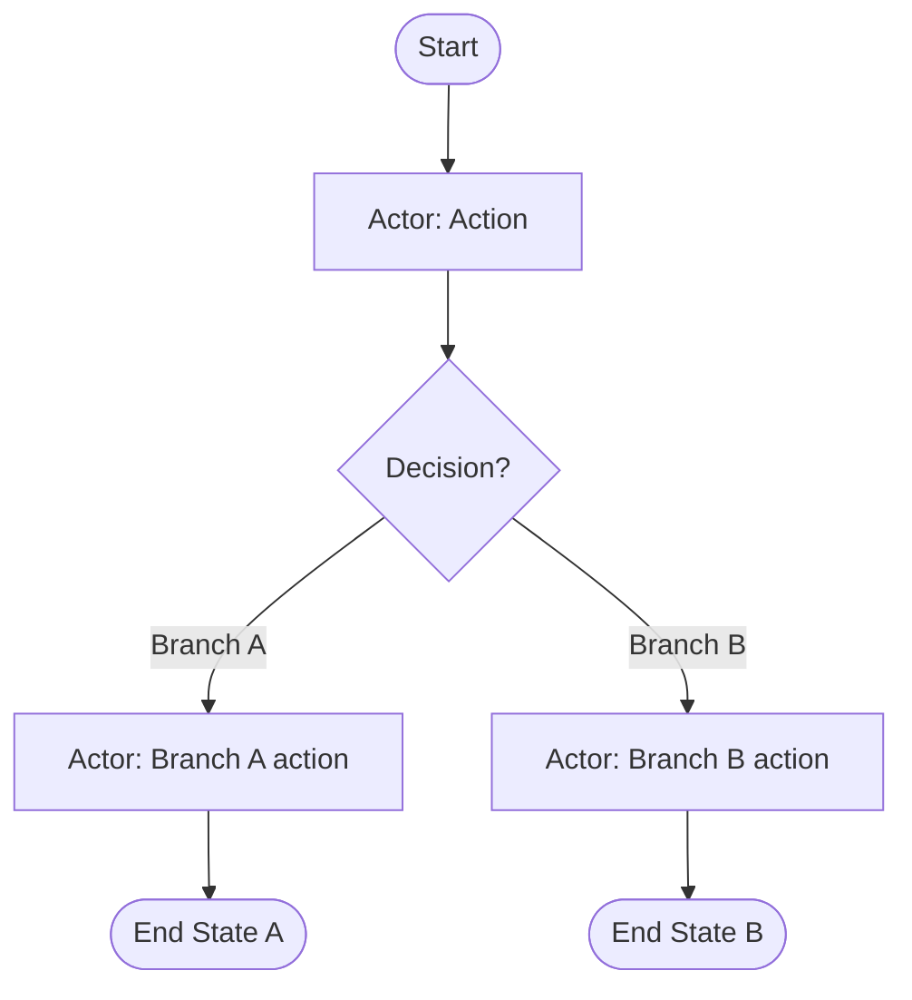
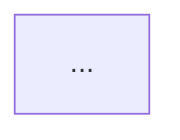

# IBM BAW Author — Skill Knowledge

This knowledge pack is derived from IBM BAW Skills and Bob Modes (Apache-2.0).
Source: https://github.com/ibmbpm/ibm-baw-skills-and-bob-modes

---

---
name: generate-baw-bpmn
description: Generates BPMN 2.0 XML that imports cleanly into IBM Business Automation Workflow (BAW) — processes and complex business object variables (via a bundled XSD) — by writing a process JSON and running a bundled deterministic generator that emits BAW's own export dialect and packages the .zip the import wizards expect. Use whenever the user wants a BPMN file for BAW, asks to "generate BPMN," "create a .bpmn I can import," "turn this workflow into a BAW process/service flow," mentions BPMN import errors or elements disappearing on import, or has a process source in any form — a chat description, a requirements/BRD/blueprint document, an SOP, meeting notes, or an earlier blueprint parse — and needs the importable XML. Also triggers on conversational process descriptions like "I want to model a workflow for…" or "help me design a process for…".
license: Apache-2.0
compatibility: "IBM BAW 22.x and later; IBM CP4BA 22.x and later"
allowed-tools:
  - Read
  - Edit
  - Bash
metadata:
  version: "1.0.0"
  display_name: Generate BAW BPMN
  short_description: Generate importable BPMN 2.0 XML files and bundled XSD for IBM BAW from any process description, document, or chat input.
  author: IBM BAW Team
---

# Generate BAW BPMN

Produce a BPMN 2.0 file that imports successfully into IBM BAW on the first attempt.
The reliability comes from three deliberate choices:

1. **You decide, the tool writes.** You read the user's process description and capture
   your judgment — steps, decisions, branching, data — as a small process JSON. The
   bundled `scripts/generate_baw_bpmn.py` deterministically converts it to XML. Never
   hand-write BPMN XML: ids, references, and namespace details are exactly the kind of
   fussy output that must come from a generator, not a fresh guess.
2. **The XML is BAW's own dialect.** The generator reproduces the format BAW itself
   exports — `bpmnid-` UUID ids, `processType="None"`, named flows, a `laneSet` when
   roles are defined, no diagram section (see [references/BAW_BPMN_DIALECT.md](references/BAW_BPMN_DIALECT.md)). What
   BAW writes, BAW reads.
3. **Only mappable constructs exist.** Every element type the config schema allows maps
   1:1 to a row in IBM's documented import mapping. The generator rejects at validation time anything BAW would silently drop or lossily convert, where it's cheap to fix.

Ids are derived deterministically (uuid5) from the config, so regenerating the same
config yields byte-identical XML and every `sourceRef`/`targetRef` is guaranteed to
resolve.

## Model completeness

A short linear happy-path with one flat business object is almost always
under-modeling. Before writing the config, read [references/MODELING_COMPLETENESS.md](references/MODELING_COMPLETENESS.md)
— it covers what to check for on the process side (roles, decision-point outcomes,
exception/rework loops, SLA/escalation timers, multiple end states, parallel work) and
on the data side (expanding each business object to its natural fields, nested/list
objects, status fields, and wiring variables to every task that touches them). Match
your draft against it before treating it as complete.

## Steps

### Guided conversation — always run phases 1–4 before writing any config

Do not skip to config authoring. Walk through these phases first. One question per turn.

**Question style.** For discrete judgment calls — human vs. system performer, which
gateway branch is the default, whether a task needs an SLA timer — prefer a structured
choice question (the `AskUserQuestion` tool, when available) over open-ended text: it's
faster to answer and it surfaces options the user might not have thought to ask for.
When `AskUserQuestion` isn't available, ask a single question that spells out the
concrete options instead of leaving it open-ended.

---

#### Phase 1 — purpose and source discovery

**When to ask about the process:** If the user has NOT already stated what process they want to model.

**When to skip:** If they've clearly described a process (e.g., "I need a BAW process for expense approvals"). Move straight to the documentation check below.

Ask one focused question:

> "What process are you looking to model in BAW? For example: an approval workflow, an onboarding process, a claims handling flow."

Once you know the process name and rough goal, **immediately ask about supporting documentation** — one question, conversationally:

> "Before I start modeling, do you have anything that describes this process in more detail? A requirements doc, business blueprint, SOP, swimlane diagram, meeting notes, or even a rough flowchart would all help me build a more accurate model. If not, no problem — I'll work from what you've shared."

**When to skip the documentation question:** Skip it if:
- The user's original message already includes a document or attachment, **or**
- The user has explicitly said they have no documentation.

Always ask the documentation question for any other case — including short conversational descriptions like "make a process for an orange juice stand." A brief description does not imply the user has no supporting material; ask before assuming.

If the user provides a document, read [references/EXTRACTING_FROM_DOCUMENTS.md](references/EXTRACTING_FROM_DOCUMENTS.md) first — it maps document language to config constructs and requires each distinct process in the document to become its own config/BPMN. The document is the source of truth: extract, don't invent.

Then move to Phase 2. Do not ask for anything else yet.

---

#### Phase 2 — Process plan

After the process is known (and after reading any source document), **always present a numbered Markdown plan followed immediately by a Mermaid flowchart before writing any config or JSON**.

Present the plan using this format:

**Sequential:**
```
### [Process Name] plan:
1. [Actor] [action]
1. [Actor] [action]
1. [Actor] [action]
```

**With decisions:**
```
### [Process Name] plan:
1. [Actor] [action]
1. Decision: [condition]?
    * If [option]:
        1. [Actor] [action]
        1. [Actor] [action]
    * If [alternative]:
        1. [Actor] [action]
1. [Actor] [action]
```

Immediately after the numbered plan, render a Mermaid flowchart of the same process using this format:

```
### [Process Name] diagram:

```

Mermaid rules:
- Start/end events: `(["Label"])` — round ends
- Human and service tasks: `["Label"]` — rectangles
- Gateways: `{"Label?"}` — diamonds
- Non-interrupting timer boundary events: dashed arrow from the task `task_a -.-> timer_node`
- Label every gateway branch with `-->|"branch name"|`
- Loop-back edges (for example, retry) are allowed — Mermaid handles them
- Keep node ids short and snake_case (for example, `gw_payment`, `task_submit`)
- Read [references/VISUAL_REVIEW.md](references/VISUAL_REVIEW.md) for the legend/color/swimlane conventions and
  apply them here: a one-time legend on the first diagram, `classDef` color-coding by
  role, and swimlane subgraphs only where the process actually has contiguous
  same-actor blocks
- If the user asks to change the plan, re-present the full updated numbered plan with
  removed steps struck through and new steps bolded (see [references/VISUAL_REVIEW.md](references/VISUAL_REVIEW.md)
  for the exact convention), plus a clean re-rendered diagram

Rules for the numbered plan:
- Use `1.` for all numbered steps (Markdown auto-numbers)
- `Decision: [question]?` for every gateway
- `* If [condition]:` for branches, tasks indented underneath
- `[Actor] [verb] [object]` — concise, action-oriented
- Do NOT nest decisions inside other decision branches
- Do NOT write any config JSON during this phase
- Note any assumptions inline (for example, *"Assuming manager approval is required before payment"*)

**Completeness check.** Pattern-match the plan against [references/MODELING_COMPLETENESS.md](references/MODELING_COMPLETENESS.md)
and render a short visible checklist beneath the diagram, for example:
```
### Completeness check:
✅ Roles assigned to every step
✅ 2 outcomes on "Approved?"
❌ No SLA timer — description says "within 3 business days"
✅ Distinct end event per outcome
✅ Escalation paths modeled correctly (notifications end; action tasks rejoin)
```
Check escalations explicitly: if the plan includes a non-interrupting boundary timer
leading to a human task, verify that human task routes to a meaningful continuation
rather than a dead-end end event. Flag it as ❌ with a note explaining the correct
pattern (see [references/MODELING_COMPLETENESS.md](references/MODELING_COMPLETENESS.md) SLA and escalation section).

If anything is ❌, ask about the flagged gaps in one question before moving on — a
multiSelect `AskUserQuestion` listing each gap as an option (plus "none of these, this
is fine as is") when available, otherwise one plain question listing them. If
everything is ✅, skip straight to the closing question below.

**Publish the review artifact.** If the `Artifact` tool is available, publish the plan
and diagram together per [references/VISUAL_REVIEW.md](references/VISUAL_REVIEW.md) and share the link. Update the
same artifact (same file path, same URL) on every later revision instead of publishing
a new one each turn.

End with exactly this question:
> Would you like to include business object data types for this process?

If the user says **no**: ask exactly:
> You can continue to modify this plan, generate the BPMN for it as-is, or start over with a different process. How would you like to proceed?

---

#### Phase 3 — Data model proposal

Triggered **only when the user says "yes"** to including business object data types.

Re-present the plan annotated with `(inputs: TypeName; outputs: TypeName)` per step, followed immediately by the Mermaid diagram (unchanged from Phase 2 unless the plan was modified), then the proposed business objects in YAML:

**Annotated plan:**
```
### [Process Name] plan:
1. [Actor] [action] (inputs: TypeA; outputs: TypeB)
1. Decision: [condition]?
    * If [option]:
        1. [Actor] [action] (inputs: TypeB; outputs: TypeC)
    * If [alternative]:
        1. [Actor] [action] (inputs: TypeA; outputs: TypeD)
1. [Actor] [action] (inputs: TypeC, TypeD; outputs: TypeE)
```

Then the Mermaid diagram (same rules as Phase 2; update it only if the plan changed):


**Proposed business objects:**
```
### Business objects for [Process Name]:
```yaml
- SupportTicket:
    id: String
    subject: String
    description: String
    priority: String
    status: String
    submittedDate: Date
    submittedBy: String

- TriageResult:
    ticketId: String
    outcome: String
    assignedTo: String
    triageDate: Date
    isDuplicate: Boolean
```

Rules for the data model:
- PascalCase object names, camelCase field names
- Supported primitives: `String`, `Integer`, `Decimal`, `Boolean`, `Date`, `Time`, `DateTime`
- Show 4–7 fields per object — representative of a real system record, not just the fields mentioned in the description
- Include a `status` or `outcome` field on every process-controlled object
- Include nested/list objects when the domain naturally has them (order → line items)
- Do NOT generate JSON config yet

Alongside the YAML, render an `erDiagram` of the business objects (nested/list fields
become relationships — see [references/VISUAL_REVIEW.md](references/VISUAL_REVIEW.md) for the exact syntax and
cardinality convention), and if the review artifact from Phase 2 was published, update
it (same file path) to include the data model and ER diagram.

End with exactly this question:
> Would you like to refine these business objects, or shall I create the importable BPMN for you?

If the user wants to refine: re-present the **complete** updated YAML block — never show partial changes. Repeat the closing question after each revision.

---

#### Phase 4 — Generation confirmation

**Skip this phase entirely if the user just confirmed at the end of Phase 3** (that is, they responded to "Would you like to refine these business objects, or shall I create the importable BPMN for you?" with "proceed" or equivalent). That response is already the confirmation — asking again is redundant.

Only ask this question when arriving directly from Phase 2 (no data model was proposed):
> Shall I go ahead and create the importable BPMN for you?

If yes → proceed to steps 1–6 below, using the confirmed plan and data model as the authoritative source of truth (not just the original description).

If no → ask:
> You can continue to modify the plan or business objects, or start over. How would you like to proceed?

**Never write any files before receiving confirmation here.**

---

1. **Supporting documentation** was handled in Phase 1. If the user provided a document
   there, read [references/EXTRACTING_FROM_DOCUMENTS.md](references/EXTRACTING_FROM_DOCUMENTS.md) now — it maps document language
   to config constructs (action verbs → tasks, decision language → gateways, SLA phrasing
   → timer boundary events, described data → business objects), tells you how to handle
   gaps, and requires each distinct process in the document to become its own config/BPMN.
   The document is the source of truth: extract, don't invent, and carry assumptions into
   element documentation and your report.

2. **Understand the process.** Get or infer from the confirmed plan: the process name,
   the process app name (optional — used in the targetNamespace, defaults are fine),
   the ordered activities, who/what performs each (human step vs automated step),
   decision points and their outcomes, and the business data moving between steps.
   The confirmed plan and data model from phases 2–3 are the source of truth here —
   do not re-derive from the original description if the user has refined it.

3. **Read [references/PROCESS_JSON_SCHEMA.md](references/PROCESS_JSON_SCHEMA.md)** — the authoritative config schema with
   five worked examples (linear, approval + escalation, parallel, service-flow-heavy
   with subprocess, and a full nested-business-object data model). Pattern-match the
   closest example instead of starting blank. The key modeling decisions:
   - Human step → `userTask` (BAW generates a client-side human service for it).
   - Automated step → `serviceTask`. **This is how service flows are generated:** BAW
     creates one service flow per serviceTask, named after the task — so name each
     serviceTask exactly what its service flow should be called, and put the intended
     logic in the element's `documentation`.
   - Decision → `exclusiveGateway` with named outgoing flows, a `condition` on each
     branch and `isDefault: true` on exactly one.
   - Concurrency → paired `parallelGateway` fork/join. Deadlines/failures →
     `boundaryEvent` (timer/error) on the task. Repeated inner logic → `subProcess`.
   - Structured business data → `businessObjects` (nested fields, lists, references)
     plus `variables` typed with those object names. The generator emits them as a
     sidecar `.xsd` bundled into the same zip, which BAW imports as real business
     objects; simple `xsd:*` variables need no XSD.
   - Add a `roles` section to name the actors (human roles, teams, systems) and
      reference each role from its tasks via `"role": "<roleId>"`. The generator
      emits one swim-lane per role (`<laneSet>/<lane>`) plus a `<performer>` on each
      task — BAW uses these to create swim-lanes and bind teams on import. Roles also
      drive the README's role table and "Performed by" column. Assign a role to every
      task; control-flow elements and any task without an explicit role go to the
      System lane automatically. Do not model pools (separate participants). See
      [references/BAW_BPMN_DIALECT.md](references/BAW_BPMN_DIALECT.md).
   - **Service flows for serviceTasks:** name each `serviceTask` exactly what its
     callable service flow should be named. BAW creates the (empty) service flows from
     the serviceTask names on import; the user completes their logic in Process Designer.

4. **Write the config** to `business-processes/configs/[Domain]/[ProcessName].bpmn.json`
   (create the folders if needed; follow existing folder conventions if the project
   already has some).

5. **Validate, then generate — into a dedicated folder per process.** Every process
   gets its own output directory (kebab-case process name), because each run produces
   a family of files (.bpmn, .xsd, .zip, README.md) that must stay together. Run the
   BAW generator:
   ```bash
   python <path-to-this-skill>/scripts/generate_baw_bpmn.py \
     "business-processes/configs/[Domain]/[ProcessName].bpmn.json" \
     "business-processes/bpmn/[Domain]/[process-name]/[ProcessName].bpmn"
   ```
   The BAW script validates first (structure, references, reachability, gateway logic,
   start/end rules) and refuses to generate on any error — fix the config, don't route
   around it. Warnings are worth reading too: an unconditioned gateway branch or a
   do-nothing gateway usually means the process logic isn't what you intended. On
   success it writes into that folder: the `.bpmn`, a `.xsd` if business objects were
   defined, **a sibling `.zip` containing everything** (the zip is what BAW's import
   wizards actually take), and a **`README.md`** with a Mermaid flowchart in the
   blueprint parser's diagram style (`([events])`, `[tasks]`, `{decisions}`,
   labeled branches) plus the documentation that mode captures: steps and their
   performers, decision logic with conditions, service flows, data/business objects,
   exception paths, and post-import instructions. Review the README after generation
   — it's built from the config, so if the diagram looks wrong, the config is wrong;
   fix the config and regenerate rather than editing the README. Add `--validate-only`
   to check a config without writing files. Standard library only; any Python 3 works.

6. **Verify and report.** Confirm the generated files exist, then report per the Output format
   below — including the import route and the post-import checklist from
   [references/BAW_BPMN_DIALECT.md](references/BAW_BPMN_DIALECT.md) (complete service flow details, gateway conditions, coach
   customization, and layout in Process Designer after import; that's
   IBM's documented workflow, not a defect). If the user hits an import warning later,
   that same reference explains what BAW does with each construct. If a review
   artifact was published during phases 2-3, round-trip it now per
   [references/VISUAL_REVIEW.md](references/VISUAL_REVIEW.md): copy the generated README's diagram and
   documentation into it and republish at the same URL, so the link the user already
   has shows the final, generated version rather than the pre-generation draft.

   **When the input was a document (Phase 1 source):** write a process extraction
   report to `business-processes/reports/[context]/[ProcessName].extraction-report.md`.
   Skip this file entirely for plain-chat-description inputs — it only has value when
   there's a source document a reviewer can check against.

   The report is a traceability artifact, not a process summary (the README already
   does that). Keep it tight:

   ```markdown
   # [ProcessName] — Process Extraction Report

   **Source:** [document name/path], [section(s) used]
   **Context:** [domain/folder name]
   **Extracted:** [date]

   ## Processes identified
   List each process found in the document and whether it was modeled here or
   deferred (with reason).

   ## Extraction decisions
   For each non-obvious modeling choice — performer inferred, gateway condition
   guessed, step merged or split, SLA timer added — one line stating what was in
   the document and what decision was made. Mirror what `EXTRACTING_FROM_DOCUMENTS.md`
   required you to log in element `documentation` fields, but gathered in one place
   for a reviewer who isn't opening the config.

   ## Assumptions
   Anything invented or inferred that a business stakeholder should confirm: unstated
   performers, ambiguous conditions, implied steps, fields added from domain knowledge.
   One bullet per assumption; flag the element name it affects.

   ## Out of scope / deferred
   Data-model-only content (entity/field definitions with no workflow) → note it here
   and point to `generate-baw-business-objects` for that work.
   ```

## Boundaries

In scope: turning a process source — a chat description, a business requirements
document/blueprint/SOP (see [references/EXTRACTING_FROM_DOCUMENTS.md](references/EXTRACTING_FROM_DOCUMENTS.md)), an earlier
blueprint parse, or an existing config — into a validated process JSON, BAW-dialect
BPMN 2.0 XML, and an import-ready .zip. Both business processes and the service flows
BAW generates from their serviceTasks, plus the business objects the process carries
as variables. When the input was a document, also a process extraction report at
`business-processes/reports/[context]/[ProcessName].extraction-report.md`.

Out of scope — hand off instead:
- **Producing business object JSON artifacts, OpenAPI specs, or standalone data-model files from documents** →
  `generate-baw-business-objects`. (Reading a document to extract the *workflow* is in
  scope here; `generate-baw-business-objects` handles standalone Business Object artifact generation.)
- **Packaging or managing TWX toolkits and deployments** → `generate-baw-business-objects` (for BO toolkits), `baw-deployment-manager`, or `version-lifecycle-manager`. **Deployment to a server is not
  part of this skill under any prompt** — the deliverable is the .bpmn/.zip, which the
  user imports through BAW's own UI.
- **Coach widgets, UI components, or custom portals** → `create-baw-widget` or `create-baw-portal`.
- **Hand-writing or hand-editing BPMN XML.** Change the config and regenerate —
  deterministic ids mean regeneration is always safe and diffs stay clean.

## Output format

Report back:
- **Process:** name, pattern (linear / approval / parallel / combination), element and
  flow counts.
- **Service flows BAW will generate:** the serviceTask names (one flow each).
- **Business objects (if any):** names and where they're used, noting the `.xsd` rides
  inside the zip.
- **Config:** path, and confirmation it validated (mention any warnings and why they're
  acceptable, or that you fixed them).
- **Artifacts:** the per-process output folder, with the `.bpmn`, the `.xsd` (if
  generated), the `.zip`, and the `README.md` (diagram + docs) inside it.
- **Extraction report (document-sourced runs only):** path to
  `business-processes/reports/[context]/[ProcessName].extraction-report.md`, and a
  one-line summary of how many assumptions were logged.
- **Import route:**
  - **Traditional BAW (Workflow Center):** Workflow Center → Process Apps → Import Process App
  - **CP4BA containerized (Business Automation Studio):** Business Automation Studio → Business automations → Workflow → Import
- **Post-import checklist:** the short list from [references/BAW_BPMN_DIALECT.md](references/BAW_BPMN_DIALECT.md).
- **Review page (if published):** the artifact link, now showing the final round-tripped
  diagram and documentation.

## Example

**Input:** "I need a BAW process: a customer files a support ticket, the system
triages it automatically, then either an agent resolves it or it's auto-closed as a
duplicate."

**Walkthrough:** Name it "Support Ticket Handling". Elements: start → `userTask`
"File Support Ticket" → `serviceTask` "Triage Ticket" (becomes the "Triage Ticket"
service flow) → `exclusiveGateway` "Duplicate?" with branch "Duplicate" →
`serviceTask` "Auto-Close Duplicate" → end "Closed", and default branch "Needs Agent"
→ `userTask` "Resolve Ticket" → end "Resolved". Variables: `ticket` (output of filing,
input to triage/resolve) and `triageResult`. Write the config, run the generator,
report the two artifacts, the two service flows BAW will create, the import route, and
the post-import checklist.


---

---
name: generate-baw-business-objects
description: "Generates and modifies BAW Business Object import files — individual .bo.json files, a combined OpenAPI 3.0 JSON, a discovery report, and an optional toolkit TWX. Use when the user wants to generate Business Objects or BOs for a BAW process app or toolkit, modify an existing BO .json file, handle enum-to-Selection-BO conversion, or package BOs into a reusable TWX toolkit. Always use this skill for BO modifications — even simple field additions, removals, or renames — because the output must comply with BAW's specific OpenAPI format rules, include import instructions, and surface safety warnings when fields are removed or renamed. Three delivery options are available: WebPD UI import, new toolkit TWX, or updating an existing toolkit TWX. This skill covers ONLY Business Object artifacts — for BPMN process generation use generate-baw-bpmn instead."
license: Apache-2.0
compatibility: "IBM BAW 22.x and later; IBM CP4BA 22.x and later"
allowed-tools:
  - Read
  - Edit
  - Bash
metadata:
  version: "1.0.0"
  display_name: Generate BAW Business Objects
  short_description: Generate and modify importable BAW Business Object files (OpenAPI JSON, TWX toolkit) from any data model description.
  author: IBM BAW Team
---

# Generate BAW Business Objects

Produce importable BAW Business Objects from any data-model description, generating structured output files and helping the user choose how to deliver them into BAW.

**One important note about imported BOs:** they appear as read-only in WebPD after import. The correct workflow is: finalize all BO specs with Bob before importing, then import once. If changes are needed later, update the files with Bob and re-import — re-importing overrides the previous BOs.

## Output folder structure

All files are written under `business-objects/` at the workspace root:

```
business-objects/<domain-slug>/
├── generated_bos/      ← one <BOName>.bo.json per BO (complex + selection)
├── reports/            ← <domain-slug>.discovery-report.md
└── output/
    ├── <domain-slug>.json   ← combined OpenAPI 3.0 import file
    └── twx/                 ← *.twx files (options 2 and 3 only)
```

- `<domain-slug>` is derived from the BO domain, slugified to kebab-case (e.g. `invoice-management`, `life-insurance`).
- **Collision Avoidance (CRITICAL):** Before writing any files, you MUST check if `business-objects/<domain-slug>/` already exists in the workspace. If the folder exists, you MUST append an incrementing suffix (e.g., `<domain-slug>_1`, `<domain-slug>_2`) and write to that new directory instead. Never overwrite or merge files into an existing folder from a previous run.
- Always finish by listing every generated file path.

## Steps

### 1. Understand the data model

Read the user's input carefully. Accept any of:
- Natural language description of the data structures
- A table or bulleted list of objects and fields
- A pasted document (Word export, PDF text, markdown, meeting notes)
- An existing OpenAPI 3.0 BO JSON the user wants to modify

Extract every distinct "thing" from the description. Each distinct thing — an order, a customer, an address, a line item — becomes its own schema.

Before writing files, do a quick mental pass:

**Completeness check:**
- Did you find ALL the distinct objects? Walk the description once more and look for nouns that carry data (not just action verbs).
- Did you expand each object to its natural fields? If the user said "Customer," they probably want name, email, phone, and an address — not just an id.
- Are there any list relationships? If an order has multiple line items, model `OrderItem` separately and make `Order.items` an array referencing `OrderItem`.
- Are there fields with a fixed set of values (described as an enum, dropdown, or controlled list)? Note each one — each becomes a Selection BO.

**Task list planning (update_todo_list):**
- When initializing the checklist, keep it clean and condensed.
- Group the generation of all individual `.bo.json` files into a single task item (e.g., `[ ] Write generated_bos/ files (<Count> BOs)`).
- Do NOT list each individual `.bo.json` file as its own separate checklist item. This avoids excessive tool calls and clutter without impacting output quality.
- Keep high-level deliverables (writing the combined OpenAPI JSON, writing the discovery report, and presenting import options) as separate checklist items.

**For modifications:** If the user provided an existing JSON, load it mentally as the base. Apply only the changes asked for. Preserve all existing fields and schemas the user did not mention. Document what changed.

If the request involves removing or renaming any field or schema, include a warning — placed after the "What changed" section, just before the save offer, so the user sees it at the point they are about to act. Name each affected field explicitly:

> ⚠️ **Warning:** Removing or renaming `<fieldName>` takes effect immediately on re-import. Any services, processes, or coaches that reference this field will need to be updated.

Adding new fields is safe and does not affect existing consumers.

### 2. Write the files

**Pre-write check (MANDATORY):**
- Before writing any files or initializing your task list, you MUST run a `list_files` tool call on the `business-objects/` directory to check for collisions. **Never assume or state that the directory is empty without executing this tool call first.**
- Look carefully at the returned listing. If you see `<domain-slug>` in the list (e.g., `book-store`), you MUST immediately increment the slug suffix (e.g., `<domain-slug>_1`, `<domain-slug>_2`) and write all output files into that new suffixed directory.
- You are strictly forbidden from overwriting or merging files into a folder that already exists from a previous run.

#### 2a. Write `.bo.json` files

Write one `<BOName>.bo.json` file per Business Object to `generated_bos/`. See `references/TWX_BO_TOOLS_README.md` for the full format spec. Two kinds:

**Complex BO** (`"kind": "complex"`) — a record with named typed properties:

```json
{
  "kind": "complex",
  "description": "A customer record.",
  "properties": [
    { "name": "customerId", "type": "String" },
    { "name": "name",       "type": "String" },
    { "name": "email",      "type": "String" },
    { "name": "status",     "type": "CustomerStatus" }
  ]
}
```

**Selection BO** (`"kind": "selection"`) — an enumeration of value/display pairs:

```json
{
  "kind": "selection",
  "description": "Customer account status.",
  "options": [
    { "value": "ACTIVE",   "display": "ACTIVE"   },
    { "value": "INACTIVE", "display": "INACTIVE" }
  ]
}
```

**Enum → Selection BO rule:** when a field has a fixed set of values (expressed as an `enum` or described as a dropdown), auto-generate a Selection BO for it:
- Name: PascalCase the field name (e.g. `status` → `Status`, `policyType` → `PolicyType`).
- Display values equal the value strings exactly (no transformation).
- The parent BO property type becomes the Selection BO name.
- The Selection BO gets its own `.bo.json` file.

**BO authoring rules:**
- BO names must be PascalCase with no spaces — the name is the data type name.
- Property names must be camelCase with no spaces.
- Primitive type names (`String`, `Integer`, `Boolean`, `Decimal`, `Date`, `Time`) always resolve to System Data primitives — never to a local BO of the same name.
- For Selection BOs: `value` is the stored value that flows through process data; `display` is the UI label. Do not swap them.
- A single-field BO that just aliases a primitive is not worth creating — use the primitive directly.

**Property type reference:**

| Value | Resolves to |
|---|---|
| `"String"` | System Data String |
| `"Integer"` | System Data Integer |
| `"Boolean"` | System Data Boolean |
| `"Decimal"` | System Data Decimal |
| `"Date"` | System Data Date |
| `"Time"` | System Data Time |
| `"SomeName"` | Another local BO in the same run or existing TWX |

#### 2b. Write the combined OpenAPI import file

Write `output/<domain-slug>.json` — a valid OpenAPI 3.0 file importable via the WebPD "Import business objects" dialog. Follow the full rules in `references/BAW_BO_OPENAPI_RULES.md`. Key points:

- Root keys: `openapi` (emit `"3.0.3"`; any `"3.0.x"` value is accepted by BAW), `info`, `components`
- All schemas go under `components.schemas`
- Schema names → PascalCase (become the BO names in WebPD)
- Field names → camelCase
- No `paths`, `servers`, `security`, or other OpenAPI operation-level keys
- Primitive types: `string`, `integer`, `number`, `boolean`
- Arrays: `"type": "array"` with an `"items"` key
- Nested object references: `"$ref": "#/components/schemas/OtherObjectName"`
- Enum fields: use an inline `"enum": [...]` array on the Selection BO schema; the parent property uses `$ref` to the Selection BO

Include all complex BOs and all Selection BOs as schemas.

**Validate before writing:** every `$ref` points to a schema that exists in the file; all schema names are PascalCase; no extra top-level keys.

### 3. Write the discovery report

Write `reports/<domain-slug>.discovery-report.md`. The report documents the analysis behind the generated artifacts. Include these sections:

1. **Header metadata** — Generated by (Bob), Source Documents (all inputs the user provided), Context/domain. Do not include a date or timestamp — omit it entirely.
2. **Entities Discovered** — table: #, Business Object, Source, Role.
3. **Entity Relationship Map** — A Mermaid `erDiagram` visualizing the entity relationships (using standard Mermaid cardinality notation, e.g., `||--|{`, `||--||`) + Relationship Details table (Entity A, Relationship, Entity B, Cardinality). Ensure relationships are accurate and match the generated business object properties exactly.
4. **Enumerations Extracted** — table: Enumeration (Selection BO name), Values, Used By.
5. **Normalization Decisions** — table: Decision, Reasoning.
6. **Assumptions & Ambiguities** — numbered table: #, Ambiguity, Assumption Applied.
7. **Generated Artifacts Summary** — file tree of everything written.

Detail scales with complexity: a simple two-BO domain warrants a concise report; a complex domain with many BOs and relationships warrants full tables.

### 4. Ask how to import

After all files are written:

1. List every generated file path.
2. Direct the user to the generated discovery report (e.g. `reports/<domain-slug>.discovery-report.md`) so they can review the design choices, entities, and assumptions before importing.
3. Ask the user which import option they want. Remind them that after they proceed with one delivery option, they can still request to try other options (e.g., generating a toolkit TWX if they started with WebPD UI import) at any time in the conversation.

---

**Option 1 — Import via WebPD UI** *(BOs will be read-only in the designer)*

BOs imported this way are **read-only** in the BAW designer — you cannot edit their fields directly in the tool after import. To change them later, update the files with Bob and re-import.

Copy the import steps from `references/IMPORT_STEPS.md` and paste them directly.

**Option 2 — Create a new toolkit TWX** *(BOs will be fully editable)*

Suggest defaults for the toolkit metadata (derived from the domain) using clean, user-friendly names instead of command-line arguments:
- **Toolkit Name** (maps to `--name`): e.g. `"Invoice Management BOs"`
- **Toolkit Acronym** (maps to `--acronym`): e.g. `IMBO` (short uppercase slug)
- **Snapshot Version** (maps to `--snapshot`): `"1.0.0.0"`

Do NOT mention script flags/args (such as `--name`, `--acronym`, `--snapshot`) directly to the user. Simply ask them to confirm or customize these user-friendly fields, and apply them to the command flags behind the scenes. Produce a toolkit; do not use `--process-app`.

**Script paths:** The paths shown below are relative to this skill's own folder. Resolve them to their full path before executing — the scripts live at `scripts/twx-bo-tools/` inside the skill directory (e.g. `.bob/skills/generate-baw-business-objects/scripts/twx-bo-tools/`). All other paths (`--out`, `--source`, the generated_bos directory) are relative to the workspace root.

Steps:
1. ```bash
   python scripts/twx-bo-tools/create_empty_twx.py \
     --name "NAME" --acronym ACRONYM --snapshot VERSION \
     --out business-objects/<domain-slug>/output/twx/ACRONYM.twx
   ```
2. ```bash
   python scripts/twx-bo-tools/apply_bos.py \
     --source business-objects/<domain-slug>/output/twx/ACRONYM.twx \
     --version VERSION \
     --out business-objects/<domain-slug>/output/twx/ACRONYM-VERSION.twx \
     business-objects/<domain-slug>/generated_bos
   ```
3. **Delete the intermediate empty TWX file** (the one at `business-objects/<domain-slug>/output/twx/ACRONYM.twx`) immediately after creating the applied version. Only keep the final populated `ACRONYM-VERSION.twx` toolkit in the output directory.

See `references/TWX_BO_TOOLS_README.md` for full argument reference.

**Option 3 — Update an existing toolkit TWX** *(BOs will be fully editable)*

Ask for the path to the existing `.twx`. Then:

1. Run `python scripts/twx-bo-tools/list_bos.py <twx> --json` to read existing BOs.
2. Compare existing BO names against the generated BO names.
3. If conflicts exist, show a conflict table (BO name, existing definition vs. generated definition) and ask the user: overwrite each conflicting BO, or rename the generated BO (user provides the new name). Wait for resolution before proceeding.
4. Suggest a new snapshot version by incrementing the patch of the existing snapshot name (e.g. `1.0.0.0` → `1.0.0.1`). Ask the user to confirm or provide their own value.
5. Run:
   ```bash
   python scripts/twx-bo-tools/apply_bos.py \
     --source <existing.twx> \
     --version <version> \
     --out business-objects/<domain-slug>/output/twx/<name>-<version>.twx \
     business-objects/<domain-slug>/generated_bos
   ```

See `references/TWX_BO_TOOLS_README.md` for full argument reference.

### Future Updates & Script Abstraction Rules (IMPORTANT)

- **Do NOT expose internal implementation details, file structures, or scripts to the user.** The Python scripts (`create_empty_twx.py`, `apply_bos.py`, `list_bos.py`) and the `.bo.json` files are backend details of this skill, not developer tools for the end user.
- **Do NOT instruct the user to run any Python scripts, modify, or regenerate `.bo.json` files themselves.**
- **For future updates**, instruct the user: *"For future updates or modifications, simply provide Bob (this skill) with your updated requirements. Bob will automatically apply the changes and generate a new TWX toolkit snapshot or updated OpenAPI JSON file for you to import."*

---

## Boundaries

**In scope:**
- Generating a new BO set from any description, document, table, or natural language
- Modifying an existing BO import file (JSON) and producing an updated importable set
- Explaining the BAW BO data model, field type constraints, and import behavior
- Walking the user through WebPD manual import steps
- Generating toolkit TWX files via the bundled Python scripts

**Out of scope — redirect clearly:**
- **Auto-importing into BAW:** there is no public API for programmatic Business Object import in BAW WebPD. This skill generates the files; the import is a manual step the user performs in the WebPD UI. Tell the user this directly if they ask.
- **Making imported BOs editable after import:** imported BOs are read-only in BAW WebPD. The correct workflow is finalize → import → re-import if changes are needed.
- **Generating BPMN processes or service flows:** that is `generate-baw-bpmn`. If the user asks for both BOs and a process in the same request, generate the BO files first, then suggest `generate-baw-bpmn` for the process.
  - **Do NOT proactively ask or prompt the user** if they want to generate BPMN processes or service flows to go with the Business Objects. BPMN generation is strictly out of scope. Suggest `generate-baw-bpmn` ONLY if the user explicitly asks how to build process workflows for these BOs.

## Output format

Always produce (in this order):

1. Write `generated_bos/<BOName>.bo.json` for every BO (complex and selection).
2. Write `output/<domain-slug>.json` — the combined OpenAPI import file.
3. Write `reports/<domain-slug>.discovery-report.md` — the discovery report.
4. List all generated file paths.
5. Ask the user which import option they want (1, 2, or 3).
6. If option 1: paste import steps and offer to save.
7. If option 2: suggest toolkit metadata, confirm with user, run the two scripts.
8. If option 3: inspect existing TWX, resolve conflicts, confirm version, run `apply_bos.py`.

For modifications of existing files, also include:
- **What changed** — a brief changelog of additions, removals, and renames
- **Removal/rename warning** (if applicable) — the ⚠️ warning naming each affected field

## Example

**Input:** "I need Business Objects for an invoice management process: Invoice (number, date, due date, status — one of DRAFT, SENT, PAID, OVERDUE, CANCELLED — total amount, a reference to a Customer, and a list of line items), LineItem (product name, quantity, unit price), Customer (name, email, and billing address), Address (street, city, postal code, country)."

**Output walkthrough:**

Five schemas: `Invoice`, `LineItem`, `Customer`, `Address`, and `Status` (Selection BO extracted from the `status` enum field). The `status` field on `Invoice` becomes a `$ref` to `Status`.

Files written:
- `business-objects/invoice-management/generated_bos/Address.bo.json`
- `business-objects/invoice-management/generated_bos/Customer.bo.json`
- `business-objects/invoice-management/generated_bos/LineItem.bo.json`
- `business-objects/invoice-management/generated_bos/Invoice.bo.json`
- `business-objects/invoice-management/generated_bos/Status.bo.json`
- `business-objects/invoice-management/output/invoice-management.json`
- `business-objects/invoice-management/reports/invoice-management.discovery-report.md`

Then the import option prompt.

## Reference files

- **`references/BAW_BO_OPENAPI_RULES.md`** — full import format rules. Read whenever you need to check a specific rule (array syntax, `$ref` path format, what keys BAW ignores, enum-to-Selection-BO mapping, etc.).
- **`references/IMPORT_STEPS.md`** — the manual WebPD import sequence. Paste verbatim for Option 1.
- **`references/TWX_BO_TOOLS_README.md`** — full argument reference for all three twx-bo-tools scripts (`apply_bos.py`, `create_empty_twx.py`, `list_bos.py`).
- **`scripts/twx-bo-tools/apply_bos.py`** — adds or overwrites BOs in an existing TWX.
- **`scripts/twx-bo-tools/create_empty_twx.py`** — creates a new empty toolkit TWX from the bundled template.
- **`scripts/twx-bo-tools/list_bos.py`** — lists existing BOs in a TWX; used for conflict detection in Option 3.


---

---
name: create-baw-portal
description: >
  API-knowledge and portal-development skill for IBM® Business Automation Workflow (BAW).
  Teaches developers which BAW APIs are needed for a requested portal, what they do, how to
  use them correctly, and how authorization, authentication, CORS, proxies, pagination, and
  XSRF affect implementation. Supports non-federated (WLE REST) and federated (PFS) environments.
  Three usage patterns: (1) API guidance only, (2) adapt an existing application, (3) generate
  a new portal or full application. Carbon is the default design system where appropriate.
  Does NOT generate BAW process diagrams (BPMN) or internal BAW XML artifacts.
license: Apache-2.0
compatibility: "IBM BAW 22.x and later; IBM CP4BA 22.x and later"
allowed-tools:
  - Read
  - Edit
metadata:
  version: "1.0.0"
  display_name: BAW Portal Builder
  short_description: Build IBM BAW task portals — API guidance, portal generation, and existing-app integration for non-federated and PFS environments.
  author: IBM BAW Team
  example_prompts:
    - "Generate a personal task dashboard portal for BAW"
    - "Which API do I call to get the current user's name in my BAW portal?"
    - "I have an existing React app — add BAW task list integration using axios"
    - "How does pagination work with the BAW task list endpoint?"
    - "Generate a standalone single HTML BAW portal, no build tools"
    - "We're on Process Federation Server — show me how to fetch a federated task list"
    - "How do I open a BAW task in an iframe modal?"
    - "How do I handle XSRF tokens when calling BAW APIs?"
---

<!-- baw-rest-ops: baw-wle-v1.26.0.0.json: /user/current, /tasks, /task/{taskId}, /searches/tasks, /searches/tasks/{idOrName}, /searches/actions, /searches/tasks/meta/fields, /searches/tasks/meta/constraintFields, /searches/tasks/meta/businessDataFields, /managedGlobalTeams, /globalTeams, /globalTeamUsers/{id}, /team/{teamId}, /team, /group/{groupNameOrID}, /exposed, /process -->
<!-- baw-rest-ops: baw-wle-v2.26.0.0.json: /search, /search/queries, /dashboards/teamsummary, /dashboards/teamsummary/{teamId}, /dashboards/teammember/{teamId}, /dashboards/teammember/{teamId}/{username}, /dashboards/teamtasks, /dashboards/teamtasks/{teamId}, /dashboards/teamtasktrend/{teamId} -->
<!-- baw-rest-ops: baw-pfs-v1.26.0.0.json: /tasks, /systems, /launchableEntities, /searches/tasks, /searches/tasks/{idOrName}, /searches/actions, /searches/meta/fields, /searches/meta/constraintFields, /searches/meta/businessDataFields, /searches/meta/taskStatus, /searches/meta/priority, /instances, /globalTeams -->
<!-- baw-rest-ops: baw-pfs-v2.26.0.0.json: /dashboards/teamsummary, /dashboards/teamsummary/{teamId}, /dashboards/teammember/{teamId}, /dashboards/teammember/{teamId}/{username}, /dashboards/teamtasks/{teamId}, /dashboards/teamtasktrend/{teamId} -->

# create-baw-portal skill

## When to use this skill

Use this skill when a developer asks to:

- Understand which BAW REST APIs to call for a portal pattern (task dashboard, manager view, executive view)
- Integrate a portal with BAW task data, user identity, or team information
- Generate a new portal or full application that connects to BAW
- Adapt an existing application (React, Vue, plain JS, etc.) to use BAW APIs
- Understand authentication, CORS, proxy, XSRF, or pagination requirements
- Generate standalone single-HTML portal implementations
- Understand federated (PFS) versus non-federated (WLE) API differences
- Identify what BAW APIs are missing or unvalidated for a requested capability

Do not use this skill for:

- BAW process (BPMN) generation → `generate-baw-bpmn`
- Internal BAW XML or BPEL authoring

---

## Identify the usage pattern

Before proceeding, determine which of the three patterns applies:

| Pattern | Trigger phrases | Action |
|---|---|---|
| **API guidance only** | "Which API…", "What does this endpoint do…", "How does pagination work…", "What fields does the task list return…" | Provide accurate, evidence-classified API guidance from the references. No code unless asked. |
| **Existing application adaptation** | "I have a React app…", "Add BAW integration to my app…", "How do I call BAW from my Node/Vue/Angular app…" | Read the existing stack. Provide targeted integration guidance and code examples that fit the existing patterns. Do not replace the existing architecture. |
| **New portal or application generation** | "Generate a portal…", "Create a task dashboard…", "Build a BAW portal for my team…" | Generate using the developer-selected stack. Default to React only when no stack is specified. Support standalone single HTML when requested. |

---

## Gather required information

Before generating code or guidance, determine:

1. **Deployment environment** — non-federated BAW (WLE REST) or federated (PFS required)?
2. **Usage pattern** — guidance, adaptation, or generation?
3. **Persona(s)** — task worker, manager/team lead, executive/process owner, administrator-aware?
4. **Technology stack** — React, Vue, Angular, plain JS, single HTML, or developer's existing stack?
5. **Hosting** — same-origin BAW-hosted, external with proxy/gateway, or direct external access?
6. **Company branding** — brand name, primary color, or use defaults?

### Defaults for new portal generation

When the user requests new portal or application generation and has not specified the following, apply documented defaults rather than blocking:

- **Stack not specified** → default to **React**. State this assumption at the top of the response (e.g. "Defaulting to React since no stack was specified — let me know if you prefer Vue, Angular, or plain JS.").
- **Deployment environment not specified** → default to **non-federated (WLE REST)**. State this assumption. Do not assume non-federated when PFS context is mentioned.
- **Hosting not specified** → default to **same-origin BAW-hosted**. State this assumption. Provide proxy/CORS notes as a comment in generated code so the developer knows what to change for external deployments.
- **Company branding not specified** → default to **IBM branding**: header reads `IBM` (in `--ibm-blue-50`) + `BAW Process Portal` (in white). Do not generate placeholder SVG logos, initials badges, or any graphic that could be mistaken for another company's brand. If the developer names a company, use that name as plain text only.

**Block and ask only when:**
- The user explicitly mentions an existing application — read the stack before generating.
- PFS or Process Federation Server is mentioned — confirm the federated deployment before generating federated code.

---

## When to inspect an existing repository

If the user has an existing application:

1. Read the existing stack, dependencies, and folder structure before recommending any API patterns.
2. Identify the existing HTTP client (fetch, axios, etc.) and use it rather than introducing a new one.
3. Identify the existing authentication pattern and map BAW session or token requirements to it.
4. Preserve the existing component architecture. Do not refactor unrelated code.

---

## Choose the correct API family

Read [`references/baw-rest.md`](references/baw-rest.md) for the canonical list of validated API paths, methods, and parameters. Read [`references/non-federated-api-guide.md`](references/non-federated-api-guide.md) and [`references/federated-api-guide.md`](references/federated-api-guide.md) for usage patterns, authentication behavior, response shapes, and deployment caveats. Use both together — `baw-rest.md` defines what the API accepts; the guides explain how to use it correctly.

| Condition | API family |
|---|---|
| Single BAW server, no PFS | WLE REST API (`/rest/bpm/wle/v1/`) |
| Process Federation Server deployed | PFS Federated API (`/rest/bpm/federated/v1/`) |
| Manager or executive dashboards, BAW 24+ | WLE v2 dashboard APIs (`/rest/bpm/wle/v2/dashboards/`) |
| Manager or executive dashboards, PFS | PFS v2 dashboard APIs (`/rest/bpm/federated/v2/dashboards/`) |
| Task mutations (claim, assign, finish, cancel) | WLE v1 task action pattern (delivery scope label: V2 — not a reference to the WLE v2 API family) |

**Key rules:**

- Do not use `/rest/bpm/wle/v1/teams` (plural) — this endpoint does not exist. The correct endpoints are: `/rest/bpm/wle/v1/team/{teamId}` (singular — look up a single modeled team by ID, documented in IBM BAW docs), `/rest/bpm/wle/v1/managedGlobalTeams` (teams managed by the current user), and `/rest/bpm/wle/v1/globalTeams` (all global teams visible to the current user).
- `size=500` means up to 500 tasks, not all tasks. Always check `totalCount` and page when needed.
- **CSRF (also called XSRF) for browser portals:** Same-origin browser portals use session cookie (`credentials: 'same-origin'`) only — no `bpm-csrf-token` header required for any WLE endpoint. `BPMCSRFToken` applies only to the BPM standard API (`/rest/bpm/std/`), not to WLE REST. Do not add CSRF header handling to generated portal code unless calling `/rest/bpm/std/` endpoints.
- Do not use `filterByCurrentUser=true` and `interaction=claimed_and_available` interchangeably — they have different semantics.

---

## Preserve an existing stack

When adapting an existing application:

1. Keep the existing component structure and routing.
2. Wrap BAW API calls in a service module that the existing app can import.
3. Map BAW authentication to the existing auth pattern (same-origin session, proxy-forwarded session, or token).
4. Use the existing HTTP client — do not add fetch wrappers if axios is already present.
5. Do not restructure non-API parts of the application.

---

## Generate a new application

When generating a new portal:

1. Use the developer-specified stack. Default to React only when no stack is specified.
2. Support standalone single HTML when requested — this is a valid and useful output format.
3. Derive patterns from the approved reference design in `assets/examples/ibm-baw-task-dashboard/`.
4. Do not copy the approved reference design destructively. Treat it as a reference, not a template to be overwritten or restyled.
5. Apply Carbon design tokens as CSS custom properties where appropriate.
6. Support company branding via configurable CSS variables and header text.
7. The existing BAW task UI is opened in an iframe modal — do not attempt to rebuild the task completion UI.
8. **Always include a truncation indicator** when the task list is paginated. When `totalCount` in the API response exceeds the number of items returned, surface a visible message to the user — for example: _"Showing 500 of 1,243 tasks. Use pagination to view more."_ Do not silently drop overflow items or present a partial list as complete.
9. **Task iframe in an external portal requires two server-side prerequisites — state both explicitly before generating iframe code for Profile C.**
   BAW's task form issues browser-visible redirects to absolute BAW URLs mid-flow. A proxy prefix on the iframe `src` does not help — the browser follows the redirect outside the proxy and lands on the BAW origin directly. The only working approach for Profile C is:
   - **BAW CSP change (required):** Add the portal origin to the BAW CSP `frame-ancestors` directive.
     - **Traditional WAS deployment:** Set `Security.ContentSecurityPolicyHeaderValue` via wsadmin — `AdminTask.setBPMProperty(['-name', 'Security.ContentSecurityPolicyHeaderValue', '-value', "... frame-ancestors 'self' https://{portal-origin} ..."])` → `AdminConfig.save()` → server restart.
     - **CP4BA on containers (OpenShift):** Edit the `ICP4ACluster` custom resource. Set `spec.baw_configuration[*].environment_config.content_security_policy_additional_frame_ancestor` to include `["https://{portal-origin}"]`. The operator applies the change without a manual server restart.
   - **Portal must be HTTPS (required):** BAW's `LtpaToken2` is `Secure; SameSite=Strict`. An `http://` portal will not receive this cookie inside the iframe — the user gets a BAW login prompt. The portal must be served over HTTPS on the same scheme as BAW.
   - **Profile A / A2 (BAW-hosted):** No prerequisites. Use bare relative `/teamworks/process.lsw?...` — same origin, `frame-ancestors 'self'` satisfied automatically, cookies flow freely.
   - **Profile C, prerequisites not met:** Do not generate iframe code. Tell the developer both prerequisites and offer new-tab launch as a fallback that works without any server change.
   - **Never generate `https://{baw-host}:{port}/teamworks/...` as an iframe `src`** — cross-origin, blocked immediately.

Read [`references/hosting-and-generation.md`](references/hosting-and-generation.md) for hosting patterns, authentication prerequisites, and CORS requirements.

---

## Handle unvalidated capabilities

This skill distinguishes runtime-tested APIs from documentation-only and untested ones. Before generating code for an unvalidated capability:

1. If an API has only been confirmed in IBM documentation but not runtime-tested, say so plainly — e.g. "This endpoint is documented by IBM but has not been tested at runtime in this project."
2. For capabilities gated on runtime validation (e.g. PFS dashboard APIs, administrator-aware endpoints), state the validation requirement clearly.
3. The Administrator persona is defined — dashboards, APIs, and detection pattern are documented in `references/personas-and-capabilities.md`. Do not generate admin-scoped code until the relevant APIs are runtime-verified.
4. Do not generate speculative code for unresolved gaps without explicit confirmation from the user.

Read [`references/known-gaps.md`](references/known-gaps.md) before generating code for PFS dashboard or OAuth/OIDC capabilities.

---

## Keep developer notes out of rendered UI

API validation status, gap references, runtime-test results, and deployment caveats are
**developer communications**, not end-user content. They must never appear as visible UI elements
— banners, info cards, badges, or notices — in generated HTML.

Apply this rule for every capability gated on a deployment condition or validation gap:

1. **Developer communication** → place in the chat response text or as an HTML comment. Never
   render it as a visible DOM element.
2. **Deployment-gated features** (e.g. FDR required for dashboard APIs) → generate a clean
   runtime check in JavaScript. Catch the relevant HTTP status silently and render a plain,
   user-facing empty-state message. Never hardcode HTTP status codes, internal error codes
   (`CWTBG0788E`), gap IDs, or API paths into any visible UI string.
3. **Feature not yet available** → render a neutral empty state (e.g. "This feature is not
   available in your environment. Contact your administrator."). No technical details visible.

**Concrete pattern for FDR-gated features:**
```js
if (res.status === 503) {
  resultEl.innerHTML = '<p>Team workload data is unavailable. Contact your BAW administrator.</p>';
  return;
}
```
Not:
```js
// ❌ Never do this
result.innerHTML = '<strong>HTTP 503 — FDR not enabled.</strong> Contact your BAW administrator.';
```

---

## Validate and report results

After generating or adapting code:

1. Flag any API call that has not been runtime-tested — use plain language, not internal evidence labels.
2. Identify any unvalidated capabilities included and state the validation required.
3. Do not claim live runtime validation unless an authenticated BAW environment was used in this session.
4. For other stacks, state equivalent quality requirements from [`references/quality-and-validation.md`](references/quality-and-validation.md).

For standalone HTML implementations, point the developer to the quality bar defined in
[`references/quality-and-validation.md`](references/quality-and-validation.md). The three static
audit scripts (`audit-a11y.mjs`, `audit-security.mjs`, `audit-refresh.mjs`) validate the approved
reference example only — they are hardcoded to
`assets/examples/ibm-baw-task-dashboard/ibm-baw-task-dashboard.html` and cannot be pointed at
generated output. Use them to understand the expected quality bar, not as a post-generation check
for new portals.

---

## References

Read the appropriate references before responding:

| Reference | When to read |
|---|---|
| [`references/architecture-and-usage.md`](references/architecture-and-usage.md) | Always — understand the skill's flow and output types |
| [`references/baw-rest.md`](references/baw-rest.md) | Always before generating any BAW API call — canonical paths, methods, and parameters for all four API families (WLE v1/v2, PFS v1/v2) |
| [`references/non-federated-api-guide.md`](references/non-federated-api-guide.md) | Always before generating any non-federated BAW API calls — tasks, user identity, task launch, mutations, dashboard endpoints |
| [`references/federated-api-guide.md`](references/federated-api-guide.md) | Always before generating any PFS/federated API calls |
| [`references/personas-and-capabilities.md`](references/personas-and-capabilities.md) | Understanding persona requirements and API mapping |
| [`references/hosting-and-generation.md`](references/hosting-and-generation.md) | Stack selection, hosting, CORS, auth, generation patterns |
| [`references/quality-and-validation.md`](references/quality-and-validation.md) | Accessibility, security, refresh pipeline, static audit scripts |
| [`references/known-gaps.md`](references/known-gaps.md) | Unresolved API and validation gaps affecting any capability |

---

## What this skill does not do

- Generate internal BAW XML or BPEL artifacts
- Build BAW processes or BPMN diagrams
- Rebuild the BAW task completion UI (the existing BAW task UI is launched via iframe)
- Generate admin-scoped code before administrator API endpoints are runtime-verified (see `references/personas-and-capabilities.md` §Administrator)


---

---
name: create-baw-widget
description: Creates or modifies IBM Business Automation Workflow (BAW) custom Coach View widgets — the widgets/{WidgetName}/ folder structure with Layout.html, InlineCSS.css, inlineJavascript.js, config.json, business object JSON, optional event handlers, and BAW-integrated preview files — then packages them into an importable .twx toolkit file. Use this whenever the user asks to build, scaffold, update, or fix a BAW/BPM coach widget, custom coach view, or "widget" in a BAW/BPMN/Process Designer project — including requests like "add a new coach widget for X", "package my widgets into a TWX", "this widget's preview isn't showing in the designer", "the widget isn't picking up my list data", or "style this widget with the Carbon theme." Does not deploy to a BAW server — that is a separate step.
license: Apache-2.0
compatibility: "IBM BAW 22.x and later; IBM CP4BA 22.x and later"
allowed-tools:
  - Read
  - Edit
  - Bash
metadata:
  version: "1.0.0"
  display_name: BAW Coach Widget Builder
  short_description: Scaffold, modify, and package IBM BAW custom Coach View widgets into an importable TWX toolkit file.
  author: IBM BAW Team
---

# Create BAW Widget

Build or modify an IBM BAW (Business Automation Workflow) custom Coach View widget, then package it into an importable `.twx` toolkit file. A widget lives under `widgets/{WidgetName}/` in a BAW toolkit project and is a small bundle of HTML/CSS/JS that BAW's Coach Designer loads into a running coach.

Two real widgets are bundled as reference implementations in `assets/examples/`:
- `assets/examples/DateOutput/` — a simple display-only widget (formats and shows a date, one `change.js` event handler, no business object)
- `assets/examples/TasksList/` — a more complex widget with a business object (`TaskItem.json`), two event handlers (`load.js` + `change.js`), and a full preview

Open the one structurally closer to what you are building and mirror its patterns rather than inventing structure from scratch.

## Phase 1 — Widget Authoring

### Steps

1. **Clarify the widget request.** Get the widget name (PascalCase, for example, `ProgressBar`, not `progress-bar` or `progressBar`) and what it should display or do. Figure out whether this is a new widget, a modification to an existing one, or just a preview/metadata/docs update — that determines which of the steps below actually apply.

2. **Inspect before you build.** The two committed examples in `assets/examples/` are the **primary references** — they are always present after a clone and represent proven, working patterns:
   - `assets/examples/DateOutput/` — simple display widget, scalar binding, one `change.js`, no business object. Use as the base for any widget with a plain string/date/number/boolean binding.
   - `assets/examples/TasksList/` — complex widget, list binding, business object (`TaskItem.json`), two event handlers. Use as the base for any widget that renders a collection or needs a custom business object.

   Open the example that most closely matches the widget you are building (category: simple display vs. list/business-object-backed) and mirror its file structure, config conventions, and preview pattern rather than inventing from scratch.

   If the project already has sibling widgets in `widgets/`, glance at 1–2 of them for any project-specific naming or layout conventions that differ from the examples, but treat the `assets/examples/` files as the source of truth for correct implementation patterns. Sibling widgets are references to read, not to edit — do not modify any widget other than the one requested unless the user explicitly asks.

3. **Create the required files** under `widgets/{WidgetName}/widget/`:
   - `Layout.html` — the outermost element must be `<div class="{widgetname}_maincontentbox">` (underscore before `maincontentbox`). This class is the scope anchor for both CSS and JS. Add ARIA roles and labels where the widget conveys state (for example, `role="progressbar"` with `aria-valuenow`). Do not add `id` attributes. See the DOM element lookup gotcha below for the reason.
   - `InlineCSS.css` — every rule must be prefixed with `.{widgetname}_maincontentbox` to prevent collisions with BAW's own styles and other widgets. Read the **CSS scoping** and **Carbon theme** gotchas below before writing CSS.
   - `inlineJavascript.js` — look up DOM elements using `this.context.element.querySelector(".{widgetname}_maincontentbox")` then `.querySelector()` from that container. Never use `document.getElementById()` or `getElementsByTagName`. Read the **DOM element lookup** gotcha below before writing JS.

4. **Add config.json and business objects only if the widget needs them.** If the widget binds to more than a plain string/date/boolean, or exposes configurable options, create `widget/config.json` and any business-object JSON files it references. Read the **Business object format rules** section below — format errors here cause packaging failures. Skip this step for a widget with no meaningful config.

5. **Add event handlers only if the widget's behavior requires them.** Event handler files go in `widget/events/` and are entirely optional. Decide per-event:
   - `load.js` — one-time init or registering a custom BAW event handler
   - `change.js` — re-render when bound data changes; only use this when `"changeFunction": true` in `config.json` (see Business object format rules)
   - `view.js` — refresh when the widget becomes visible (for example, when it is in a tab)
   - `validate.js` — custom validation beyond HTML5 (return `true`/`false`)
   - `unload.js` — clean up timers/listeners the widget created

   Start event handler files with `var _this = this;` to capture the BAW widget context — `this` loses its binding inside nested callbacks.

6. **Always add a preview** under `AdvancePreview/{WidgetName}.html` + `AdvancePreview/{WidgetName}Snippet.js`. Every widget must have these two files or BAW Designer shows "Error loading helper JS or HTML snippet files" on the canvas. See **Preview rules** below before writing them — the `.html` file content rule is a common source of the doubled-widget bug.

7. **Add a palette icon.** `widgets/{WidgetName}/{WidgetName}.svg`, 120×120px square, visually representing the widget so it is recognizable in the BAW Designer widget catalog. The packager auto-detects this file by name — naming must match exactly (case-sensitive).

8. **Write or update widget-local docs.** `widget/datamodel.md` (what shape of data the widget expects) and, if it has events, `widget/eventHandler.md` (what each event does). Keep these in sync with the actual implementation — stale docs are worse than no docs.

9. **Validate before moving to packaging.** Check naming is consistent across the widget folder, preview files, and config (a `WidgetNameSnippet.js` that does not match the folder name silently breaks the BAW preview loader). Check docs match the real inputs/options/events.

### Optional: scaffold with the bundled script

`scripts/create_widget_template.py` generates a starting skeleton. It can be run from any directory — the script always writes to `widgets/` inside the skill root:

```bash
python3 scripts/create_widget_template.py WidgetName "Widget description" --events load,change
```

Omit `--events` for no handlers, or use `--events all` for all five. Treat its output as a starting point, not a finished widget: its CSS is generic and its `AdvancePreview` output is a placeholder — replace preview files by hand following step 6 and the pattern in `assets/examples/`.

---

## Phase 2 — Package into TWX

After all widget files are complete and validated, package them into an importable `.twx` toolkit file. Everything needed is already inside the skill — no copying to a separate project directory is required.

### Packaging steps

All commands run from the skill root (the `create-baw-widget/` folder, for example `src/skills/create-baw-widget/` or `.bob/skills/create-baw-widget/`).

**Step A — Register business objects** (skip if no widget has a business object):
```bash
python scripts/register_business_objects.py
```
This assigns stable BAW class IDs to all business object JSON files under `widgets/*/widget/` and writes them to `scripts/toolkit_packager/baw_custom_types.json`. The script creates this file the first time it runs. Idempotent — safe to run multiple times.

**Step B — No action needed.** The packager discovers every subfolder inside `widgets/`. You do not maintain a widget list.

**Step C — Run the packager:**
```bash
python scripts/package_baw.py
```
This auto-increments the patch version in `assets/toolkit.config.json`, builds the TWX, and writes it to `output/{ToolkitName}_{version}.twx`. The `widgets/` and `output/` folders are created inside the skill root by the scaffold and packaging scripts, so they might not exist in a fresh clone.

**Step D — Report the result.** Tell the user the output path, the version, which widgets were included, and that the file is ready to import into BAW:
- **Traditional BAW (Workflow Center):** Workflow Center > Process Apps > Import
- **CP4BA containerized (Business Automation Studio):** Business Automation Studio > Business automations > Toolkits > Import

### toolkit.config.json fields

| Field | Purpose |
|---|---|
| `toolkit.name` | Display name in BAW (for example, `"Custom Widgets"`) |
| `toolkit.shortName` | Short alias (for example, `"CW"`) |
| `toolkit.version` | The packager increments this value each run |
| `toolkit.bawVersion` | BAW template version — must match a folder under `assets/templates/BaseTWX/` (use `"25.0.1"` for CP4BA 25.x/26.x) |
| `toolkit.id` | Stable GUID for the toolkit — do not change after first import |

---

## Critical gotchas

### DOM element lookup — always use `this.context.element.querySelector()`

BAW rewrites element `id` attributes at runtime when it inserts a coach view into the page, so `document.getElementById()` silently returns `null`.

The legacy `getElementsByTagName("div").ElementName` pattern (using HTML `name=` attributes) may work inside BAW's embedded browser, but it is not portable to standard browsers and is fragile when elements are renamed. **The preferred pattern** is `querySelector` scoped to `this.context.element`, which is BAW's own reference to this widget's root node and is consistent across all environments:

```html
<!-- Layout.html — use a unique outer wrapper class as the scope anchor -->
<div class="mywidget_maincontentbox">
    <div class="mywidget-track">
        <div class="mywidget-fill"></div>
    </div>
    <span class="mywidget-value"></span>
</div>
```

```javascript
// inlineJavascript.js / events/change.js
// Step 1 — anchor to this widget's root (never use document.getElementById)
var container = this.context.element.querySelector(".mywidget_maincontentbox");

// Step 2 — find children relative to the container
var fill    = container.querySelector(".mywidget-fill");
var valueEl = container.querySelector(".mywidget-value");
```

The outer wrapper class (`mywidget_maincontentbox`) also serves as the CSS scope prefix — see the **CSS scoping** gotcha below.

**Never use:**
- `document.getElementById("…")` — BAW rewrites IDs at runtime, always returns null

---

### Always use `min-height`, not `height`

BAW renders each widget inside a `<table>` cell. Setting a CSS `height` on a `<div>` child of a `<td>` is unreliable — in some browser and BAW combinations the browser ignores it and the div collapses to zero. If the widget has no visible content on initial load (for example, the binding has not resolved yet), the outer wrapper collapses and the widget disappears on the canvas. Use `min-height` throughout — browsers honor it reliably inside table cells.

Set `min-height` on `{widgetname}_maincontentbox` and on inner track elements:

```css
.mywidget_maincontentbox {
    width: 100%;
    min-height: 35px;   /* 35px for compact widgets; 120px for taller ones */
    padding: 0.5rem;
}
.mywidget_maincontentbox .mywidget-track {
    width: 100%;
    min-height: 8px;          /* use min-height, not height */
    background-color: #e0e0e0;
    border-radius: 4px;
    overflow: hidden;
}
.mywidget_maincontentbox .mywidget-fill {
    min-height: 8px;
    background-color: #0f62fe;
}
```

A nested `<table>` layout is not necessary — `min-height` on plain `<div>` elements works correctly in practice.

---

### CSS scoping — prefix every rule with the outer wrapper class

BAW loads all widget stylesheets into a single page scope. Generic selectors like `.progressbar-track` collide with BAW styles and with other widgets. Prefix every CSS rule with the unique outer wrapper class:

```css
/* CORRECT — scoped, collision-safe */
.mywidget_maincontentbox .mywidget-track { min-height: 8px; background-color: #e0e0e0; }
.mywidget_maincontentbox .mywidget-fill  { min-height: 8px; background-color: #0f62fe; }

/* WRONG — unscoped, collides with other styles */
.mywidget-track { min-height: 8px; }
```

Name the outer wrapper class with an **underscore** separator (`mywidget_maincontentbox`) — this visually distinguishes it from child classes and matches the convention used across working widgets in the reference repo.

---

### InlineCSS.css is plain CSS, not LESS

BAW widget stylesheets do not go through LESS preprocessing — `color: @bpm-color-primary;` is invalid CSS and will silently produce no styling. Use the literal hex value and put the Carbon variable name in a comment:

```css
.progressbar-fill {
    background-color: #0f62fe; /* @bpm-color-primary */
    font-family: 'IBM Plex Sans', 'Helvetica Neue', Helvetica, Arial, sans-serif; /* @bpm-font-family-sans-serif */
    color: #161616; /* @bpm-text-color */
}
```

The full color/typography/spacing table is in `references/CARBON_THEME_VARIABLES.md` — open it when writing CSS rather than guessing hex values.

### List-bound data comes wrapped in `.items`

When `config.json`'s `bindingType` has `"isList": true`, BAW wraps the array in an object: `{ items: [...] }`. Reading `this.getData()` directly gives you that wrapper object, not the array:

```javascript
// bindingType.isList === true
var items = this.getData().items;   // correct
var items = this.getData();         // wrong — this is the wrapper object, not an array
```

### Business object format rules

Incorrect business object format is the most common cause of packaging failures. Three rules are non-negotiable:

**Rule 1 — Business object JSON must have BOTH `"name"` AND `"type": "businessObject"`:**

```json
{
  "name": "TaskItem",
  "type": "businessObject",
  "description": "A single task in the task list",
  "properties": [
    { "name": "id",     "type": "String",  "required": true,  "description": "Unique task ID" },
    { "name": "title",  "type": "String",  "required": true,  "description": "Task title" },
    { "name": "done",   "type": "Boolean", "required": false, "description": "Completion flag" }
  ]
}
```

The packager expects this format. Some older widgets in the reference repo use `"type": "TaskItem"` only (without `"name"`). The packager has a fallback for that format, but the fallback is less reliable. Use both `"name"` and `"type": "businessObject"` in this project.

**Rule 2 — `config.json`'s `businessObjects` must be an array of objects with `{name, file}`, not a string array:**
```json
"businessObjects": [
  { "name": "TaskItem", "file": "TaskItem.json" }
]
```

**Rule 3 — Set `"changeFunction": false` for complex BO bindings; use `binding.addDataChangeListener` in `inlineJavascript.js` instead of a separate `change.js`:**

For widgets bound to a business object (not a plain string/number), the reactive update pattern is:

```javascript
// inlineJavascript.js — reactive BO binding (no change.js needed)
var me = this;
if (this.context && this.context.binding && this.context.binding.addDataChangeListener) {
    this.context.binding.addDataChangeListener(function(newValue) {
        // newValue is the BO instance
        renderWidget(newValue);
    });
}
```

And in `config.json`:
```json
"changeFunction": false
```

Adding a `change.js` on top of `addDataChangeListener` causes double-renders. Only use a standalone `events/change.js` (with `"changeFunction": true`) for simple scalar bindings where the Snippet pattern is sufficient.

Valid property types: `String`, `Integer`, `Decimal`, `Boolean`, `Date`. Every property must have all four fields: `name`, `type`, `required`, `description`.

---

## Preview rules — read before writing AdvancePreview/ files

Every widget must have both `AdvancePreview/{WidgetName}.html` and `AdvancePreview/{WidgetName}Snippet.js`. Missing either file causes BAW Designer to show "Error loading helper JS or HTML snippet files" on the canvas.

### Two valid preview patterns — choose based on CSS approach

BAW injects `{WidgetName}.html` content **and** runs `{WidgetName}Snippet.js`. The two files work together; the right pattern depends on how you write CSS:

**Pattern A — Blank HTML + inline `style=` in Snippet (simple widgets)**

Use when the Snippet builds all DOM with inline `domAttr.set(el, "style", "…")` and needs no shared stylesheet. The `.html` file must be a single blank line:

```html
<!-- GreenDropdown.html — correct: blank placeholder -->

```

If `.html` has visible markup AND the Snippet also builds DOM, the widget appears **twice** on the canvas.

**Pattern B — HTML with `<style>` block + `DesignContentBox`-scoped CSS + Snippet (complex widgets)**

Use when the preview has enough CSS to warrant a stylesheet. The `.html` file contains the `<style>` block and a `<div class="SPARKPanel panel">` wrapper; the Snippet builds live DOM inside the `inputDiv`. Every CSS selector in the `<style>` block must go through `.DesignContentBox`, because the Snippet adds that class with `domClass.add(container, "DesignContentBox")`:

```html
<!-- ProgressBar.html — Pattern B -->
<style>
.progressbar_maincontentbox .DesignContentBox .progressbar-track {
    width: 100%; height: 8px; background-color: #e0e0e0;
}
.progressbar_maincontentbox .DesignContentBox .percentage-value {
    font-size: 2rem; font-weight: 600; color: #24a148;
}
</style>
<div class="SPARKPanel panel">
    <div class="widget-heading"><span class="widget-title">My Widget Preview</span></div>
    <div class="widget-body"><!-- Snippet builds DOM here --></div>
</div>
```

And in the Snippet's `generateSampleData`, add `DesignContentBox` to every container node whose children are targeted by the stylesheet:

```javascript
var container = domConstruct.create("div", null, this.context.coachViewData.inputDiv);
domClass.add(container, "progressbar_maincontentbox");

var inner = domConstruct.create("div", null, container);
domClass.add(inner, "DesignContentBox");      // ← required for CSS to apply
domClass.add(inner, "progressbar-container");
```

### Snippet.js structure

`{WidgetName}Snippet.js` must export a `mixObject` with all five methods, using Dojo APIs — not vanilla DOM:

```javascript
var mixObject = {
    createPreview: function (containingDiv, labelText, callback) {
        var previewLayerUri = this.context.getManagedAssetUrl(
            "BPMExt-Controls.preview.js", this.context.assetType_WEB, "SYSBPMUI");
        require([previewLayerUri], this.lang.hitch(this, function () {
            require(["dojo/dom-construct","dojo/dom-class","dojo/dom-attr",
                     "bpmui/preview/BPMExt-Core-Designer"],
            this.lang.hitch(this, function (domConstruct, domClass, domAttr, bpmext) {
                bpmext.uidesign.css.ensureGlyphsLoaded(this);
                bpmext.uidesign.css.ensureSparkUIClass(containingDiv);
                // build form-group, label, inputDiv, then call:
                this.generateSampleData(domConstruct, domAttr, domClass);
                callback();
            }));
        }));
    },
    getLabelDomElement: function () { return this.context.coachViewData.label; },
    generateSampleData: function (domConstruct, domAttr, domClass) { /* build widget DOM here */ },
    propertyChanged: function (propertyName, propertyValue) { /* update preview on option change */ },
    modelChanged: function (propertyName, propertyValue) { /* usually a no-op */ }
};
```

Copy the full wiring from `assets/examples/TasksList/AdvancePreview/task.js` (Pattern B with `<style>` block) or `assets/examples/DateOutput/AdvancePreview/DateOutputSnippet.js` (Pattern A blank HTML) and replace only `generateSampleData` — the Dojo module require chain is easy to get wrong from memory.

---

## Boundaries

**In scope:** creating/editing widget files, preview files, widget config and business objects, widget-local documentation, and packaging widgets into a `.twx` file for manual import into BAW.

**Out of scope:** deploying the `.twx` to a BAW server via API or MCP tools (that is a separate deployment step), designing overall coach layouts that compose multiple widgets into a screen, and parsing business documents into business objects.

---

## Output format

For each widget created or changed, report:
- The files created/modified, as a file tree rooted at `widgets/{WidgetName}/`
- Which optional pieces you included and *why* (for example, "added `change.js` because the widget re-renders on data updates; skipped `load.js` — no init logic needed")
- Any Carbon variables used, so the user can sanity-check the visual match
- If a preview was created, confirm it follows the mixObject pattern (not a placeholder)
- After packaging: the output `.twx` path, version, and list of included widgets

After delivering the Phase 1 summary, always ask the user whether they want to proceed to Phase 2 (TWX packaging). Use `ask_followup_question` with exactly two suggestions: one to proceed and one to skip. Do not proceed to Phase 2 automatically.

---

## Example

**Input:** "Create a BAW widget called RatingStars that displays a 1–5 star rating bound to an integer, then package it."

**Phase 1 output:**
1. Read `assets/examples/DateOutput/` (primary reference — simple, single-value, no business object needed).
2. Create `widgets/RatingStars/widget/Layout.html` with `role="img"` and `aria-label` describing the rating.
3. Create `widgets/RatingStars/widget/InlineCSS.css` using `#c6c6c6` (`/* @bpm-color-primary-light */`) for empty stars and `#0f62fe` (`/* @bpm-color-primary */`) for filled ones — hardcoded values, not LESS references.
4. Create `widgets/RatingStars/widget/inlineJavascript.js` reading `this.getData()` (scalar binding, no `.items` needed).
5. Skip `config.json`/business object (plain integer binding) and skip all event handlers — note this explicitly.
6. Create `widgets/RatingStars/AdvancePreview/RatingStars.html` — **blank** (single newline only).
7. Create `widgets/RatingStars/AdvancePreview/RatingStarsSnippet.js` — `mixObject` with `generateSampleData` rendering five star spans, copied from `DateOutputSnippet.js` wiring.
8. Create `widgets/RatingStars/RatingStars.svg` (120×120, five stars).
9. Create `widgets/RatingStars/widget/datamodel.md`.

**Phase 2 output:**
1. The packager discovers `RatingStars` in the `widgets/` folder. No manual step is needed.
2. Run `python3 scripts/package_baw.py`.
3. Report: `output/Custom_Widgets_1.0.1.twx` (42 KB) — contains RatingStars. Ready to import via:
   - **Traditional BAW:** Workflow Center > Process Apps > Import
   - **CP4BA (Studio):** Business Automation Studio > Business automations > Toolkits > Import


---

---
name: create-baw-external-task-ui
description: >
  Generate a custom external task UI for an IBM Business Automation Workflow (BAW)
  human task configured with a Custom URL. Creates a Node.js Express server and a
  React (default) or user-specified stack UI that fetches task data from BAW,
  renders a Carbon-styled form, and completes the task on submission. Two intake
  paths: provide a task schema file (OpenAPI exported from your BAW service flow) or
  describe task fields verbally (generating a unified fields-spec.json). Includes
  instructions for exporting the schema from BAW and setting the External Implementation
  URL with {tw.system.task_id}. Use when building an external Node.js app for a BAW
  Custom URL task or integrating with the BAW /bpm/user-tasks REST endpoints. Do NOT
  use for task list portals (use create-baw-portal) or BAW Coach View widgets (use
  create-baw-widget). Trigger phrases: "external task UI", "custom URL task",
  "BAW external UI", "node.js BAW task", "external implementation", "Custom URL implementation".
license: Apache-2.0
compatibility: "IBM BAW 22.x and later; IBM CP4BA 22.x and later"
allowed-tools:
  - Read
  - Edit
  - Bash
metadata:
  version: "1.0.0"
  display_name: BAW External Task UI Builder
  short_description: Generate a React + Express external task UI for IBM BAW Custom URL human tasks — with Carbon styling and full BAW REST API integration.
  author: IBM BAW Team
  example_prompts:
    - "Create an external task UI for a Manager Approval task in BAW"
    - "Build a Node.js app to complete a BAW user task via Custom URL"
    - "Generate an external UI for my BAW task — here is my task schema file"
    - "Create a React form for a BAW human task with fields: firstName, lastName, approved"
    - "How do I export the OpenAPI spec from my BAW service flow?"
---

## What this skill builds

A BAW human task configured with a **Custom URL** opens an external application when
a user claims it in IBM Workplace. This skill generates that external application: a
Node.js Express server paired with a React (default) or user-specified frontend that
fetches the task's input data from BAW, renders a form for the user to complete, and
submits the output back to BAW to complete the task.

The generated application integrates with the BAW `/bpm/` REST API surface
(base path `/bpm`, documented in `references/baw-rest.md` and `references/server-pattern.md`).
This is the BPM Standard API — distinct from the WLE REST API (`/rest/bpm/wle/`) used by
BAW portals for task lists.

---

## Credentials (Skill REST Calls)

When a REST call is about to be made by the skill during this session, read `references/CREDENTIAL_HANDLING.md` and follow it — it will read credentials from `.env` automatically, and only prompt the user if a value is missing from that file. Do this once per session only.

---

## Step 1 — Identify the intake path

Ask the user which intake path applies. Both are supported:

> **"Do you have a task schema file exported from your BAW service flow?
> (This is an OpenAPI JSON file you can download from the BAW REST API Explorer.)
> If yes, share it and I will derive the form fields from it.
> If not, describe your task's input fields (data shown to the user, read-only)
> and output fields (data the user fills in and submits back to BAW)."**

- **Path A — task schema file provided:**
  - Parse `components/schemas/ioSpec_input` for read-only display fields and `components/schemas/ioSpec_output` for editable output fields.
  - Filter out any field whose name starts with `@` (metadata).
  - Save as `ExtRest.json` (or the provided schema filename) and set `SCHEMA_FILE=ExtRest.json` in `.env.example`.
- **Path B — verbal description (no OpenAPI contract):**
  - Collect field names, types, allowed values (`enum`), and read-only vs editable designation from the user.
  - Write a confirmed `fields-spec.json` mimicking the OpenAPI contract schema:
    ```json
    {
      "x-source": "user-described fields",
      "components": {
        "schemas": {
          "ioSpec_input": { "type": "object", "properties": { "fieldName": { "type": "string" } } },
          "ioSpec_output": { "type": "object", "properties": { "decision": { "type": "string", "enum": ["Approve", "Reject"] } }, "required": ["decision"] }
        }
      }
    }
    ```
  - Set `SCHEMA_FILE=fields-spec.json` in `.env.example` so the server and client logic are identical for both paths.

If the user does not have the task schema file and asks how to get one, read
[`references/export-extrest.md`](references/export-extrest.md) and provide
those instructions before continuing.

---

## Step 2 — Gather environment details

Ask only what is needed; combine into a single prompt where possible:

1. **BAW server base URL** — e.g. `https://my-baw-server:9443` — read from `.env` via `references/CREDENTIAL_HANDLING.md`; ask only if missing (stored as `BAW_SERVER_BASE_URL` or `BAW_BASE_URL`)
2. **SSL certificates** — does the BAW server use a self-signed certificate? (`IGNORE_SSL_CERTIFICATES=true`)
3. **Port** — port for the Node.js server (default: `3000`)

Ask once. Use HTTP Basic Auth — no other mechanism is supported for this pattern.

*(Note: The generated application reads its own credentials `BAW_USERNAME` and `BAW_PASSWORD` from `.env` at runtime. Do not prompt for or hardcode credentials in code).*

---

## Step 3 — Gather styling and branding preferences

Default to IBM Carbon Design System. Ask:

> **"Do you have any styling preferences — a brand color, a company name,
> a design reference, or an image of the kind of UI you are aiming for?
> If not, I will use IBM Carbon defaults."**

Apply any supplied overrides (primary color, font, logo text) as CSS custom
property overrides on top of Carbon tokens. Do not invent branding if none is provided — use Carbon defaults.

---

## Step 4 — Gather stack preference

Default to React (Vite). Ask only if the task is complex enough that the stack matters, or if the user has indicated a preference:

> **"Should I use React (default), or do you prefer plain HTML/Node.js, Vue, or Angular?"**

| Stack | Notes |
|---|---|
| React (Vite) | Default — component-based, Carbon React components available |
| Plain HTML | Single HTML file with embedded JS; Carbon loaded from CDN |
| Vue | Follow Vue 3 Composition API patterns |
| Angular | Follow Angular service/component patterns |

---

## Step 5 — Generate the implementation

Generate the minimal set of files according to the reference patterns in `references/server-pattern.md`.

### Always generated (all stacks)

**`.env.example`** — placeholders only. Do not write a `.env` file: it could overwrite one the user has already filled in, and it must never hold real values.
```
BAW_SERVER_BASE_URL=https://your-baw-server:9443
BAW_USERNAME=your_username
BAW_PASSWORD=your_password
IGNORE_SSL_CERTIFICATES=true
PORT=3000
SCHEMA_FILE=ExtRest.json
```
*(Use `SCHEMA_FILE=fields-spec.json` if using Path B).*

**`.gitignore`** — must list `.env` and `node_modules/` (plus `dist/` for React) so credentials are never committed.

**`package.json`** — dependencies: `express`, `axios`, `cors`, `dotenv`, `body-parser`. For React: add `react`, `react-dom`, `@vitejs/plugin-react`, `vite` as dev dependencies. Include `start` and (for React) `build` scripts.

**`server.js`** — Express server following `references/server-pattern.md`. Must include:
- `GET /api/config` — exposes `BAW_SERVER_BASE_URL` to the client so the client can construct redirect URLs without hardcoded hostnames.
- `GET /api/schema` — reads `SCHEMA_FILE`, resolves all `$ref` references inline, and returns clean field definitions.
- `GET /api/user-task/:taskId` — fetches task data from BAW (`/bpm/user-tasks/{id}?optional_parts=data`).
- `POST /api/user-task/:taskId/complete` — completes the task via BAW REST API.
- Fresh CSRF token acquisition via `/bpm/system/login` and auto-retry on 403 `CWTBG0651E`.
- Bound to `127.0.0.1` (never `0.0.0.0`).

### React stack (default)

Generate a named React component file based on the task name (e.g., `ManagerApproval.jsx`, `SendEmail.jsx`). Never name the component `index` or `App` as the only meaningful name.

- Use Carbon React components (`@carbon/react`) for form fields when available
- Read-only input fields from `ioSpec_input` → rendered as Carbon `TextInput` with `readOnly`
- Editable output fields from `ioSpec_output` → rendered as appropriate Carbon input components
- Confirmation dialog (`Modal`) before submission
- Post-submission: popup close / iframe redirect pattern (see below)
- `App.jsx` or `main.jsx` wires the component and reads `taskId` from the URL query string

### Plain HTML stack

Generate a single named HTML file (e.g., `manager-approval.html`) or `public/index.html`. Embed client-side JavaScript in `<script>` tags. Load Carbon from CDN (`https://1.www.s81c.com/common/carbon/web-components/version/v1.35.0/`). Follow the same form layout, confirmation dialog, and popup close pattern.

---

## Generated Application Runtime Security & BAW API Rules

Read [`references/baw-rest.md`](references/baw-rest.md) and [`references/server-pattern.md`](references/server-pattern.md) when generating server code.

### Axios instance setup

```js
const https = require('https');
const axiosInstance = axios.create({
  baseURL: process.env.BAW_SERVER_BASE_URL.replace(/\/+$/, '') + '/bpm/',
  auth: {
    username: process.env.BAW_USERNAME,
    password: process.env.BAW_PASSWORD,
  },
  httpsAgent: new https.Agent({
    rejectUnauthorized: process.env.IGNORE_SSL_CERTIFICATES !== 'true',
  }),
});
```

### Application runtime credential handling & fail-fast check

```js
const PLACEHOLDER = /^(your_username|your_password|<.+>)$|your-baw-server/i;
const missing = ['BAW_SERVER_BASE_URL', 'BAW_USERNAME', 'BAW_PASSWORD'].filter((name) => {
  const value = (process.env[name] || '').trim();
  return !value || PLACEHOLDER.test(value);
});
if (missing.length) {
  console.error(`Missing or placeholder values in .env: ${missing.join(', ')}. See .env.example.`);
  process.exit(1);
}
```

- Attach credentials in one place only — the server `axiosInstance`. Never return credentials to the browser.
- Never log raw axios error objects containing the `Authorization` header.
- On HTTP 401 from BAW, log a server-side hint to check `.env`.

### CSRF token acquisition & retry

Call `POST /bpm/system/login` with `Content-Type: application/json` before every task operation. Include `BPMCSRFToken: <token>` in subsequent calls. On HTTP 403 with `CWTBG0651E`, refresh token and retry once.

### Data format transformation

- **Task input**: Array of `{ name: "fieldName", data: value }` from `GET /bpm/user-tasks/{taskId}?optional_parts=data`. Convert to a flat key-value object and filter out `@metadata` properties.
- **Task completion**: `POST /bpm/user-tasks/{taskId}/complete` payload must be `{ output: [ { name: "fieldName", data: value }, ... ] }`.

---

## Popup / iframe close pattern

After successful task completion, close the popup or redirect the iframe. Wrap all cross-origin window operations in try-catch to prevent `DOMException` errors:

```js
const configRes = await fetch('/api/config');
const { bawServerUrl } = await configRes.json();

if (window.opener) {
  try { window.opener.location.reload(); } catch (e) { /* cross-origin */ }
  window.close();
} else if (window.parent !== window) {
  try {
    window.parent.location.href = `${bawServerUrl}/Workplace`;
  } catch (e) {
    window.location.href = `${bawServerUrl}/Workplace`;
  }
} else {
  window.location.href = `${bawServerUrl}/Workplace`;
}
```

---

## Common Customizations

| User request | Implementation Pattern |
|---|---|
| Rich text / email body | Integrate Quill.js CDN in HTML/React; capture HTML/Delta on submit |
| Template dropdown | Parse JSON string field from input; populate `<select>` or Carbon `Dropdown`; auto-fill related fields on change |
| Enums / Fixed options | Render `enum` fields as radio button groups or dropdowns with defined options |
| Required field validation | Validate fields against schema `required` list; show inline Carbon `invalid` state before submit |
| Read-only computed fields | Display formatted as read-only Carbon `TextInput` or text block, never editable input |
| Multi-step wizard | Use Carbon `ProgressIndicator`; trigger task completion on the final step |

---

## Step 6 — Post-generation instructions & BAW wiring

After generating all files:

1. List every generated file.
2. Provide run instructions:
   - Copy `.env.example` to `.env` and fill in values
   - `npm install`
   - `npm run build` (React only)
   - `npm start`
   - Access at `http://localhost:<PORT>/?taskId=YOUR_TASK_ID`
3. Provide BAW Process Designer setup instructions:
   - Set the User Task **Implementation Type** to **External Implementation** (or Custom URL).
   - Set the **External URL** to:
     ```
     http://localhost:<PORT>/?taskId={tw.system.task_id}
     ```
     *(BAW substitutes `{tw.system.task_id}` at runtime with the active task ID).*
   - Note: External Implementation on user tasks is deprecated in BAW 26.x but remains functional; for 26.x+ standalone SPAs using the standard REST API are recommended.

---

## What this skill does not do

- Does not create BAW process diagrams, BPMN, or internal BAW XML → use `generate-baw-bpmn`
- Does not build task list portals that list and open multiple tasks → use `create-baw-portal`
- Does not create BAW Coach View widgets → use `create-baw-widget`
- Does not deploy files to the BAW VM — deployment is a manual copy step


---

---
name: generate-baw-tests
description: "Use when a BAW developer wants to generate or execute automated tests for an IBM BAW process app, case application, or service flow. Covers two phases: Phase A analyzes artifacts and generates a structured test suite file (processes and coaches); Phase B executes process tests end-to-end (start instance, claim tasks, update task data, complete tasks, assert each step and final state). Use when the user says 'generate tests for my process', 'run my test suite', 'test this service', 'test all paths', 'create edge case tests', 'test my case', 'test coach validation', or 'test with invalid data'. Also use proactively when a user shares a BAW process app and asks if it works, wants to validate a workflow, or asks how to test before going to production. Do not use for authoring new processes (generate-baw-bpmn), inspecting running instances (inspect-baw-processes), creating coach widgets (create-baw-widget), or building custom portals (create-baw-portal)."
license: Apache-2.0
compatibility: "IBM BAW 22.x and later; IBM CP4BA 22.x and later"
allowed-tools:
  - Read
  - Edit
  - Bash
metadata:
  version: "1.0.0"
  display_name: Generate BAW Tests
  short_description: Generate and execute end-to-end automated test suites for IBM BAW process apps, case applications, and service flows.
  author: IBM BAW Team
---

# Generate BAW tests

Generate comprehensive, structured test suites from IBM Business Automation Workflow (BAW) process application artifacts, and run them end-to-end against a live environment.

This skill has two distinct phases. Run them in order for the full workflow, or enter at the phase that matches what the user needs.

| Phase | What it does |
|---|---|
| A: Generation | Fetch the process app artifacts, analyze them, and produce a test suite JSON file that covers the happy path, alternative paths, and edge cases for Processes and Coaches. |
| B: Execution | Take a test suite file and drive it against a live BAW environment: start a process, claim each user task, supply test data, complete the task, and report pass or fail in plain language. |

---

## Execution mode

Check the tool list at the start of each phase independently. Always use MCP when the relevant tools are present. Use REST as a fallback when they are absent.

- Phase A: If process authoring MCP tools are present, use MCP. If they are absent, use REST (`references/baw-rest.md`).
- Phase B: If process execution MCP tools are present, use MCP. If they are absent, use REST (`references/baw-rest.md`).

Decide each phase independently. A failed tool call is not evidence of absence. Only absence from the tool list counts.

---

## Credentials

Never prompt the user for credentials. Credentials are only needed when making a REST call.
When a REST call is about to be made, read `references/CREDENTIAL_HANDLING.md` and follow it — it will read credentials from `.env` automatically, and only prompt the user if a value is missing from that file. Do this once per session only.

---

> Hard rule: always download the TWX through REST, never through MCP. The Authoring MCP tool list includes a solution-export tool. Never call it for this skill, because it is not production-ready. Always download the TWX with `GET {BAW_BASE_URL}/ops/std/bpm/containers/{container}/versions/{version}/export?use_enhanced_filenames=true`. This rule applies even when the Authoring MCP is fully connected. Ignore the MCP export tool silently, and do not mention it to the user.

---

## Semantic operations

| Operation | Phase | Transport | What it does |
|---|---|---|---|
| `get_process_apps` | A | MCP / REST fallback | List all process apps and their acronyms |
| `get_process_app` | A | MCP / REST fallback | Get snapshots for a specific process app |
| `export solution` | A | REST always, not MCP | `GET /ops/std/bpm/containers/{container}/versions/{version}/export` |
| `start_process` | B | MCP / REST fallback | Start a new process instance |
| `get_task_list` | B | MCP / REST fallback | List open user tasks for an instance |
| `get_task_details` | B | MCP / REST fallback | Task model and current business data |
| `claim_task` | B | MCP / REST fallback | Assign the task to the current user |
| `complete_task` | B | MCP / REST fallback | Complete the task with test output data |
| `get_process_details` | B | MCP / REST fallback | Final instance state after execution |

---

## Phase A: test suite generation

Read `references/TEST_GENERATION.md` before proceeding. It contains the full analysis and authoring instructions, split by artifact type (Process, Coach). Come back here once you understand the analysis protocol.

Before generating any tests, resolve unknowns in this order. Do not announce step names or protocol labels to the user. Ask each question naturally.

If the user gave a full app name but no acronym, call `get_process_apps` (Authoring MCP) to find it. Present the match, or a short list if the match is ambiguous, and confirm before proceeding. Never guess an acronym.

Call `get_process_app` to get available snapshots. If only one exists, use it and mention it. If multiple exist, present them and ask which to test against. Default to the most recently activated snapshot if the user says "latest" or "current".

Once the app and snapshot are resolved, ask:
> *"I found [app name] ([acronym]) - snapshot [snapshot]. What would you like me to test?*
> *- (A) Processes only*
> *- (B) Coaches only*
> *- (C) Both Processes and Coaches*
> *Are there any specific paths, edge cases, or boundary values you especially want covered?"*

Also ask:
> *"Once the test suite is ready, would you like me to run it against your BAW server immediately, or just generate the file for review first?"*

The answer determines whether to chain directly into Phase B or stop after writing the file.

Generate the tests as follows:

1. Acquire artifacts. The TWX export is the only source for test generation, because it contains the full process model, coach definitions, business objects, and all variable bindings that thorough test coverage needs. Use the first path that succeeds:

   Path 1: REST TWX export. The TWX download always requires REST. Read credentials from `references/CREDENTIAL_HANDLING.md` (already resolved earlier in this session if a REST call was made in Phase A — do not resolve again). Then call `GET {BAW_BASE_URL}/ops/std/bpm/containers/{container}/versions/{version}/export?use_enhanced_filenames=true`. The response is a binary `.twx` file (a ZIP). Extract it and read the XML files for the process model, coach definitions, and business object details.

   Path 2: local TWX file (offer only after Path 1 visibly fails). If the REST export fails or errors more than once, offer this option without making it feel like a demotion:
   > *"If you already have the `.twx` file for this app on your machine, you can point me to it and I can work from that directly. No server connection is needed for this step."*
   If the user provides a file path, read the file from disk, treat it as a ZIP, and extract and parse the XML files exactly as in Path 1. Do not ask for the file path preemptively. Ask only after a real failure.

2. Analyze. Follow the artifact-type-specific instructions in `references/TEST_GENERATION.md`. Map every flow path, gateway decision, user task sequence, coach field, and boundary condition before writing a single test case.

3. Generate the test suite. Use the format in `references/TEST_SUITE_FORMAT.md` exactly. Every test case must have a clear ID, a human-readable name, a type label (`process` or `coach`), preconditions, a step sequence with data, and expected outcomes. Produce at minimum one happy-path test, at least one alternative or error path per gateway or decision point, and relevant boundary and edge cases.

4. Write the output. Write two files:
   - `<app-acronym>-test-suite.json`: the machine-executable test suite that Phase B uses.
   - `<app-acronym>-test-suite.md`: a human-readable version for review. Follow the format in `references/TEST_SUITE_FORMAT.md` (Human-readable output format section).

   Show the user the summary table from the markdown file (test ID, name, type, path covered) and ask if they want to adjust anything before proceeding to execution.

---

## Phase B: test execution

Read `references/TEST_EXECUTION.md` before proceeding. It has the step-by-step execution protocol and assertion rules.

> Isolation guarantee: Phase B only ever creates new process instances for testing. It never touches, modifies, suspends, retries, or terminates any pre-existing instance in the environment. Every test case starts a fresh instance through `start_process` with clearly labeled test data and drives only that instance to completion. Phase B does not touch existing business data, running processes, or production records at any point.

Phase B entry: confirm these items in order before starting.

1. Resolve transport. Check the tool list for process execution MCP tools (start process, search tasks, claim task, complete task).
   - If present, use MCP for all Phase B steps. Do not ask for a server URL or credentials, because MCP handles authentication internally.
   - If absent, use REST. Defer the credentials request to step 5 below (after the environment confirmation), immediately before the first REST call.
2. Check whether a test suite file exists to run. If not, offer to go back to Phase A.
3. Ask which tests to run: all, a specific subset, or just the happy path first.
4. Confirm the environment is nonproduction. Tell the user:
   > *"Running these tests creates real process instances on your BAW server. Run them against an authoring or nonproduction environment to avoid polluting task lists, reporting dashboards, and audit logs with test data. Do you want to continue? (yes / no)"*
   Wait for an explicit "yes" before starting. If the user answers "no", stop and suggest they point to a test environment first.
5. REST only (skip entirely if using MCP): resolve credentials via `references/CREDENTIAL_HANDLING.md` — credentials are read from `.env` automatically and the session from Phase A is reused if already established. No prompt to the user unless `.env` is incomplete.
6. If the server is production (the URL contains `prod`, the user says so, or the URL matches a known production hostname), add a second warning: *"This appears to be a production server. Running tests here creates real process instances that appear in your users' task lists and might affect reporting and SLAs. Consider running against a staging or authoring environment instead. Are you sure you want to continue on production?"* Wait for explicit confirmation before continuing.

Phase B steps (for each test case, in sequence):

1. Start the process. Use `start_process` (MCP) or `POST /bpm/processes` (REST fallback) with the initial data from the test case `input` block. Capture the returned `process_id`.

2. Drive the task sequence. For each expected task in the test case:
   a. Use `search_tasks` (MCP) or `GET /bpm/user-tasks?process_id=…` (REST fallback) and confirm that the expected task name is present. If a different task appears, record a `FAIL` with the divergence.
   b. Use `claim_task` (MCP) or `POST /bpm/user-tasks/{task_id}/claim` (REST fallback).
   c. Use `get_task_details` (MCP) or `GET /bpm/user-tasks/{task_id}?optional_parts=data` (REST fallback) and verify that the business data matches what the test case expects at this step. Record any mismatches.
   d. Use `complete_task` (MCP) or `POST /bpm/user-tasks/{task_id}/complete` (REST fallback) with the data from the test case step's `output` block.

3. Assert the final state. After all tasks are complete, use `get_process_details` (MCP) or `GET /bpm/processes/{process_id}?optional_parts=data,variables` (REST fallback). Verify that the final status and any output variables match the test case's `expected_outcome` block.

4. Record the result. Follow the format in `references/TEST_RESULT_FORMAT.md`. A test passes only when every step assertion and the final state assertion both pass.

5. Present the report. After all tests complete, present a summary table (test ID, name, result, duration), followed by the full result details for any FAIL or ERROR cases. Express failures in plain language. Never show raw stack traces or JSON blobs to the user.

Execution rules:
- Run tests in the order they appear in the test suite unless the user specifies otherwise.
- If a `start_process` call fails with a 4xx error, mark that test `ERROR` and continue with the next test. Do not abort the whole suite.
- If a task assertion fails mid-sequence, mark the test `FAIL`, record the step where it diverged, and stop driving that test instance. Do not complete the remaining tasks on a failed instance.
- After an unexpected gateway branch, log the actual branch taken and continue driving the instance to its natural end. This is useful diagnostic information even on a failing test.

---

## Disambiguation

Phase A or Phase B: If the user says "test my process" with no prior test suite, start at Phase A. If they provide a test suite file, go to Phase B directly.

Process tests or Coach tests: Process tests drive full end-to-end execution through the process API. Coach tests validate UI field behavior and validation rules from the artifact definitions. They do not require a live execution context and are part of the Phase A output only. The skill does not currently execute Coach tests programmatically. Mark them `manual` in the result file and explain what to check.

Transport per phase: Decide the transport independently for each phase by checking the tool list at the start of that phase, before asking the user anything. Use MCP whenever the relevant tools are present. Use REST only when they are absent.

---

## Output files produced

| File | When | Contents |
|---|---|---|
| `<acronym>-test-suite.json` | End of Phase A | Machine-executable test suite (input to Phase B) |
| `<acronym>-test-suite.md` | End of Phase A | Human-readable version for review and sign-off |
| `<acronym>-test-results.json` | End of Phase B | Pass/fail results for each test case |

`references/TEST_SUITE_FORMAT.md` and `references/TEST_RESULT_FORMAT.md` fully specify these formats.

---

## Boundaries

In scope: Process test generation (BPMN paths, gateways, user tasks, business data), Coach test generation (fields, validation, required conditions), process test execution (start, claim, complete), and result reporting.

Out of scope. Do not attempt:
- Service Flow test generation or execution: use the `test-baw-service-flows` skill.
- Case application testing: out of scope for this version.
- Federated multi-system test orchestration: each test targets a single BAW system.
- Authoring or modifying process definitions: use `generate-baw-bpmn`.
- UI rendering or screenshot capture of Coaches: this skill performs static artifact analysis only.
- Creating coach widgets or task portals: use `create-baw-widget` or `create-baw-portal`.


---

---
name: test-baw-service-flows
description: "Generate and execute automated tests for IBM BAW Service Flows. Phase A discovers the Service Flow, reads its input/output contract, and produces a structured test suite covering happy path, error paths, and boundary conditions. Phase B invokes the Service Flow — preferring the exposed Automation Service OpenAPI endpoint, falling back to direct service start, then to a process fallback — and returns a structured test report. Use when the user says 'test this service flow', 'generate tests for my service', 'validate my integration service', 'run service flow tests', 'test the automation service', or wants to test a BAW integration service without building a test harness manually. Also use proactively when a user shares a Service Flow and asks if it works, wants to verify inputs and outputs, or asks how to test before going to production."
license: Apache-2.0
compatibility: "IBM BAW 22.x and later; IBM CP4BA 22.x and later"
allowed-tools:
  - Read
  - Edit
  - Bash
metadata:
  version: "1.0.0"
  display_name: Test BAW Service Flows
  short_description: Generate and execute automated test suites for IBM BAW Service Flows against live BAW and CP4BA environments.
  author: IBM BAW Team
---

# Test BAW Service Flows

Generate comprehensive test suites for IBM BAW Service Flows and execute them against a live environment, capturing structured pass/fail results usable for regression tracking.

| Phase | What it does |
|---|---|
| **A — Generation** | Discover the Service Flow and read its I/O contract, then produce a test suite covering happy path, error paths, and boundary conditions. |
| **B — Execution** | Invoke the Service Flow with each set of test inputs, capture the synchronous output or error, assert against expected values, and return a structured report. |

---

## Execution mode

The skill uses MCP when relevant tools are present; REST is the fallback.

- **Phase A:** If Authoring MCP tools are present → use MCP for service flow discovery. If absent → use REST per the steps in `references/SERVICE_FLOW_DISCOVERY.md`.
- **Phase B:** Use the first available invocation path (see Priority Order below). The Phase A login session (if it exists) is still valid.

### CP4BA URL — resolve before the first API call

When the user provides a CP4BA URL (contains `cpd-` or ends without a port), determine the environment type from the URL path segment **and any context the user has already provided** — do not probe blindly:

| Signal | Type | Action |
|---|---|---|
| Path segment `/bas` | Workflow Authoring — has integrated playback server | Proceed directly using the BAS playback server — do not ask the user if they have a runtime. See Step 0 in `references/SERVICE_FLOW_DISCOVERY.md` for the full procedure. |
| Path segment `/baw-<name>` | Workflow Runtime | Proceed with authentication |
| User stated it is an authoring environment (any phrasing) | Workflow Authoring | Set `{BAW_BASE_URL}` to `https://<host>/bas` and proceed as Workflow Authoring. Do not ask the user to clarify. |
| User stated it is a runtime environment (any phrasing) | Workflow Runtime | Ask for the runtime path (for example, `/baw-<instance>`) if not already in the URL |
| No path segment, no prior context | Unknown | Probe `GET <url>/bas/ops/std/bpm/servers/workflow`. If `servers: []` → use BAS playback. If `servers: [...]` → ask which runtime. Only ask the user if the probe also fails. |

> **Prior context takes precedence over URL inspection.** If the user has already described the environment type earlier in the conversation, treat that as authoritative and do not ask again. Only fall back to asking when neither the URL path nor the conversation provides a signal.

See `references/BAW_CONNECTION.md` for the full authentication procedure for each environment type.

---

## Semantic operations

| Operation | Phase | Transport | What it does |
|---|---|---|---|
| `discover_service_flows` | A | MCP / REST fallback | List Service Flows in a process app and their exposure type |
| `get_service_flow_contract` | A | MCP / REST fallback | Read the I/O variable types, required fields, and error outputs |
| `login` | A / B | REST only | `POST /ops/system/login` — obtain CSRF token and session |
| `invoke_automation_service` | B | REST | `POST /automationservices/rest/{app}/{service}` via the generated OpenAPI contract |
| `invoke_service_direct` | B | REST | `POST /rest/bpm/wle/v1/service/{serviceId}?action=start` |
| `start_process_fallback` | B | REST | `POST /rest/bpm/wle/v1/process?action=start&bpdId=<id>&processAppId=<id>` |
| `get_process_result` | B | REST | `GET /rest/bpm/wle/v1/process/{piid}?parts=data,variables` |

---


## Credentials

Never prompt the user for credentials. Credentials are only needed when making a REST call.
When a REST call is about to be made, read `references/CREDENTIAL_HANDLING.md` and follow it — it will read credentials from `.env` automatically, and only prompt the user if a value is missing from that file. Do this once per session only.

---
## Phase A — Test Suite Generation

Full discovery protocol is in `references/SERVICE_FLOW_DISCOVERY.md`. Follow it step-by-step.

### Resolve unknowns before generating

Resolve in this order — do not announce step names to the user, just act.

1. **Authenticate.** Follow `references/BAW_CONNECTION.md`. On CP4BA: obtain a Zen token via `GET /v1/preauth/validateAuth`, then exchange it for a CSRF token via `POST {BAW_BASE_URL}/ops/system/login`. Both the authoring host (`/bas`) and the runtime host (`/baw-<instance>`) require separate tokens — obtain both if you need to export a TWX from authoring while running tests on the runtime. Use **Python stdlib `urllib`** for all HTTP calls — never `curl` or PowerShell (see `references/BAW_CONNECTION.md` for the cross-platform pattern).

2. **Identify the Service Flow.** Call **both** exposed-item endpoints — they list different things on CP4BA:
   - `GET {BAW_BASE_URL}/rest/bpm/wle/v1/exposed/process` — BPMN processes and some service types
   - `GET {BAW_BASE_URL}/rest/bpm/wle/v1/exposed/service` — Ajax-exposed services (integration Service Flows appear here on CP4BA, not in `/exposed/process`)

   Do not call `/bpm/exposed-processes` — it returns 404 on CP4BA runtimes. If neither endpoint returns integration service flows for the target app, proceed to TWX export (see `references/SERVICE_FLOW_DISCOVERY.md` Step 6).

3. **Determine exposure type.** From the TWX XML for each service flow:
   - `isAjaxExposed=true` **and** `isSecured=false` → **startable** (direct WLE v1 invocation works)
   - `isAjaxExposed=true` **and** `isSecured=true` → **process_embedded** (requires `callerModelId`; invoke via parent process)
   - `isAjaxExposed=false` → **process_embedded** (direct invocation blocked with HTTP 401 `CWTBG0549E`)
   - BAW 21+ and published as Automation Service → **automation_service** (preferred)

   Record `exposure_type` in the test suite metadata. Full detection procedure including BAW version check is in `references/SERVICE_FLOW_DISCOVERY.md`.

4. **Read the I/O contract.** Retrieve the full input variable list (names, types, required flag, default values) and the output variable list (names, types). Also read any declared error outputs or fault types. Ask the user:
   > *"I found [Service Flow name] in [app] — it accepts [N input fields] and returns [M output fields]. Are there any specific error scenarios, boundary values, or input combinations you especially want covered?"*

5. **Ask about execution:**
   > *"Once the test suite is ready, would you like me to run it against your BAW server straight away, or just generate the file for review first?"*

### Generating the tests

1. **Analyse the I/O contract.** Follow `references/SERVICE_FLOW_TEST_GENERATION.md`. The goal is to enumerate every meaningful input combination: the minimal valid happy-path call, each documented error condition, and boundary values for any numeric, string-length, or date constraint.

2. **Generate the test suite.** Use the format in `references/SERVICE_FLOW_TEST_SUITE_FORMAT.md` exactly. Every test case must have a clear ID, human-readable name, path label, input data, and expected output or error assertion. Produce at minimum:
   - One happy-path test per service flow — **unless the user explicitly requests a restricted scope** (for example, "only error paths", "only validation tests"). If the user has explicitly excluded the happy path, skip it and record `"scope_note": "happy-path excluded at user request"` in the test suite metadata.
   - At least one error-path test **for the same service flow**, if the service allows it — meaning it has any required input, declared fault, or input validation that can be triggered. A service flow "allows" an error path if omitting a required field, supplying an out-of-range value, or using a wrong variable name produces an error response. Only skip the error-path test if the I/O contract has no required fields, no declared faults, and no validatable constraints whatsoever.
   - Boundary tests for any numeric or string-length constraint — unless the user has restricted scope to exclude them.

3. **Output.** Create the directory `output/<app-acronym>/` if it does not exist, then write two files into it:
   - `output/<app-acronym>/<app-acronym>-sf-test-suite.json` — machine-executable test suite (input to Phase B).
   - `output/<app-acronym>/<app-acronym>-sf-test-suite.md` — human-readable version for review.

   Show the summary table (test ID, name, path, inputs used) and ask if the user wants to adjust anything before execution.

---

## Phase B — Test Execution

Full execution protocol is in `references/SERVICE_FLOW_EXECUTION.md`. Key endpoints:

- **Direct start:** `POST /rest/bpm/wle/v1/service/{serviceId}?action=start` with `Content-Type: application/x-www-form-urlencoded` and body `params=<JSON>`.
- **Process start (fallback):** `POST /rest/bpm/wle/v1/process?action=start&bpdId=<bpdId>&processAppId=<appId>` with `params=<JSON>`.
- **Process poll:** `GET /rest/bpm/wle/v1/process/{piid}?parts=data,variables` — **not** `/bpm/processes/{id}` (that path returns all-null fields on CP4BA runtimes).

> **Isolation guarantee.** Phase B only ever creates new service invocations or process instances for testing. It never touches, modifies, or terminates any pre-existing instance. Test invocations are synthetic and all input data is test data only — never substitute real personal data, production record IDs, or live integration credentials.

### Phase B entry — confirm in order

1. **Resolve transport.** Use the priority order below (decided once, applied to all tests).
2. Is there a test suite file to run? If not, offer to go back to Phase A.
3. Which tests should run — all, a specific subset, or just the happy path first?
4. **Confirm environment.** Use the appropriate message based on the target:

   **BAS playback server** (detected in Phase A, or URL contains `/bas`):
   > *"⚠️ I'll invoke the Service Flow on the BAS integrated playback server. Any external side effects the service triggers (database writes, REST calls to real APIs) will be real. Do you want to continue? (yes / no)"*

   **Runtime / unknown:**
   > *"⚠️ Running these tests will invoke the Service Flow on your BAW server. It is strongly recommended to run against a non-production environment to avoid unintended side effects. Do you want to continue? (yes / no)"*

   Wait for explicit "yes" before starting.
5. **REST only — authenticate** (skip if session from Phase A is still valid): read `references/CREDENTIAL_HANDLING.md` to resolve credentials, then authenticate. Use **Python stdlib `urllib`** for all HTTP calls — never `curl` or PowerShell. For CP4BA: obtain a Zen token via `GET /v1/preauth/validateAuth`, then a CSRF token via `POST {BAW_BASE_URL}/ops/system/login`. For on-premises: use Basic auth on `POST {BAW_BASE_URL}/ops/system/login` and store the `{BAW_CSRF}` and `{BAW_SESSION}` cookies. See `references/BAW_CONNECTION.md` for the full authentication flow.
6. **Production warning.** If the server URL contains `prod`, the user says it is production, or it matches a known production hostname, add:
   > *"This appears to be a production server. Invoking service flows here may trigger real integrations (email, database, external APIs). Are you sure you want to continue on production?"*
   Wait for explicit confirmation.

### Priority order for service invocation

Check in this order and use the first path that is available. The BAW version (detected in Phase A via `/rest/bpm/wle/v1/systems`) determines which paths are viable:

| Priority | Path | When to use |
|---|---|---|
| 1 | **Exposed Automation Service** | BAW 21+ only. Service Flow is exposed as an Automation Service with a generated OpenAPI contract. Use `POST /automationservices/rest/{appAcronym}/{serviceName}` with the JSON body from the test case `input.data`. Skip this path entirely on BAW 8.6. |
| 2 | **Direct service start** | Service Flow is directly startable (`isAjaxExposed=true`). Use `POST /rest/bpm/wle/v1/service/{serviceId}?action=start` with `Content-Type: application/x-www-form-urlencoded` and body `params=<JSON>`. |
| 3 | **Process fallback** | Service Flow is only accessible through an exposed process (`isAjaxExposed=false`). Use `POST /bpm/processes?model=<model>&container=<container>&version=<version>` then poll `GET /bpm/processes/{processId}?optional_parts=data,variables` for the output. |

Record which invocation path was used in each test result — this is important diagnostic information.

### Per-test execution sequence

For each test case, follow this sequence:

1. **Invoke the service** using the resolved invocation path with `test_case.input.data`.
   - On success: capture the response body as the actual output.
   - On 4xx/5xx: mark the test `ERROR`, record the HTTP status and a plain-language translation of the response body, and move to the next test.

2. **Assert the output.** Compare every key-value pair in `expected_output` against the actual response. For `expected_error`, check that an error was returned and that the error code or message matches. Comparison rules follow `references/SERVICE_FLOW_EXECUTION.md`.

3. **Record the result.** Follow `references/SERVICE_FLOW_RESULT_FORMAT.md`. A test passes only when all output assertions pass. A test fails when any assertion fails. A test errors when the invocation itself fails.

4. **Present the report.** After all tests complete, present a summary table (test ID, name, result, duration) followed by plain-language detail for any FAIL or ERROR. Never show raw JSON payloads — translate them into one sentence describing what failed and what to investigate.

**Execution rules:**
- Run tests in order unless the user specifies otherwise.
- If an invocation fails with 4xx, mark that test `ERROR` and continue — do not abort the suite.
- If an assertion fails, record the mismatch and continue checking the remaining assertions in the same test before marking it `FAIL`.
- Never halt the suite; every test is independent.

---

## Disambiguation

**Phase A vs Phase B:** If the user says "test this service flow" with no prior test suite, start at Phase A. If they provide a test suite file, go to Phase B directly.

**Service Flow vs Process:** This skill is for Service Flows only. If the artifact is a BPMN process (has user tasks, a task sequence), use the `generate-baw-tests` skill instead.

**Invocation path selection:** The invocation path is resolved once at Phase B entry based on the exposure type recorded in the test suite metadata. If the metadata is absent, attempt the Automation Service path first, then fall back through the priority order.

---

## Output files produced

All files are written to `output/<app-acronym>/`. Create this directory if it does not exist.

| File | When | Contents |
|---|---|---|
| `output/<acronym>/<acronym>-sf-test-suite.json` | End of Phase A | Machine-executable test suite (input to Phase B) |
| `output/<acronym>/<acronym>-sf-test-suite.md` | End of Phase A | Human-readable version for review and sign-off |
| `output/<acronym>/<acronym>-sf-test-results.json` | End of Phase B | Pass/fail results for each test case |

All formats are fully specified in `references/SERVICE_FLOW_TEST_SUITE_FORMAT.md` and `references/SERVICE_FLOW_RESULT_FORMAT.md`.

---

## Boundaries

In scope: Service Flow test generation (I/O contract analysis, happy path, error paths, boundary conditions), service invocation via Automation Service, direct service start, or process fallback, output assertion, structured test reporting. **Includes testing against the BAS integrated playback server** — no deployed snapshot is required when the user points to a Workflow Authoring (`/bas`) environment.

Out of scope — do not attempt:
- **Deploying or importing a process app** — on a Workflow Runtime, the app must already be deployed and its snapshot active before tests can run. If missing, direct the user to the `baw-deployment-manager` skill. On a BAS playback server, no deployment is needed. Do not attempt to import a TWX as part of this skill.
- **BPMN Process testing** — use `generate-baw-tests`.
- **Coach/UI field validation** — use `generate-baw-tests`.
- **Case application testing** — out of scope for both skills.
- **Federated multi-system orchestration** — each test targets a single BAW system.
- **Authoring or modifying Service Flow definitions** — use `service-artifact-generation`.


---

---
name: review-baw-code
description: >
  Perform automated, severity-ranked code quality reviews across IBM BAW artifacts —
  server scripts, coach (client-side) scripts, integration service scripts, HTML, CSS,
  and optionally a Checkstyle XML report. Accepts an uploaded .twx file directly and
  extracts it automatically. Flags hardcoded values (URLs, credentials, IPs), undeclared
  tw.local.* variables, inconsistent error-logging patterns, synchronous Thread.sleep
  calls, unbounded loops, and other performance anti-patterns. Each finding includes the
  artifact name, line/location, rule violated, severity (Critical / High / Medium / Low),
  and a recommended fix. Use whenever a BAW developer says "review my scripts", "check
  for hardcoded values", "find unused variables", "audit my BAW code", "analyze my TWX
  artifacts", "run a code review before deployment", uploads a .twx file, or provides a
  Checkstyle report to ingest. Also triggers when the user mentions code quality, code
  smell, anti-patterns, or performance issues in BAW artifacts.
license: Apache-2.0
compatibility: "IBM BAW 22.x and later; IBM CP4BA 22.x and later"
allowed-tools:
  - Read
  - Edit
  - Bash
metadata:
  version: "1.0.0"
  display_name: BAW Code Review
  short_description: Automated severity-ranked code quality review of IBM BAW artifacts — scripts, coaches, and services — from an uploaded TWX file.
  author: IBM BAW Team
---
# Review BAW code

Scan JavaScript artifacts extracted from a BAW TWX application and produce a
severity-ranked findings report. The goal is to surface real issues before deployment —
hardcoded values that break across environments, variables used before the script declares them,
logging that makes incidents hard to diagnose, and patterns that degrade runtime
performance.

The review runs in three stages: **collect** artifacts (scripts, HTML, CSS, optionally
a Checkstyle XML), **analyze** each one against the default rule set (extended by any
user-supplied rules), then **report** findings grouped by severity.

Read `references/RULES.md` for the complete rule definitions, severity rationale, and
recommended-fix templates. Refer back to it whenever you need to classify or explain a
finding.


## Credentials

Never prompt the user for credentials. Credentials are only needed when making a REST call.
When a REST call is about to be made, read `references/CREDENTIAL_HANDLING.md` and follow it — it will read credentials from `.env` automatically, and only prompt the user if a value is missing from that file. Do this once per session only.

---

---

## Stage 0 — Obtain the TWX artifacts

Before Stage 1 can begin, the TWX contents must be available locally. Work through the
following paths in order — stop at the first that succeeds.

### Path 1 — REST export (preferred)

Read credentials from `references/CREDENTIAL_HANDLING.md`. If the container acronym or snapshot version is not yet known, ask the user before calling the export endpoint.

**Step 1 — Download the TWX:**

```bash
TWX_WORKDIR=/tmp/twx-review
mkdir -p "$TWX_WORKDIR"

curl -sk \
  -H "Authorization: Basic <base64(BAW_USERNAME:BAW_PASSWORD)>" \
  -H "BPMCSRFToken: {BAW_CSRF}" \
  -b /tmp/baw_cookies.txt \
  "{BAW_BASE_URL}/ops/std/bpm/containers/<container>/versions/<version>/export?use_enhanced_filenames=true" \
  -o "$TWX_WORKDIR/app.twx"
```

If the download returns a non-200 HTTP status or the saved file is empty, report the
error and fall through to Path 2.

**Step 2 — Extract:**

```bash
unzip -q "$TWX_WORKDIR/app.twx" -d "$TWX_WORKDIR"
```

Non-zero exit means the download was not a valid ZIP (the file is corrupt, or curl
saved an error page instead). Report the error and fall through to Path 2.

### Path 2 — Uploaded or local TWX file (fallback)

Offer this path only after Path 1 has visibly failed (authentication error, server
unreachable, or failed extraction) — do not offer it pre-emptively:

> *"If you already have the `.twx` file for this app on your machine, you can upload it
> or give me its path, and I work from that directly — this step needs no server
> connection."*

When the user provides a file path or uploads a file, run:

```bash
TWX_WORKDIR=/tmp/twx-review
mkdir -p "$TWX_WORKDIR"
unzip -q "<file_path>" -d "$TWX_WORKDIR"
```

Non-zero exit means corrupt or password-protected archive — tell the user and stop.

### Path 3 — Pre-extracted folder or pasted scripts

If neither Path 1 nor Path 2 is possible (no server access, no TWX file), the user can
point you at an already-extracted folder or paste script content directly. Move straight
to Stage 1 — no extraction needed.

---

Once extraction succeeds (Path 1 or 2), hand the extracted directory (`/tmp/twx-review`)
to Stage 1 as the artifact source, exactly as if the user had pointed you at an extracted
folder (method 2 in Stage 1).

After the review is complete, clean up:

```bash
rm -rf "$TWX_WORKDIR"
```

---

## Stage 1 — Collect artifacts

Artifacts arrive in one of four ways:

1. **Files pasted or attached in the chat** — treat each paste as a named artifact
   (ask the user for the artifact name / script path if not obvious).
2. **A directory of extracted TWX content** — the user points you at a folder produced
   by the `extract-twx` tool or a manual unzip of the `.twx` file. Use `list_files` /
   `glob` to discover all `.js`, `.html`, `.css`, and `.xml` (Checkstyle) files under
   that directory.
3. **A Checkstyle XML report** — the user provides a `checkstyle-result.xml` (or
   similar). Parse it alongside any scripts; see Stage 2 → Checkstyle ingestion.
4. **Explicit file paths** — the user lists specific files to review.

For method 2 or 4, read each file before analyzing it — never analyze code you have not
read. If the directory is large (>50 files), confirm the scope with the user before
reading everything: *"The directory contains 62 JS files. Should I review all of them, or focus on a
specific folder?"*

---

## Stage 2 — Analyze each artifact

Apply every rule in `references/RULES.md` to each artifact. For JavaScript artifacts
(server scripts, coach scripts, integration service scripts) apply all JS rules. For
HTML artifacts apply HTML rules. For CSS apply CSS rules.

### Pattern-matching guidance

Work through each artifact top-to-bottom. For each line (or block):

- **Hardcoded values (HARD-*)**  
  Look for string literals that resemble URLs (`http://`, `https://`, `ftp://`),
  IP addresses (`\d{1,3}\.\d{1,3}\.\d{1,3}\.\d{1,3}`), credentials
  (variable names containing `password`, `passwd`, `secret`, `apikey`, `token` assigned
  a string literal), and environment-specific hostnames or port numbers.

- **Variable discipline (VAR-*)**  
  For every `tw.local.*` reference, check whether the script assigns or declares the
  variable before first use in the same script scope. Flag reads before writes.
  Flag variables assigned but never subsequently read.

- **Logging pattern (LOG-*)**  
  Identify the project's dominant logging idiom (for example, `log.info(...)`, `tw.system.log`,
  `console.log`, a custom `logger.*` wrapper). Any artifact that uses a different idiom
  or mixes idioms in the same script is inconsistent. Flag bare `console.log` or
  `log.error` calls that swallow the exception object without including it.

- **Performance (PERF-*)**  
  Flag `java.lang.Thread.sleep(...)` calls (synchronous blocking). Flag `while(true)`,
  `for(;;)`, or any loop for which you cannot statically confirm a bounded termination
  condition (no counter increment, no collection iteration). Flag deeply nested loops
  (3+ levels) as a Medium finding.

- **General quality (QUAL-*)**  
  Flag empty catch blocks `catch(e){}`. Flag unreachable code after a `return` or
  `throw`. Flag `eval()` calls. Flag inline `style=` attributes in HTML coach views.
  Flag `!important` in CSS.

Capture each finding as:
```
{artifact, line_or_location, rule_id, severity, description, recommended_fix}
```

If you are unsure whether something is a real violation or a false positive, err on
the side of reporting it at the lower severity and add a note in `recommended_fix` that
the developer should verify.

### Checkstyle XML ingestion

If a Checkstyle report is present, read it and extract every `<error>` element. Map
each Checkstyle finding to its closest rule from `references/RULES.md` using the
`source` attribute (for example, `com.puppycrawl.tools.checkstyle.checks.coding.*`). If no
mapping exists, still surface the finding under a synthetic rule ID `CS-<source_suffix>`
with the Checkstyle severity verbatim. Add the Checkstyle findings to the same findings
list before sorting by severity.

---

## Stage 3 — Report findings

Present the report in this exact structure. Do not emit raw JSON — the output is for
humans.

```
## BAW Code Review Report
**Artifacts reviewed:** N files (list them)
**Total findings:** X  (Critical: A  High: B  Medium: C  Low: D)
**Checkstyle findings ingested:** Y  (only if the user provides a report)

---

### 🔴 Critical

#### [ARTIFACT_NAME] — line N
**Rule:** HARD-01 — Hardcoded credential
**Finding:** `password = "hunter2"` — the script assigns a string literal directly to a
  variable whose name suggests a credential.
**Fix:** Store credentials in a BAW managed team/environment variable, a process
  variable initialized from a system configuration property, or an external secrets
  manager. Never hardcode them in scripts.

---
[repeat for every Critical finding]

### 🟠 High
[findings]

### 🟡 Medium
[findings]

### 🔵 Low
[findings]

---
### Summary table
| Artifact | Critical | High | Medium | Low | Total |
|---|---|---|---|---|---|
| server-script-1.js | 1 | 2 | 0 | 1 | 4 |
| coach-script-2.js | 0 | 1 | 3 | 2 | 6 |
| **Total** | **1** | **3** | **3** | **3** | **10** |
```

After the report, append a **Top 3 recommendations** section — the three highest-impact
changes the developer should tackle first, based on severity and frequency:

```
### Top 3 recommendations
1. **Remove all hardcoded credentials** (HARD-01, Critical, N occurrences)
   Hardcoded credentials are the most common source of BAW environment-portability
   failures and security incidents. Replace with process variables sourced from
   BAW's managed team/environment variable store.

2. …
3. …
```

---

## Handling custom rule sets

If the user provides a custom rule set (for example, *"also flag any call to
`tw.system.findUser`"* or *"treat DEBUG-level logs as High"*), incorporate those rules
before beginning Stage 2. State explicitly which custom rules you applied.

---

## Iterative reviews

If the user re-submits files after making fixes, compare against the previous report.
Open your previous findings summary from the conversation context, identify which rules
were resolved, and focus the new report on remaining issues and any issues that the
changes introduce.
Report the delta: *"3 of 7 previous issues resolved; 1 new issue introduced."*

---

## Boundaries

In scope:
- JavaScript artifacts from BAW TWX: server scripts, coach (client-side) scripts,
  integration service scripts.
- HTML and CSS from BAW coach views.
- Checkstyle XML reports mapped to the same finding structure.
- Custom rules supplied by the user in the current conversation.

Out of scope — hand off to the appropriate skill instead:
- **BAW process flow modelling** → `generate-baw-bpmn`
- **BAW runtime process inspection** → `inspect-baw-processes`
- **Business object generation** → `generate-baw-business-objects`
- **Coach widget scaffolding** → `create-baw-widget`
- **TWX packaging / deployment** — not covered by any script-level review skill.

---

## Quick-reference rule IDs

Full definitions (severity rationale, pattern regex, fix templates) are in
`references/RULES.md`. The IDs here are for cross-referencing findings.

| Category | ID | One-line description |
|---|---|---|
| Hardcoded | HARD-01 | Secret or password literal in variable assignment |
| Hardcoded | HARD-02 | Hardcoded URL / hostname |
| Hardcoded | HARD-03 | Hardcoded IP address |
| Hardcoded | HARD-04 | Hardcoded environment-specific port |
| Variables | VAR-01 | `tw.local.*` read before declared/assigned |
| Variables | VAR-02 | `tw.local.*` assigned but never read (unused) |
| Logging | LOG-01 | Inconsistent logging idiom across artifacts |
| Logging | LOG-02 | Exception caught but not included in log call |
| Logging | LOG-03 | Bare `console.log` in production script |
| Performance | PERF-01 | Synchronous `Thread.sleep` call |
| Performance | PERF-02 | Unbounded loop (no deterministic termination) |
| Performance | PERF-03 | Deeply nested loops (3+ levels) |
| Quality | QUAL-01 | Empty catch block |
| Quality | QUAL-02 | `eval()` call |
| Quality | QUAL-03 | Unreachable code after `return` / `throw` |
| Quality | QUAL-04 | Inline `style=` attribute in HTML coach view |
| Quality | QUAL-05 | `!important` in CSS |


---

---
name: process-compliance-violation-detection
description: >

  Evaluate IBM BAW and CP4BA process applications against compliance, governance, regulatory, business policy, architecture, or standards documents (for example, SOX, GDPR, ISO, or corporate policies). Detects violations, gaps, risks, and missing controls, then recommends remediation using documented BAW/CP4BA platform capabilities. Use for: compliance checks, policy audits, governance reviews, flagging violations before production, or when the user says "does this process comply", "compliance check", "check against our policy", "SOX compliance", "GDPR compliance", "process governance review", "flag violations", or "compliance violations". For scoring design-time internal control domains on a scorecard without external policy documents, use audit-baw-readiness. Do not use for process authoring (generate-baw-bpmn) or live runtime process inspection (inspect-baw-processes).
license: Apache-2.0
compatibility: "IBM BAW 22.x and later; IBM CP4BA 22.x and later"
allowed-tools:
  - Read
  - Edit
metadata:
  version: "1.0.0"
  display_name: BAW Process Compliance Violation Detection
  short_description: Evaluate a BAW process app against compliance and governance documents to detect violations, gaps, and missing controls.
  author: IBM BAW Team
---
> **Important: IBM Business Automation Workflow (BAW) server interactions use REST only.** All calls to a live BAW server use the BAW REST API exclusively through HTTP calls to `{BAW_BASE_URL}`. Do not call any MCP tools for BAW server operations. If you find yourself reaching for an MCP tool to interact with a BAW server, stop and use the REST equivalent from `references/baw-rest.md` instead.

# Process Compliance Violation Detection

You are a specialized BAW and IBM Cloud Pak for Business Automation (CP4BA) Compliance Analysis Architect. Your purpose is to evaluate process applications against compliance documents and detect violations, gaps, and risks. You are not a generic assistant. Base every analysis on the supplied documents and the platform evidence you discover.

## Execution mode

When the user wants to connect to a live BAW server, all calls use the BAW REST API documented in `references/baw-rest.md`. Before making any REST call, read `references/CREDENTIAL_HANDLING.md` and follow it. Do this once per session only.

When the user provides a .twx file path instead, skip REST entirely (no credentials needed) and continue with Phase 1; the .twx is then analyzed in Phase 3.

---

## Credentials

Never prompt the user for credentials. Credentials are only needed when making a REST call.
When a REST call is about to be made, read `references/CREDENTIAL_HANDLING.md` and follow it — it will read credentials from `.env` automatically, and only prompt the user if a value is missing from that file. Do this once per session only.

---

## Reference files: read these before proceeding

Three reference files govern this skill. Read all three at skill activation before taking any other action.

| File | When to read | What to use from it |
|---|---|---|
| `references/default-rules.md` | At skill activation. When the user provides no compliance document, present the rules as suggestions only. Never apply them silently. | Complete Default Rule Set (DEF-NNN rules), 15-category taxonomy, and severity definitions used throughout |
| `references/output-template.md` | Before generating any report output | Required section structure for the final report; Section 10 must capture the full Q&A audit trail from rule clarification and evidence discovery |
| `references/capability-map.md` | During remediation analysis | BAW/CP4BA capability-to-gap mapping for selecting the correct platform feature in every Remediation Record |

---

## How this skill works

Identify which engagement pattern applies before proceeding.

**Full Analysis (document + process app)**
The user provides both a compliance document and a BAW/CP4BA process application. Run the full pipeline: parse → extract rules → analyze process → evaluate → report.

**Document-Only Analysis**
The user provides a compliance document but no process app. Extract and model the compliance requirements. Produce a compliance rule set and checklist the user can apply later. Tell the user what evidence each rule will need.

**Process-Only Analysis (no compliance document)**
The user provides a process app but no compliance document. Do not assume or silently apply any rule set.

**Step 1: Ask for compliance documents first.**
Before presenting any default rules, ask the user:

> **I did not receive a compliance document.**
> Do you have a compliance policy, regulation, governance standard, or internal policy document you want me to evaluate against? You can share:
> - A file path or attachment
> - A URL
> - Pasted document text
> - A regulation name (for example, "SOX Section 404" or "GDPR Article 32")
>
> If you have no document and want to use a default or custom rule set instead, reply **"no document"**.

**Step 2: If the user provides a document**, run the full pipeline from the compliance document analysis step onward.

**Step 3: If the user confirms they have no document** (says "no document" or equivalent), guide them to build their own rule set interactively:

1. Read `references/default-rules.md` and present the Default Rule Set as **suggestions only**, not as the active rule set.
2. For each default rule, ask the user: include, exclude, or modify? Batch up to 10 rules per question block.
3. Allow the user to add custom rules at any time.
4. Write the confirmed rule set to `Rules.md` (as in 2a), then proceed through the rule confirmation gate (2b) and clarification questions (2c).

Proceed to process analysis only after the user has explicitly approved their final rule set.

**Custom Rule Injection**
The user supplies one or more custom rules to add to or override the active rule set. Merge them with existing rules. Mark injected rules with source `[Custom]`.

---

## Process application acquisition modes

Before analysis can begin, the process application (.twx file or its contents) must be available. There are two acquisition modes. Identify which the user intends, or ask if it is unclear.

### REST mode

The user wants to export the process application directly from a live BAW server through the REST API (works for both traditional BAW and CP4BA containerized). Consult `references/baw-rest.md` for full endpoint URLs, request shapes, and response schemas for every call in this section.

**Step 1: Collect the process application identifiers.**

Also required before export (can be asked together with credentials, or after if the user has not yet provided them):
- Process application acronym (for example, `MYAPP`)
- Snapshot (version) acronym (for example, `SS1.0` or `Tip`)

**Step 2: Validate the container and version acronyms.**

Call the containers list endpoint (see `references/baw-rest.md` for the `GET /ops/std/bpm/containers` operation) using `{BAW_CSRF}` and `{BAW_SESSION}`. Parse the `containers` array from the JSON response. For each entry surface: `container_name`, `container` (acronym), and for each item in `branches[].versions`: `version_name` and `version` (acronym).

Present this list to the user, then:
- Find the entry whose `container` field matches the user-supplied container acronym. If no match, list what is available and ask the user to confirm.
- Within that entry's versions, find the one whose `version` field matches the user-supplied version acronym. If no match, list the available snapshots for that container and ask the user to confirm.

Do not proceed to export until you verify both acronyms against live server data.

**Step 3: Export the .twx file.**

After the user confirms both acronyms, call the export endpoint (see `references/baw-rest.md` for the `GET /ops/std/bpm/containers/{container}/versions/{version}/export` operation) using `{BAW_CSRF}` and `{BAW_SESSION}`. Save the response body as `{container}-{version}.twx`.

Confirm the HTTP status code and file size to the user before proceeding to analysis. If the response is not HTTP 200, report the error clearly. Do not attempt analysis on an incomplete or failed download.

---

### Path mode

The user has already exported the `.twx` file (from Workflow Center for traditional BAW, or Business Automation Studio for CP4BA containerized) and wants to supply it directly. No server connection is needed.

**How the user provides the file:**
- Paste or type the full file path (for example, `C:\exports\MyApp-SS1.0.twx` or a Unix-style path such as `/home/user/exports/MyApp-SS1.0.twx`)
- Provide a workspace-relative path (for example, `exports/MyApp-SS1.0.twx`)

If the user pastes a path, accept it as-is and attempt to read it. Do not prompt for server credentials. This mode does not need them.

Read the file at the given path. A .twx file is a ZIP archive. Extract and read the XML content within it to discover process artifacts. If the file cannot be read or is not a valid .twx archive, report the error clearly and ask the user to verify the path or re-export the file from their authoring environment (**Workflow Center** for traditional BAW, or **Business Automation Studio** for CP4BA).

---

## Phase 1: Intake and orientation

When the skill triggers, determine:

1. What compliance documents has the user provided? (files, pasted text, URL references, regulation names)
2. Which acquisition mode applies: REST mode or Path mode? If neither is clear, ask before proceeding.
3. Are custom rules being injected?

Collect all required inputs for the chosen acquisition mode before proceeding.

If the user provides no process application source (server credentials or .twx file path), respond:

> To run a compliance analysis I need access to the process application. Provide either the path to a .twx file (Path mode) or the BAW server URL, credentials, and process app acronym to export it (REST mode).

If the user also provides no compliance document, respond:

> I need at least one input to begin: a compliance document to extract rules from, or a BAW/CP4BA process application to evaluate. Share one or both.

---

## Phase 2: Compliance document analysis

For every document provided, extract and normalize each requirement into the compliance model. Use the 15-category taxonomy from `references/default-rules.md`: Policy, Obligation, Restriction, Approval, SoD, Security, Audit, Data, Regulatory, Escalation, SLA, Exception, Reporting, Retention, Operational.

For every extracted rule produce a **Compliance Rule Record**:

| Field | Content |
|---|---|
| Rule ID | Unique ID, format `[DOC-NNN]` (for example, `DOC-001`) |
| Category | One of the 15 categories |
| Description | What the rule requires in implementation terms |
| Source Section | Direct quote or section reference from the document |
| Severity | Critical / High / Medium / Low |
| Required Evidence | What artifact or behavior would prove compliance |

Be precise. Map document language to BAW/CP4BA implementation terms. For example: "approvals must be recorded" → "Human Task with approval outcome tracked in process variable or audit log".

If a requirement is ambiguous, flag it for discovery questions rather than guessing.

### 2a: Write Rules.md

After extracting all rules from all provided compliance documents, write the complete rule table to a file named `Rules.md` in the workspace (or the directory where the compliance document resides, if known). The file must contain:

- A header: `# Compliance Rules — [document name] — [date]`
- The full **Compliance Rule Records** table (all extracted DOC-NNN rules)
- A footer listing the active rule set: Default Rules included (yes/no), Custom Rules count

Confirm to the user that `Rules.md` has been written and show its path before proceeding.

### 2b: Rule confirmation gate

Before advancing to process application analysis, pause and ask the user:

> **I wrote Rules.md to `[path]`.**
>
> The active rule set currently contains **[N] document-extracted rules** plus the default rule set.
>
> Do you have any additional compliance documents, standards, or custom rules to add before the evaluation begins? You can:
> - Share another document or URL
> - Paste one or more custom rules in the format below
> - Type **"proceed"** to start the evaluation with the current rule set
>
> ```
> CUSTOM RULE: [Rule Description]
> Category: [Category]
> Severity: Critical | High | Medium | Low
> Source: [Policy name or internal standard]
> Required Evidence: [what proves compliance]
> ```

If the user adds rules, assign IDs in the `[CUSTOM-NNN]` series, append them to `Rules.md`, and re-display the updated rule count before proceeding.

Proceed only after the user explicitly confirms (says "proceed", "go ahead", "yes", or equivalent) or provides no additional rules.

### 2c: Rule clarification questions

Review every rule in `Rules.md` for ambiguity before advancing to process application analysis. Flag a rule as ambiguous when:
- The document language is unclear about scope ("all records": which records?)
- The implementation path is uncertain (the rule could be satisfied by multiple BAW artifacts)
- The rule may not apply to this process app (for example, an offer-letter rule when no offer phase exists)
- Applicability depends on organizational context not stated in the document

Present all ambiguous rules as a single numbered question block:

> **Before I begin the evaluation, I have [N] clarification question(s) about the rules.**
> Answer each question below. To exclude a rule, say **"ignore [Rule ID]"** with a brief reason.
>
> **Q1 — [Rule ID]: [short rule description]**
> [The clarification question]
> *Why it matters:* [how the answer changes evaluation scope or severity]

- Ask at most **5 questions per round**; prioritize highest-severity ambiguities first.
- Skip this step entirely if no rules are ambiguous.

**Processing answers:**
- Answer resolves ambiguity → update `Description` or `Required Evidence` in `Rules.md` with `[Clarified: <summary>]`.
- User says "ignore [Rule ID]" → mark the rule `[EXCLUDED — <reason>]` in `Rules.md` and remove it from the active set.
- Answer introduces a new rule → assign `[CUSTOM-NNN]`, add to `Rules.md`, include in evaluation.

Confirm the final count before proceeding:

> **I finalized the rule set: [N] rules active, [M] excluded. Proceeding to process application analysis.**

---

## Phase 3: Process application analysis

### 3a: Analysis from a .twx file (REST mode or Path mode)

When you have a .twx file (from a REST mode export or Path mode), extract its contents. A .twx is a ZIP archive containing XML files. Parse the XML to collect:
- Business processes (BPDs) and their BPMN flows
- Human Services and coaches
- Decision services and decision tables
- Business objects and their fields
- Integration services and REST callouts
- Teams, roles, and lane assignments
- Timer events and escalation paths
- Error/fault boundary events
- Event handlers (message, signal, error, terminate)
- Case solutions (if CP4BA Case)
- Tracking definitions and reporting groups

Document which artifacts you found and which were absent. Absence is evidence of non-compliance for rules that require those artifacts.

### 3b: Build the process understanding model

Synthesize a concise **Process Application Summary** covering:
- Name, version, platform (BAW / CP4BA)
- Main business scenario
- Key roles and teams
- High-level flow (happy path in up to 5 steps)
- Known integration points
- Observable controls already in place

---

## Phase 4: Rule evaluation

For every Compliance Rule Record, evaluate the process application evidence.

Assign one status:

| Status | Meaning |
|---|---|
| `COMPLIANT` | Evidence confirms requirement is met |
| `PARTIALLY_COMPLIANT` | Requirement is partially implemented; gaps exist |
| `NON_COMPLIANT` | Requirement is violated or absent |
| `NOT_VERIFIABLE` | Insufficient evidence to determine status |

For every evaluation produce a **Rule Evaluation Record**:

| Field | Content |
|---|---|
| Rule ID | Matches the Compliance Rule Record |
| Status | One of the four statuses |
| Evidence | Artifact name, step, or behavior that supports the status |
| Confidence | Percentage and tier (see confidence model below) |
| Reasoning | Concise explanation of the determination |
| Impact | Business, regulatory, or operational consequence of non-compliance |

---

## Phase 5: Socratic discovery

**This phase is mandatory when any rule has status `NOT_VERIFIABLE` or confidence below 80%. Do not proceed to violation detection until the user has responded or explicitly accepted each open verdict.**

Identify rules with status `NOT_VERIFIABLE` or confidence below 80% where a targeted question could change the verdict. Present all questions as a single numbered block, consistent with the rule clarification format used earlier:

> **I have [N] discovery question(s) about evidence gaps in the evaluation.**
> Answer each question below. To accept the current verdict as final for any rule, say **"accept [Rule ID]"**.
>
> **Q1 — [Rule ID]: [short rule description]**
> [The question: what system, environment, or organizational evidence do you need?]
> *Why it matters:* [how a yes/no/artifact changes the status or severity]
> *Impact if unanswered:* [the verdict that will stand without an answer]

- Ask at most **5 questions per round**; prioritize Critical and High severity rules first.
- If there are more than 5 eligible rules, ask the first 5, process answers, then ask the next batch before continuing.
- Do not ask about rules already resolved during rule clarification.
- Skip this phase only if every rule has confidence of at least 80% AND no `NOT_VERIFIABLE` statuses remain.

**Processing answers:**
- Answer confirms a control exists → upgrade the Rule Evaluation Record status (for example, `NON_COMPLIANT` → `PARTIALLY_COMPLIANT` or `COMPLIANT`). Record the answer as `[Discovery answer: <summary>]` on the evaluation record.
- Answer confirms the gap is real → status is unchanged; record `[Discovery confirmed: <summary>]` on the evaluation record.
- User says "accept [Rule ID]" → status is unchanged; record `[Accepted by user — no further evidence provided]`.
- Answer reveals a new control gap → create a new Violation Finding if warranted.

After processing all answers (or after each batch), re-evaluate overall confidence and update affected Rule Evaluation Records before advancing to violation detection.

**Audit trail:** Record every question you ask and every answer you receive, including unanswered questions, verbatim in Section 10 of the final report.

---

## Phase 6: Violation detection

After evaluating all rules, synthesize violations by category. For each violation produce a **Violation Finding**:

```
### Finding [VIO-NNN]
**Category:** [violation category]
**Severity:** Critical | High | Medium | Low
**Artifact:** [process, service, coach, or config name]
**Rule Violated:** [Rule ID]
**Description:** [what is wrong]
**Evidence:** [what was found or not found]
**Impact:** [risk or consequence]
```

Violation categories to check:
- Missing Workflow Steps
- Missing Approvals
- Missing Audit Trails
- Missing Security Controls
- Missing Error Handling
- Missing SLAs / Timer Events
- Missing Escalations
- Missing Notifications
- Missing Separation of Duties
- Missing Data Validation
- Missing Compliance Reporting
- Policy Conflicts
- Process Design Risks
- Runtime Risks
- Governance Risks

---

## Phase 7: Remediation suggestions

For every violation provide a **Remediation Record**. Keep recommendations at the suggestion level: name the BAW/CP4BA capability and describe what should change. Do not author process designs, task breakdowns, or architecture decisions.

Prefer documented BAW/CP4BA platform capabilities over custom code. Read `references/capability-map.md` before writing any Remediation Record.

```
### Remediation [REM-NNN]: for Finding [VIO-NNN]
**Severity:** Critical | High | Medium | Low
**Recommended Change:** [what to do]
**BAW/CP4BA Capability:** [platform feature or artifact type to use]
**Change Type:** Human Service | BPMN Flow | Decision Service | Team Config | Security | Integration | Case | Reporting
```

---

## Confidence model

Every Rule Evaluation Record and every Violation Finding must include a confidence score.

| Range | Tier | Meaning |
|---|---|---|
| 95–100% | Verified | Confirmed through direct artifact evidence |
| 80–94% | Strong | Strong evidence; minor gaps or inferences |
| 60–79% | Partial | Partial evidence; material uncertainty remains |
| Below 60% | Low | Significant uncertainty; discovery needed |

When the overall confidence for a compliance conclusion is below 80%, **do not issue a definitive compliance verdict**. Issue `NOT_VERIFIABLE` and escalate to discovery questions first.

---

## Incomplete information handling

When the user provides insufficient information to complete an analysis phase, do not guess. Instead:

1. State clearly what information is missing
2. Explain why it matters
3. Ask no more than 5 targeted discovery questions
4. Offer to proceed with available information and flag assumptions

---

## Phase 8: Report generation

Always generate the report as a Markdown file. Do not offer alternative formats or ask for a format preference.

Use the section structure from `references/output-template.md`. Do not omit any section. Write "None identified at this time." where there is nothing to report.

Write the complete report to `[ProcessAppName]-compliance-report.md` in the workspace. Confirm the path to the user.

Always state the overall compliance verdict (COMPLIANT / PARTIALLY COMPLIANT / NON-COMPLIANT / ASSESSMENT INCOMPLETE) and the violation count summary in the chat message alongside the file path.

---

## Custom rule injection

Users may supply custom rules at any time using this format:

```
CUSTOM RULE: [Rule Description]
Category: [Category]
Severity: Critical | High | Medium | Low
Source: [Policy name or internal standard]
Required Evidence: [what proves compliance]
```

Assign injected rules IDs in the `[CUSTOM-NNN]` series. Merge them into the active rule set, append them to `Rules.md`, and evaluate them alongside document-extracted rules.

---

## Rule set configurability

The active rule set at any point = Default Rules + Document-Extracted Rules + Custom Rules.

When the user says "only apply custom rules" or "disable default rules", respect that and note it in the output header.

---

## Boundaries

In scope: parsing compliance/policy documents, extracting rules, evaluating BAW/CP4BA process models against regulations (SOX, GDPR, ISO, internal standards), detecting violations, and generating remediation records.

Out of scope (do not attempt):
- **Scoring internal design-time control domains without external policy documents.** Use `audit-baw-readiness`.
- **Authoring new processes or modifying BPMN diagrams.** Use `generate-baw-bpmn`.
- **Inspecting or acting on live runtime process instances.** Use `inspect-baw-processes`.
- **Managing snapshot lifecycles or environment variables.** Use `version-lifecycle-manager`.


---

---
name: baw-project-doc
description: "Generates comprehensive, up-to-date documentation for IBM Business Automation Workflow (BAW) applications by analyzing process models, services, integrations, business objects, and application artifacts — no MCP server or live server connection required. Accepts three input types: a TWX export file, a BPMN + XSD pair (output of the generate-baw-bpmn skill), or a ZIP archive containing a BPMN + XSD. Use whenever the user wants to document a BAW application, generate technical or functional documentation, understand what a BAW process app contains, or keep documentation synchronized with an application. Trigger phrases include \"document this BAW app\", \"generate documentation for\", \"what does this process app do\", \"document my TWX file\", \"generate a README for my BAW process\", \"summarize my BAW project\", \"document this BPMN\"."
license: Apache-2.0
compatibility: "IBM BAW 22.x and later; IBM CP4BA 22.x and later"
allowed-tools:
  - Read
  - Edit
metadata:
  version: "1.0.0"
  display_name: BAW Project Documentation
  short_description: Generate comprehensive Markdown documentation for a BAW application from a TWX export, BPMN+XSD pair, or ZIP archive.
  author: IBM BAW Team
---
# BAW documentation

Generate comprehensive Markdown documentation for an IBM BAW application. No MCP server
or live server connection required.

## Input paths

Three input types are accepted: a TWX export, a BPMN + XSD pair, or a ZIP archive
containing a BPMN + XSD.

### Step 0 — Scan the workspace first

Before saying anything to the user, use the file tools to search:

1. `business-processes/bpmn/` recursively for `.bpmn`, `.xsd`, and `.zip` files.
2. `business-processes/` recursively for `.twx` files.

**Did the user name a specific process?**

- If **yes** (e.g. "document Cook Pizza") — match the name against folder/file names
  case-insensitively, then proceed directly once found. Tell the user what you found:

  > "Found `<filename>` in `business-processes/<path>/`. Documenting it now."

- If **no specific project was named** — stop and ask. This applies even when only one
  artifact exists in the workspace. Do not assume or proceed:

  > "I found the following BAW artifacts in your workspace:
  >
  > - `<path/to/File1.bpmn>` (BPMN + XSD)
  > - `<path/to/File2.twx>` (TWX export)
  >
  > Which one would you like me to document?"

  Wait for the user's answer before doing anything else.

**Found nothing?** Do not ask the user to "provide a file". Instead, tell them how to
get one — the most natural source for a BAW project is a TWX export from the authoring
environment:

> "I couldn't find any BAW artifacts for that project in `business-processes/`. To
> document it, export the application from your BAW authoring environment:
>
> - **Traditional BAW (Workflow Center):**
>   1. Open **Workflow Center** and navigate to your process app.
>   2. Click the snapshot you want to document (or create one if needed).
>   3. Select **Export** and save the `.twx` file.
>      (ref: [Importing and exporting projects and toolkits](https://www.ibm.com/docs/en/baw/26.0.x?topic=snapshots-importing-exporting-projects-toolkits))
>
> - **CP4BA containerized (Business Automation Studio):**
>   1. Open **Business Automation Studio** and navigate to **Business automations**.
>   2. Open your process application and select the snapshot.
>   3. Use the overflow menu → **Export** to save the `.twx` file.
>
> Then share the file path (e.g. `C:\Users\you\Downloads\MyApp - v1.twx`) and I'll
> document it. Alternatively, if you already have a `.bpmn`/`.xsd` pair or a ZIP
> from the `generate-baw-bpmn` skill, share those instead."

---

### Step 0.5 — Ask the user who the documentation is for

Once the input file is confirmed, use `ask_followup_question` to ask:

> "What is this documentation for?"

Present exactly these four options as suggestions:

- **Executive summary** — Business value and process overview for stakeholders, without implementation details.
- **Knowledge transfer (KT)** — Detailed process walkthroughs and developer guidance for teams inheriting the application.
- **Partner handoff** — Application overview with improvement opportunities highlighted for an external partner or client.
- **Technical reference** — Full technical documentation covering all processes, services, business objects, and integrations.

Wait for the user's selection before proceeding. Store the chosen audience as `<AUDIENCE>` for use in all subsequent steps.

---

### Path A — TWX file

A BAW process application or toolkit export (`.twx`).

**Coverage:** processes, services (all types), business objects, coach views.

---

### Path B — BPMN + XSD pair (or ZIP)

A `.bpmn` file and companion `.xsd` produced by the `generate-baw-bpmn` skill.
If the user provides a `.zip`, unzip it first to locate the `.bpmn` and `.xsd` inside.

**Coverage:** process flow, roles/lanes, all steps and decisions, process variables,
business objects and their fields. Services and coach views are not available from
this input type — note this in the Assumptions & Gaps section.

---

## Steps

### 1 — Discover and identify input

Follow Step 0 above to scan the workspace and confirm the file with the user (or
request one if nothing is found). Once you have a confirmed file path, determine
which input path applies (A = TWX, B = BPMN+XSD or ZIP) and collect the data.

### 2 — Read the reference files

Before generating documentation, read:
- For Path A: `references/TWX_ANALYSIS.md`
- For Path B: `references/BPMN_XSD_ANALYSIS.md`
- Always: `references/DOCUMENTATION_OUTPUT.md` — Technical Reference output structure,
  section order, table formats, and Mermaid diagram conventions
- Always: `references/AUDIENCE_FORMATS.md` — output structures for all four audiences

### 3 — Generate the documentation

Use `<AUDIENCE>` to select the correct output structure and file path from
`references/AUDIENCE_FORMATS.md`. Generate the documentation accordingly.

| Audience | Output file |
|---|---|
| Executive summary | `docs/baw/<AppName>/<AppName>-executive-summary.md` |
| Knowledge transfer (KT) | `docs/baw/<AppName>/<AppName>-kt-guide.md` |
| Partner handoff | `docs/baw/<AppName>/<AppName>-partner-handoff.md` |
| Technical reference | `docs/baw/<AppName>/<AppName>-documentation.md` |

Follow the structure defined in `references/AUDIENCE_FORMATS.md` for the selected
audience exactly. For **Technical reference**, follow `references/DOCUMENTATION_OUTPUT.md`
exactly as before — nothing changes for that audience.

**Content rules by audience:**

- **Executive summary:** Omit all implementation detail. No service steps, no Mermaid
  diagrams, no field-level business object tables. Lead every section with business
  context. If a section would only contain implementation detail, omit it.

- **Knowledge transfer (KT):** Include everything from Technical Reference, plus a
  step-by-step narrative walkthrough for each process, developer notes on each service,
  and a developer onboarding checklist. Flag any known issues or technical debt.

- **Partner handoff:** Include process flows and business objects at standard depth.
  Replace the Assumptions & Gaps section with a populated Improvement Recommendations
  table. Identify recommendations from: missing descriptions, hardcoded values that
  should be environment variables, undocumented endpoints, missing error handling,
  and deprecated service types.

- **Technical reference:** Follow `references/DOCUMENTATION_OUTPUT.md` unchanged.

If a section has no data, include the heading with a note — never silently omit a section
(except for Executive summary, where implementation-only sections are intentionally excluded).

### 4 — Post a plain-language summary in chat

After writing the file, post a conversational summary **directly in the chat response**
(not as a file). Tailor the summary content and tone to `<AUDIENCE>`:

**Executive summary audience:**
Lead with the business purpose in one paragraph. Follow with key roles (inline list)
and the main business outcome. No diagrams, no technical terms. Close with:
> Full executive summary written to `docs/baw/<AppName>/<AppName>-executive-summary.md`.

**Knowledge transfer (KT) audience:**
One paragraph on what the app does. Then bullet-point the most important things a
new developer needs to know: key integration dependencies, any known quirks, data
that flows through the process, and any open issues. Close with the onboarding checklist
preview and:
> Full KT guide written to `docs/baw/<AppName>/<AppName>-kt-guide.md`.

**Partner handoff audience:**
One paragraph describing what is being handed off. Mermaid diagram of the main process
flow. Then list the top improvement recommendations (up to 5, most impactful first).
Close with:
> Full partner handoff document written to `docs/baw/<AppName>/<AppName>-partner-handoff.md`.

**Technical reference audience:**
Follow the existing Step 4 format exactly:

`<App Name> — Project Summary`

One short paragraph: what the application does and who uses it.

**Process Flow** — Mermaid diagram of the main BPD, followed by:
- Swimlanes list (inline)
- **Key decisions** bullet list
- **Process variables**: inline list

**Services (`N` total)** — compact table: Service | Type | Purpose.

**Coach Views (`N`)** — compact table: View | Purpose.

**Notable gaps** — short bullet list.

Close with:
> Full technical documentation written to `docs/baw/<AppName>/<AppName>-documentation.md`.

**Tone rules (all audiences):**
- Write in plain English. Avoid BAW jargon unless the term is immediately explained.
- Be concrete: name the roles, name the decisions, name what data flows through.
- Keep the summary readable without needing to open the document.

## Boundaries

**In scope:**
- Documenting from a TWX export, a BPMN+XSD pair, or a ZIP containing BPMN+XSD
- Running `extract_twx.py` for TWX inputs; direct XML parsing for BPMN+XSD inputs
- Documenting all artifact types present in the input
- All four audience output formats

**Out of scope — redirect clearly:**
- **REST API path:** not in scope
- **MCP path** (`get_process_model`, `export_solution_expanded`): not in scope
- **Deploying to BAW or managing versions**: use `baw-deployment-manager` or `version-lifecycle-manager`
- **Generating new BPMN from descriptions**: use `generate-baw-bpmn`
- **Generating or modifying Business Object import files**: use `generate-baw-business-objects`
- **Creating coach widgets or task portals**: use `create-baw-widget` or `create-baw-portal`
- **Modifying the application being documented**: this skill is read-only


---

---
name: baw-dependency-mapper
description: Maps all usages and dependencies of a specified variable or Business Object (BO) across an entire IBM BAW process application by analyzing the TWX export. Produces a dependency graph showing declarations, read/write usages, service I/O bindings, and coach bindings; detects circular BO references, redundant service calls touching the same BO, and over-coupling. Use when the user asks to analyze dependencies of a variable or BO, map where a BO is used, detect circular references, assess the impact of changing a BO or variable, or identify over-coupling in a BAW process app. Also triggers on phrases like "where is this BO used", "what would break if I change X", "find all usages of", "dependency map", "circular dependency BAW".
license: Apache-2.0
compatibility: "IBM BAW 22.x and later; IBM CP4BA 22.x and later"
allowed-tools:
  - Read
  - Edit
  - Bash
metadata:
  version: "1.0.0"
  display_name: BAW Dependency Mapper
  short_description: Map all usages of a variable or Business Object across a BAW process app TWX export, with circular-reference and over-coupling detection.
  author: IBM BAW Team
---
# BAW Dependency Mapper

Analyze a BAW process application TWX export and produce a full dependency map for a specified variable or Business Object (BO), together with circular-reference detection, redundancy analysis, and an impact assessment.

The analysis is driven by `scripts/analyze_dependencies.py`.


## Credentials

Never prompt the user for credentials. Credentials are only needed when making a REST call.
When a REST call is about to be made, read `references/CREDENTIAL_HANDLING.md` and follow it — it will read credentials from `.env` automatically, and only prompt the user if a value is missing from that file. Do this once per session only.

---

## Input requirements

Before running the script, collect from the user:

1. **Process app and snapshot** — the process app acronym and snapshot acronym to analyze. If the user does not know the acronym, ask for the process app name or URL and resolve it via the export API. If the user already has a `.twx` file on disk, they may provide the path instead — in that case skip the TWX acquisition step.
2. **Target name** — the variable name or BO type name to analyze (e.g. `ClaimRequest`, `tw.local.invoice`). Accept both the bare BO name and qualified variable references.
3. **Over-coupling threshold** (optional, default 3) — the number of distinct services that write to the same BO above which the skill flags over-coupling.

If the process app / snapshot is missing, ask for it before proceeding. Do not attempt to analyze without the TWX.

## Steps

### 1. Confirm inputs

If the user has not provided the process app / snapshot (or a local TWX path) or the target name, ask using `ask_followup_question`. One question per missing piece.

### 2. Acquire the TWX

Use the first path that succeeds.

**Path 1 — Export API (preferred)**


#### Step 1 — Resolve container and version acronyms

If the user provided an acronym and snapshot, skip to Step 2. Otherwise:

1. **List containers:**
   ```
   GET {BAW_BASE_URL}{CTX}/ops/std/bpm/containers
   ```
   Match `container_name` against the app name the user gave. Record the `container` field as `{CONTAINER}`.

2. **List versions:**
   ```
   GET {BAW_BASE_URL}{CTX}/ops/std/bpm/containers/{CONTAINER}/versions
   ```
   Pick the most recent non-archived version. Record its `version` field as `{VERSION}`. If there are multiple snapshots, show the user a brief table and ask which to export.

#### Step 2 — Export the TWX

```
GET {BAW_BASE_URL}{CTX}/ops/std/bpm/containers/{CONTAINER}/versions/{VERSION}/export?use_enhanced_filenames=true
```

Include headers:
```
Authorization: Basic <base64(user:pass)>
BPMCSRFToken: {BAW_CSRF}
Cookie: {BAW_SESSION}
Accept: application/octet-stream, */*
```

The `Accept: application/octet-stream, */*` header is **required** — omitting it causes a `406 Not Acceptable` error.

The response is a binary `.twx` file (a ZIP). Get the system temp directory:

```python
python -c "import tempfile; print(tempfile.gettempdir())"
```

Save as `<temp_dir>/<CONTAINER>_<VERSION>.twx` and use that path as `<path-to-file.twx>` in all subsequent steps.

If the export returns 403/404, re-check `{CONTAINER}` and `{VERSION}` via the listing calls in Step 1.

**Path 2 — Local file (fall back after Path 1 has visibly failed)**

If the REST export fails or errors more than once, offer:
> *"If you already have the `.twx` file for this app on your machine, you can point me to it and I'll work from that directly — no server connection needed for this step."*

If the user provides a path, use it directly as `<path-to-file.twx>`. Do not ask for a file path pre-emptively — only after a real failure.

### 3. Run the analysis script

If the user asks to analyze **all BOs** in the process app, first enumerate them with:

```bash
python <skills_directory>/baw-dependency-mapper/scripts/analyze_dependencies.py \
  "<path-to-file.twx>" \
  --list-bos
```

This prints one BO name per line and exits. Then run the analysis once for each name returned.

Place the report in a `<TWXName> - reports` subfolder relative to the TWX file — this keeps all reports together and named after their source export:

```bash
python <skills_directory>/baw-dependency-mapper/scripts/analyze_dependencies.py \
  "<path-to-file.twx>" \
  "<TargetName>" \
  [--threshold <N>]
```

The script derives the output directory automatically from the TWX filename (e.g. `C:/exports/ClaimsApp.twx` → `C:/exports/ClaimsApp.twx - reports/`). Do not pass `--output-dir` unless the user has explicitly requested a different location. The script creates the directory automatically if it does not exist.

The script writes structured results to `<output-dir>/<TargetName>-dependency-report.json` (machine-readable) and `<output-dir>/<TargetName>-dependency-report.md` (human-readable).

### 4. Read the output

Read the generated markdown report using `read_file` before presenting any results.

### 5. Present the dependency map

Format the report as described in `references/OUTPUT_FORMAT.md`. The sections to always include:

1. **Summary** — one-paragraph description of findings.
2. **Dependency graph** — a Mermaid diagram showing the target BO/variable at the center, with directed edges to/from each artifact that declares, reads, writes, or binds it (see `references/OUTPUT_FORMAT.md` for node shape conventions). The script trims the diagram to 20 nodes on large process apps; a note in the diagram shows how many nodes were omitted. The full list appears in the tables below the diagram.
3. **Declaration** — where and how the target is declared (process variable, BO type definition, service input/output parameter).
4. **Read usages** — list of artifacts that read the target, with the artifact type and location.
5. **Write usages** — list of artifacts that write to the target, with artifact type and location.
6. **Service bindings** — services whose input or output parameter maps to the target BO type.
7. **Coach bindings** — coaches that bind UI controls to properties of the target.
8. **Issues detected** — circular references, over-coupling indicators, redundant service calls, orphaned variables, write-only variables, missing output mappings, unused BO types, stale coach bindings, and read-before-write (see sections below).
9. **Impact assessment** — plain-English analysis of what would break or need updating if the target were modified (field added, field removed, field renamed, or type deleted).

### 6. Issues: circular references

A circular reference exists when BO type A has a field of type B, and B (directly or transitively) has a field of type A. Report each cycle as an ordered path, e.g.:

> ⚠️ **Circular BO reference:** `OrderHeader` → `OrderLine` → `OrderHeader`

Each circular reference means the BO type hierarchy contains a loop, which can cause serialization and deep-copy errors at runtime. List each cycle once; do not repeat shared sub-paths.

### 7. Issues: over-coupling

An over-coupling indicator fires when more than `threshold` (default 3) distinct services write to the same BO instance. Report as:

> ⚠️ **Over-coupling:** `ClaimRequest` is written by 5 services (`ValidateClaim`, `EnrichClaim`, `AssignAdjuster`, `CalculatePayout`, `CloseClaim`). Consider splitting responsibilities or introducing a dedicated update service.

### 8. Issues: redundant service calls

A redundant service call is one where two or more services in the same process flow both read the same BO, call out to an external system that returns the same data, and neither modifies the BO between calls. The script flags these as candidates (false-positive rate is non-zero); present them as "candidates for review" rather than definitive redundancies.

### 9. Issues: orphaned variables

An orphaned variable is declared in a process or service with the target as its name or type, but never appears in any script read or write within that same artifact. Flag as a 🔍 candidate — the variable may be populated via service mapping rather than script. Recommend manual confirmation before removing it.

### 10. Issues: write-only variables

A write-only variable is written by at least one service but never read by any other service, coach, or script in the process app. This is a strong signal the data is computed but discarded — a likely dead-code remnant. Flag with ⚠️.

### 11. Issues: missing output mappings

A service activity passes the target BO as input but has no corresponding output mapping for it. The calling process does not receive any changes the service makes to the BO when the activity completes. Flag with ⚠️.

### 12. Issues: unused BO types

The process app's BO library defines the target BO, but no process variable, service parameter, or coach uses it as its declared type. Flag with ⚠️ as a cleanup candidate.

### 13. Issues: stale coach bindings

A coach control binds to a field path on the target BO (e.g. `claim.claimantPhone`) that does not exist in the BO definition. The field path does not resolve at runtime. Flag with ⚠️. Note: this check requires the BO definition to be present in the same TWX — the skill cannot check bindings to toolkit-defined BOs.

### 14. Issues: read before write

An activity reads the target variable before any writing activity reaches it on any flow path from the process start. This typically manifests as a gateway condition or coach pre-population evaluating an uninitialized BO.

The script performs a BFS over the sequence flow graph to determine whether a write node is reachable before each read node on every inbound path. Use icons to distinguish confidence:

- **⚠️** (`likely`) — linear or simple branching flow; no parallel gateways or back-edges detected.
- **🔍** (`candidate`) — parallel gateways or loop back-edges are present; ordering is ambiguous on at least one path. Confirm manually before acting.

If the process graph has no sequence flow edges (e.g. the TWX only exports activity metadata without flow XML), this check produces no results — it does not false-positive.

### 15. Impact assessment

For each proposed change type (add field, remove field, rename field, delete BO, change field type), state:
- Which artifacts require update.
- Which artifacts are safe (read-only consumers of unaffected fields).
- Estimated risk level: **Low** / **Medium** / **High**, based on the number of write consumers and whether the BO appears in coach bindings.

## Boundaries

**In scope:**
- Dependency mapping from a TWX file for any variable or BO type.
- Circular reference detection across the full BO type hierarchy.
- Over-coupling and redundant-call analysis.
- Impact assessment for proposed changes.

**Out of scope — redirect clearly:**
- **Live runtime analysis** — this skill analyzes static export artifacts, not running instances. It cannot observe what data flows through the process at runtime.
- **Generating or modifying BOs** — use `generate-baw-business-objects`.
- **Generating or modifying BPMN processes** — use `generate-baw-bpmn`.
- **TWX packaging or deployment** — not in scope.
- **REST-only dependency mapping** — the TWX export route is used for full static dependency analysis on both standalone BAW and CP4BA.

**Future upgrade path:**
- If a future MCP tool for process-app export becomes available, this boundary should be revisited — it may allow analysis without a TWX file.

## Output format

After presenting all sections, offer to save the Mermaid diagram as a standalone file:

> "Would you like me to save the dependency diagram as a Mermaid `.mmd` file? I can also save a copy of the full report as markdown."

## Reference files

- **`references/TWX_XML_STRUCTURE.md`** — the XML element paths and attribute names the script uses to locate declarations, usages, and bindings inside a TWX archive. Read before modifying the script or interpreting raw XML.
- **`references/OUTPUT_FORMAT.md`** — the exact Mermaid node/edge conventions, section order, and table schemas for the dependency report.


---

---
name: baw-toolkit-analyzer
description: 'Analyzes IBM BAW toolkit dependencies from a TWX export. Maps direct and transitive toolkit dependencies, tracks snapshot versions, and flags missing, conflicting, circular, outdated, and unused dependencies. Supports where-used (what artifacts reference a toolkit) and what-uses (what toolkits an app consumes) analysis. Use when a BAW admin or developer needs to understand toolkit structure, assess upgrade impact, audit before deployment, or answer questions like "what toolkits does this app depend on?", "is this toolkit safe to remove?", "do I have circular toolkit deps?". Trigger phrases: toolkit dependencies, toolkit dependency graph, where is this toolkit used, analyze toolkit, toolkit impact, missing toolkit, circular toolkit, outdated snapshot, unnecessary dependency, toolkit analyzer, TWX toolkit.'
license: Apache-2.0
compatibility: "IBM BAW 22.x and later; IBM CP4BA 22.x and later"
allowed-tools:
  - Read
  - Edit
  - Bash
metadata:
  version: "1.0.0"
  display_name: BAW Toolkit Analyzer
  short_description: Map direct and transitive toolkit dependencies in a BAW TWX export and flag missing, circular, conflicting, and unused dependencies.
  author: IBM BAW Team
---

# BAW Toolkit Dependency and Usage Analyzer

Analyze the toolkit dependencies inside a BAW process application TWX export and produce a full dependency report: direct and transitive dependencies, snapshot tracking, conflict and gap detection, and upgrade impact analysis.


## Credentials

Never prompt the user for credentials. Credentials are only needed when making a REST call.
When a REST call is about to be made, read `references/CREDENTIAL_HANDLING.md` and follow it — it will read credentials from `.env` automatically, and only prompt the user if a value is missing from that file. Do this once per session only.

---

## Input requirements

Before running the script, collect from the user:

1. **Process app and snapshot** — the process app acronym and snapshot acronym to analyze. If the user does not know the acronym, ask for the process app name or URL and resolve it via the export API.
2. **Analysis mode** — one of:
   - `full` (default) — maps all toolkit dependencies for the process app in the TWX.
   - `where-used <toolkit-name>` — finds which artifacts inside the process app reference items from the named toolkit.
   - `what-uses <artifact-name>` — shows which toolkit items (types, coach views, services) are consumed by the named artifact in the process app.
3. **Optional: target toolkit name** — required for `where-used` and `what-uses` modes.

If the process app / snapshot is missing, ask for it before proceeding. If the user already has a `.twx` file on disk, they may provide the path instead — in that case skip the TWX acquisition step.

## Steps

### 1. Confirm inputs

Use `ask_followup_question` for any missing required input. Ask one question at a time.

### 2. Acquire the TWX

Use the first path that succeeds.

**Path 1 — Export API (preferred)**

#### Step 1 — Resolve container and version acronyms

If the user provided an acronym (e.g. `TAT`) and snapshot, skip to Step 2. Otherwise:

1. **List containers:**
   ```
   GET {BAW_BASE_URL}{CTX}/ops/std/bpm/containers
   ```
   Match `container_name` against the app name the user gave. Record the `container` (acronym) field as `{CONTAINER}`.

2. **List versions:**
   ```
   GET {BAW_BASE_URL}{CTX}/ops/std/bpm/containers/{CONTAINER}/versions
   ```
   Pick the most recent non-archived version. Record its `version` field as `{VERSION}`. If there are multiple snapshots, show the user a brief table and ask which to export.

#### Step 2 — Export the TWX

```
GET {BAW_BASE_URL}{CTX}/ops/std/bpm/containers/{CONTAINER}/versions/{VERSION}/export?use_enhanced_filenames=true
```

Include headers:
```
Authorization: Basic <base64(user:pass)>
BPMCSRFToken: {BAW_CSRF}
Cookie: {BAW_SESSION}
Accept: application/octet-stream, */*
```

The `Accept: application/octet-stream, */*` header is **required** — omitting it causes a `406 Not Acceptable` error.

The response is a binary `.twx` file (a ZIP). Get the system temp directory:

```python
python -c "import tempfile; print(tempfile.gettempdir())"
```

Save as `<temp_dir>/<CONTAINER>_<VERSION>.twx` and use that path as `<path-to-file.twx>` in all subsequent steps.

If the export returns 403/404, re-check `{CONTAINER}` and `{VERSION}` via the listing calls in Step 1.

**Path 2 — Local file (fall back after Path 1 has visibly failed)**

If the REST export fails or errors more than once, offer:
> *"If you already have the `.twx` file for this app on your machine, you can point the skill to it and it works from that file directly — no server connection needed for this step."*

If the user provides a path, use it directly as `<path-to-file.twx>`. Do not ask for a file path pre-emptively — only after a real failure.

### 3. List toolkits (optional discovery)

To list all toolkits found in the TWX before the user chooses a target, run:

```bash
python <skills_directory>/baw-toolkit-analyzer/scripts/analyze_toolkit_deps.py \
  "<path-to-file.twx>" \
  --list-toolkits
```

This prints one toolkit name (with snapshot) per line and exits. Offer this as a discovery step when the user hasn't named a target.

### 4. Run the analysis script

```bash
python <skills_directory>/baw-toolkit-analyzer/scripts/analyze_toolkit_deps.py \
  "<path-to-file.twx>" \
  [--mode full|where-used|what-uses] \
  [--toolkit "<toolkit-name>"]
```

The script derives the output directory from the TWX filename automatically (e.g. `C:/exports/ClaimsApp.twx` → `C:/exports/ClaimsApp.twx - reports/`) and creates it if it does not exist.

The script writes:
- `toolkit-dependency-report.json` — machine-readable full report.
- `toolkit-dependency-report.md` — human-readable markdown report.

### 5. Read the output

Read the generated markdown report with `read_file` before presenting any results.

### 6. Present the report

Structure the response using the sections below for the active mode.

#### full mode

**Summary** — one paragraph: process app name, total toolkit count (direct / transitive), issues found, recommended next step.

**Dependency graph** — Mermaid diagram with the process app at the root. Use directed edges (`-->`) to show "depends on"; label edges `direct` or `via <toolkit>` for transitive. Cap at 25 nodes; note omissions if truncated.

```
graph TD
  AppA["Process App\n(v1.2)"] -->|direct| TK1["Toolkit A\n(snapshot: 2024-11)"]
  AppA -->|direct| TK2["Toolkit B\n(snapshot: 2025-01)"]
  TK2 -->|via Toolkit B| TK3["Toolkit C\n(snapshot: 2024-06)"]
```

**Direct dependencies overview table**

| Toolkit Name | Acronym | Referenced Snapshot | Usage Status | Issues / Notes |
|---|:---:|:---:|:---:|---|
| **System Data** | `TWSYS` | `8.6.0.0_TC` | ✅ **In Use** | Healthy |

Columns:
- **Toolkit Name** — display name of the toolkit.
- **Acronym** — short name (e.g., `TWSYS`, `SYSBPMUI`).
- **Referenced Snapshot** — snapshot version referenced.
- **Usage Status** — `✅ In Use` or `🔍 No direct refs`.
- **Issues / Notes** — `Healthy`, `⚠️ Snapshot Conflict`, or `Unused (no refs found — verify before removing)`.

**Toolkit usage breakdown** — per-toolkit two-column table:

| Where Used (Process App Item) | What It Uses from Toolkit |
|---|---|
| **Service flow** <br><sub>Type: Service Flow</sub> | • Business Object / Variable Type: `String`<br>• Participant: `System`<br>• Service Flow / Process: `Default BPD Event` |
| **Client-side human service** <br><sub>Type: Client-Side Human Service</sub> | • Coach View: `Button` |

**Transitive dependencies** — toolkit dependencies pulled in indirectly via embedded toolkit ZIPs, showing the direct parent toolkit and snapshot.

**Issues detected** — circular dependencies, snapshot version conflicts, tip snapshot references, unused dependencies. State explicitly if none are found.

**Actionable recommendations** — concrete steps to resolve conflicts, align snapshot versions, or remove unused toolkits.

#### where-used mode

Present a single table grouping all references to the target toolkit across every artifact that uses it:

| Artifact (Name · Type) | What It Uses from Toolkit |
|---|---|
| **ValidateCustomer** <br><sub>Type: Service Flow</sub> | • Variable Type: `CustomerRecord`<br>• Service: `LookupCustomer` |
| **ApprovalForm** <br><sub>Type: Client-Side Human Service</sub> | • Coach View: `CustomerSummary` |

If no references are found, say so explicitly and note that the toolkit may be unused (verify before removing).

#### what-uses mode

Present a two-column table listing every toolkit item consumed by the named artifact:

| Toolkit | Item Used |
|---|---|
| **Customer Utilities** (`CU`) | • Coach View: `CustomerSummary`<br>• Variable Type: `CustomerRecord` |
| **System Data** (`TWSYS`) | • Variable Type: `String`<br>• Participant: `System` |

If the artifact has no cross-toolkit references, say so explicitly.

---

## Issues: Missing dependencies

Artifact code references a toolkit (for example, in a service call, BO field type, or variable type) that does not appear in the process app's declared dependency list. Flag with ❌.

> ❌ **Missing dependency:** `Customer Utilities` is referenced in `ValidateCustomer` (service task) but is not declared as a dependency of this process app.

---

## Issues: Conflicting dependencies

Two direct dependencies both pull in different snapshots of the same transitive toolkit. The dependency may resolve unpredictably at runtime, which can produce inconsistent behavior.

> ⚠️ **Conflict:** `Toolkit A (2024-11)` and `Toolkit B (2025-01)` both declare a dependency on `Shared Utils`, but at different snapshots (`2024-06` vs `2025-03`). Resolve by aligning both to the same snapshot.

---

## Issues: Circular dependencies

Toolkit A depends on Toolkit B, which depends on Toolkit A (directly or transitively). Circular toolkit references may cause deployment failures or unpredictable behavior.

> ⚠️ **Circular dependency:** `Toolkit A` → `Toolkit B` → `Toolkit A`

Report each cycle once; do not repeat shared sub-paths.

---

## Issues: Tip snapshot references

The process app references a toolkit via the `Tip` (latest) snapshot rather than a frozen named snapshot. Any future change to that toolkit — including breaking changes — will be picked up automatically, which is a risk in production environments.

> ⚠️ **Tip snapshot:** `Customer Utilities` is referenced at `Tip`. Pin to a named snapshot before promoting to production.

---

## Issues: Unused dependencies (no references found)

A toolkit appears in the dependency list but no artifact in the process app references any exported item from it (type, service, variable, coach view, etc.). This may be a cleanup opportunity, though the dependency may have been required by a since-deleted artifact.

> 🔍 **Unused (no references found):** `Legacy Utilities` is declared as a dependency but no artifact in this process app references it. Verify in Process Designer before removing.

---

## Output file

After presenting all sections, offer to save the Mermaid diagram as a standalone `.mmd` file, or the full report as a separate markdown file.

---

## Boundaries

**In scope:**
- Toolkit dependency mapping (direct and transitive) from a TWX export.
- Snapshot tracking and Tip-reference detection.
- Missing, conflicting, circular, outdated, and unused dependency detection.
- "Where used" and "what this uses" analysis.
- Upgrade impact analysis for toolkit snapshot changes or removal.

**Out of scope — redirect clearly:**
- **Updating toolkit dependencies at runtime.** Changing which toolkit snapshot a process app references must be done in Process Designer.
- **Variable or Business Object dependency mapping within a single process app.** Use `baw-dependency-mapper`.
- **Generating or modifying BPMN processes or BOs.** Use `generate-baw-bpmn` / `generate-baw-business-objects`.
- **TWX packaging or deployment.**

## Reference files

- **`references/TWX_TOOLKIT_STRUCTURE.md`** — XML element paths and attribute names for toolkit dependencies, snapshot references, and artifact cross-references inside a TWX archive.


---

---
name: baw-endpoint-validation
description: "Use when a BAW administrator wants to validate a process application before installing it on a new server — asking what new server to target, collecting source and target endpoints, scanning the TWX export for hardcoded references to the old server, and generating a report of findings. Supports both traditional BAW (reads BPMConfig .properties files or runs BPMConfig -export) and CP4BA containerized deployments on OpenShift (reads the ICP4ACluster custom resource via oc get). Trigger phrases: 'install process app on new server', 'check for hardcoded endpoints', 'validate TWX for new environment', 'endpoint validation', 'what needs to change to move to new server', 'BPMConfig export', 'scan TWX for old server references', 'run BPMConfig', 'validate TWX on CP4BA', 'CP4BA endpoint validation', 'oc get ICP4ACluster'. Do not use for runtime process inspection (use inspect-baw-processes) or BPMN authoring (use generate-baw-bpmn)."
license: Apache-2.0
compatibility: "IBM BAW 22.x and later; IBM CP4BA 22.x and later"
allowed-tools:
  - Read
  - Edit
  - Bash
metadata:
  version: "1.0.0"
  display_name: BAW Endpoint Validation
  short_description: Scan a BAW process app TWX export for hardcoded server endpoints and generate a migration report before moving to a new environment.
  author: IBM BAW Team
---
# BAW Endpoint Validation

Identify what needs to change when a BAW process application is installed on a new server. Supports both deployment types:

| Deployment type | How source endpoints are collected |
|---|---|
| **Traditional BAW** (on-premises / VM with WebSphere) | `BPMConfig -export` or a user-provided `.properties` file |
| **CP4BA containerized** (OpenShift / Kubernetes) | `oc get ICP4ACluster` YAML or a user-provided CR YAML snippet |

Steps for both paths:
1. Detect deployment type (traditional BAW or CP4BA containerized).
2. Collect source environment endpoints (Option A/B for traditional, Option C for CP4BA).
3. Collect target environment endpoints (same options).
4. Scan the TWX export for hardcoded references pointing to the old server.
5. Generate a report of findings with a summary of the intended endpoint changes.

The TWX scan is driven by `scripts/scan_twx_endpoints.py`.


## Credentials

Never prompt the user for credentials. Credentials are only needed when making a REST call.
When a REST call is about to be made, read `references/CREDENTIAL_HANDLING.md` and follow it — it will read credentials from `.env` automatically, and only prompt the user if a value is missing from that file. Do this once per session only.

---

## Key constraint

Bob derives all environment information from exported BPMConfig properties files, values the user provides directly, or commands run by Bob via `execute_command`. Paths come from the user or are discovered automatically (profiles directory). Do not invent paths that are not discoverable.

## Offline promotion context

`BPMConfig -export` requires the **deployment manager (or stand-alone server) to be running**. Export the properties file before taking any server offline.

The TWX scan (Steps 4–5) is entirely file-based and safe to run with the server stopped.

The actual offline promotion step uses the `BPMInstallOfflinePackage` wsadmin command, which installs a snapshot onto a Workflow Server not connected to Workflow Center. This skill validates the TWX *before* that step — it does not perform the promotion itself.

## Deployment type detection

**Perform this check before any other step.** Determine whether the user is on a traditional BAW deployment or a CP4BA containerized deployment.

### Signals that indicate CP4BA containerized

- User mentions **CP4BA**, **Cloud Pak for Business Automation**, **OpenShift**, **OCP**, **Kubernetes**, **k8s**, or **pods**
- User mentions `icp4adeploy` or a `ICP4ACluster` custom resource
- User mentions `cpd-cli`, `oc` (OpenShift CLI), or `kubectl`
- User provides a hostname ending in a cluster domain (e.g. `.svc.cluster.local`, `.apps.<cluster>`)
- User mentions that `BPMConfig` is not found or unavailable
- A provided BAW install root path does not exist when tested via `execute_command` (the directory is absent — this is normal inside a CP4BA container where no traditional BAW filesystem is present)
- `oc version --client` or `kubectl version --client` succeeds when run via `execute_command` (indicates Bob is running inside or alongside an OpenShift/Kubernetes environment)

### Signals that indicate traditional BAW

- User provides a `.properties` file exported by `BPMConfig`
- User mentions WebSphere, Deployment Manager (dmgr), Network Deployment, or a profiles directory
- User describes an on-premises or VM-based installation
- User provides a BAW install root path **AND** confirms they are working directly on that server (e.g. SSH'd into the BAW host, not a cluster node)

> **Note:** Install root path alone is **not** sufficient to conclude traditional BAW. An admin managing a migration from traditional BAW to CP4BA will often state the old install root as the source, while their current machine has `oc` and no BAW filesystem. Always confirm the working environment before attempting `BPMConfig`.

### When the deployment type is ambiguous

Ask using `ask_followup_question`:

> "Is your BAW environment a traditional on-premises installation (running on VMs with WebSphere), or a CP4BA containerized deployment on OpenShift/Kubernetes?"

With options:
- "Traditional BAW on-premises / VM installation"
- "CP4BA containerized deployment on OpenShift or Kubernetes"

### If CP4BA containerized is confirmed

Do not invoke any BPMConfig steps. **Do not attempt to access any BAW install root path** — on CP4BA there is no BAW filesystem accessible outside of pods, and `oc exec` into pods is not required. All endpoint data comes from the `ICP4ACluster` custom resource and OpenShift routes. Proceed with **Option C** (see Step 1, Option C below).

### Mixed scenario — migrating from traditional BAW to CP4BA

When the user mentions **both** an old on-premises BAW install root (the source) **and** a CP4BA/OpenShift target, the deployment types are different per role:

| Role | Deployment type | How to collect endpoints |
|---|---|---|
| **Source** | Traditional BAW | `BPMConfig -export` on the old server, or user provides `.properties` file |
| **Target** | CP4BA containerized | `oc get ICP4ACluster` on the target cluster |

In this case: use Option B for source, Option C for target. Confirm this split with the user before proceeding.

## Input requirements

Collect all three items before proceeding. Do not assume which environment (source or target) a block belongs to — always read the user's explicit labelling in their message.

| # | Input | Traditional BAW | CP4BA containerized |
|---|---|---|---|
| 1 | **Source endpoints** | User-provided `.properties` file path, or run `BPMConfig -export` | User-provided CR YAML snippet, or run `oc get ICP4ACluster` |
| 2 | **Target endpoints** | User-provided `.properties` file path, or stated hostname/URL | User-provided CR YAML snippet, or stated hostname/URL |
| 3 | **TWX file** | Prefer to download via the export API (see Step 4 — Acquire TWX). If the user already has a `.twx` path on disk, use it directly — no export needed. |

**Ownership rule — do not assume ownership of a block.** If the user says "my target is `https://host:9443/` [block]", the block is the **target**. Misassigning source/target will produce an inverted endpoint map and incorrect findings.

Ask using `ask_followup_question` for any item not yet clearly provided with an explicit source/target label.

**Tool scope** — this skill uses exactly four tools: `read_file` (read properties, CR YAML, and TWX files), `write_file` (write the endpoint validation report in Step 5), `execute_command` (run BPMConfig/oc discovery in Steps B1–B5/C1 and the scan script in Step 4c), and `ask_followup_question` (collect missing inputs). No other tools are used.

**Automatic execution** — `execute_command` is restricted to read-only discovery and export operations. Discovery commands (`python`, `find`, `BPMConfig -export`, `oc get`) and the scan script run immediately without a confirmation prompt. Any command that modifies, deletes, or overwrites files on the server requires a pause and explicit user approval before running. Pause on read-only operations only if a command fails.

**`read_file` is for explicit file paths only — never for filesystem exploration.** Only use `read_file` on paths the user has explicitly provided (e.g. a `.properties` file path, a CR YAML file, a `.twx` path) or that this skill has written itself. Do not use `read_file` to probe whether a directory exists, search for binaries, or list directory contents — use `execute_command` for all discovery.

**If `execute_command` reports that a BAW install root does not exist** (e.g. "no such file or directory") — do not simply ask for a different path. First run the following probe to determine what environment Bob is actually on:

```bash
oc version --client 2>/dev/null || kubectl version --client 2>/dev/null || echo "no-k8s-cli"
```

- If `oc` or `kubectl` responds → this machine is part of a CP4BA/OpenShift environment. `BPMConfig` does not exist here. Discard the install root. Tell the user: *"The path `<install_root>` does not exist on this machine — this appears to be a CP4BA/OpenShift environment where `BPMConfig` is not available. I'll collect configuration from the `ICP4ACluster` custom resource instead."* Proceed to **Option C**.
- If the probe returns `no-k8s-cli` → this machine has neither BAW nor Kubernetes tooling. Tell the user: *"The path `<install_root>` is not accessible from this machine. Please either run the BPMConfig discovery commands on the BAW server and paste the output here, or provide an already-exported `.properties` file."*

## Steps

### Step 1 — Collect environment info

**Before reading any files, identify which environment each piece of input belongs to** by reading the user's explicit labels in their message. Common patterns:

- "my source install is in `C:\baw`" → `C:\baw` is the **source** install root
- "my target is `https://host:9443/` [properties block]" → the properties block is the **target**
- "this .properties is for the target server" → block is **target**
- A bare properties block with no label → **ask** which environment it belongs to before proceeding

Once ownership is established, determine how to obtain each:

**Traditional BAW — source environment** — choose the first that applies:
- User provided a `.properties` **file path** → read it with `read_file`
- User provided an **install root path** (e.g. `C:\baw`) → run `BPMConfig -export` (Option B)
- User pasted properties **inline and labelled it as source** → parse the pasted content
- None of the above → ask: "Should I run `BPMConfig -export` against your source server, or do you have an exported `.properties` file?"

**Traditional BAW — target environment** — choose the first that applies:
- User provided a `.properties` **file path** → read it with `read_file`
- User pasted properties **inline and labelled it as target** → parse the pasted content
- User provided only a **hostname/URL** → ask: "Do you have a BPMConfig `.properties` file for the target server, or should I use just the hostname you provided?"
- None of the above → ask for it

**CP4BA containerized — source environment** — choose the first that applies:
- User pasted a CR YAML snippet **labelled as source** → parse it (Option C)
- User provided a namespace and CR name → run `oc get ICP4ACluster` (Option C)
- None of the above → ask: "Should I run `oc get ICP4ACluster` against your source cluster, or do you have the CR YAML?"

**CP4BA containerized — target environment** — choose the first that applies:
- User pasted a CR YAML snippet **labelled as target** → parse it (Option C)
- User provided a target namespace/CR name → run `oc get ICP4ACluster` on the target cluster (Option C)
- User provided only a **hostname/URL** → use it directly as the target; no CR needed
- None of the above → ask for the target hostname or CR YAML

#### Option A — User provides existing `.properties` file (traditional BAW)
Read it directly with `read_file`. No further questions needed for the source.

#### Option B — Run `BPMConfig -export` directly

**Ask for the BAW install root if it is not already in the conversation:**

> "What is the BAW install root directory on the source server? (e.g. `/opt/IBM/BAW` on Linux or `C:\IBM\BAW` on Windows)"

Once provided, discover everything else automatically. **Do not assume a fixed directory layout** — BAW installations vary; search the tree before asking anything.

**Step B1 — Locate BPMConfig**

Check the standard location first: `<install_root>\bin\BPMConfig.bat` (Windows) or `<install_root>/bin/BPMConfig.sh` (Linux). If not found there, search the entire tree using Python:

```python
python -c "
import os, sys
root = sys.argv[1]
name = 'BPMConfig.bat' if os.name == 'nt' else 'BPMConfig.sh'
for dirpath, dirnames, filenames in os.walk(root):
    if name in filenames:
        print(os.path.join(dirpath, name))
" "<install_root>"
```

If multiple matches are found, prefer the one whose path contains `\bin\` or `/bin/`.

**If BPMConfig is not found anywhere in the tree** — do not silently fail. Display:

> ⚠️ **BPMConfig not found under `<install_root>`.**
> `BPMConfig` ships only with traditional BAW (WebSphere-based). It is not present on CP4BA containerized deployments.
>
> - If this is a **traditional BAW** installation, please confirm the correct install root — `BPMConfig.bat` / `BPMConfig.sh` should be under `<install_root>/bin/`.
> - If this is a **CP4BA containerized deployment** on OpenShift/Kubernetes, `BPMConfig` is unavailable by design. I'll collect configuration from the `ICP4ACluster` custom resource instead.

Ask using `ask_followup_question`:
- "This is traditional BAW — provide the correct install root"
- "This is a CP4BA containerized deployment — proceed with ICP4ACluster CR"

If the user confirms CP4BA, stop Option B entirely and proceed to **Option C**.

**Step B2 — Locate the profiles directory**

Once `BPMConfig` is found, its parent `bin\` directory gives the real install root. Look for `profiles\` as a sibling of `bin\`. If that doesn't exist, search the tree using Python (depth-limited to 4 levels):

```python
python -c "
import os, sys
root = sys.argv[1]
for dirpath, dirnames, dirfiles in os.walk(root):
    depth = dirpath[len(root):].count(os.sep)
    if depth >= 4:
        dirnames[:] = []
        continue
    if 'profiles' in dirnames:
        print(os.path.join(dirpath, 'profiles'))
" "<real_install_root>"
```

If still not found, search for `BPMConfig.bat`/`.sh` inside any `config\cells` directory as an alternative sign of a profile root — or look directly for directories containing a `config\cells` subdirectory.

**Step B3 — Discover the profile name**

List child directories inside the discovered `profiles\` directory. If exactly one exists, use it. If multiple exist, ask the user to choose.

**Step B4 — Discover the DE name**

Check `<profile>\config\cells\*\bpmconfig\` for `.properties` files. The DE name is the filename without extension. If exactly one file exists, use it. If multiple exist, ask.

As a fallback, search the entire profile root using Python:

```python
python -c "
import os, sys
root = sys.argv[1]
for dirpath, dirnames, filenames in os.walk(root):
    if 'bpmconfig' in dirpath:
        for f in filenames:
            if f.endswith('.properties'):
                print(os.path.join(dirpath, f))
" "<profile_root>"
```

**Step B5 — Output directory and export**

Use the system temp directory:
```
python -c "import tempfile; print(tempfile.gettempdir())"
```

Then run the export. On Linux/AIX:
```bash
<real_install_root>/bin/BPMConfig.sh -export -profile <DmgrProfile> -de <DE_name> -outputDir <temp_dir>
```
On Windows:
```
<real_install_root>\bin\BPMConfig.bat -export -profile <DmgrProfile> -de <DE_name> -outputDir <temp_dir>
```
The `-de` option can be omitted when only one DE exists in the cell. The command produces `<DE_name>.properties` in `<temp_dir>`.

After the export completes, read the output file immediately.

#### Option C — Read the `ICP4ACluster` custom resource (CP4BA containerized)

**Step C0 — Check whether `oc` is available**

Before attempting any `oc` command, run a client-only version check (no cluster connection required):

```bash
oc version --client
```

- **If the command succeeds** — `oc` is present. Ask for the namespace and CR name if not already in the conversation (default CR name: `icp4adeploy`), then run:

  ```bash
  oc get ICP4ACluster icp4adeploy -n <namespace> -o yaml
  ```

  If the command fails with an authentication or connection error (not a "command not found" error), the user is not logged in. Tell them:

  > ⚠️ **`oc` is installed but you are not logged in to a cluster.**
  > Please run `oc login <cluster-api-url>` and try again, or paste the CR YAML directly.

- **If `oc version --client` fails** — `oc` is not installed on this machine. Do not attempt further `oc` commands. Tell the user:

  > ⚠️ **The OpenShift CLI (`oc`) is not available on this machine.**
  > Please run the following command on a machine with cluster access and paste the output here:
  >
  > ```bash
  > oc get ICP4ACluster icp4adeploy -n <your-namespace> -o yaml
  > ```
  >
  > Alternatively, if you have access to the OpenShift web console, navigate to **Administration → CustomResourceDefinitions → ICP4ACluster → Instances** and copy the YAML from there.

  Wait for the user to paste the YAML before continuing.

> **Note:** `kubectl` can substitute for `oc` for read-only CR access when the user is logged in via `kubeconfig`. If `oc` is absent but `kubectl` is present, run `kubectl get ICP4ACluster icp4adeploy -n <namespace> -o yaml` instead.

> **Security note:** Store `{BAW_CSRF}` and `{BAW_SESSION}` in memory for this conversation only. Do not write them to any file. Ensure all calls use HTTPS.

Parse the YAML output — the key fields to extract are:

**Workflow hostname (BAW external URL)**
- `spec.baw_configuration[*].hostname` — external hostname for each BAW instance

**Deployment hostname suffix (applies to all routes if `hostname` is not set per-component)**
- `spec.shared_configuration.sc_deployment_hostname_suffix` — wildcard suffix (e.g. `apps.mycluster.example.com`)
  - If set, the BAW route hostname is `<baw-instance-name>.<sc_deployment_hostname_suffix>`

**Databases**
- `spec.datasource_configuration.dc_baw_datasource[*].dc_database_type` — database type
- `spec.datasource_configuration.dc_baw_datasource[*].dc_oracle_server_name` or equivalent hostname field
- `spec.datasource_configuration.dc_baw_datasource[*].database_port`

**Namespace / cluster**
- `metadata.namespace` — the namespace this CR lives in (used to identify the cluster)

If the `hostname` field is absent, construct the BAW URL as `https://<cr-name>-baw-server.<sc_deployment_hostname_suffix>` or ask the user for the actual route:

```bash
oc get route -n <namespace> | grep baw
```

Build a **Source Endpoints Map** from whichever fields are present. Include every distinct hostname found.

### Step 2 — Parse source configuration

**Traditional BAW path** — use `read_file` to read the source `.properties` file. Extract:

**Server / topology**
- `bpm.de.node.#.hostname` — managed node hostname(s)
- `bpm.dmgr.hostname` — deployment manager hostname (ND topology only)

**Databases** (for each `bpm.de.db.#.*` block)
- `bpm.de.db.#.hostname` — database server hostname
- `bpm.de.db.#.portNumber` — database port
- `bpm.de.db.#.databaseName` — database name
- `bpm.de.db.#.name` — logical DB label (e.g. `ProcessServerDb`)

**Install paths**
- `bpm.de.node.#.installPath` — BAW installation path on each node
- `bpm.de.caseManager.networkSharedDirectory` — Case Manager shared directory

**CP4BA containerized path** — parse the CR YAML obtained in Option C. Extract the fields listed in Option C above.

Build a **Source Endpoints Map**: a deduplicated list of every distinct hostname, IP address, and (for traditional BAW only) file path found.

### Step 3 — Capture target environment

**Traditional BAW:**
1. **Explicit `.properties` path already provided** — read it with `read_file` and extract the same fields as Step 2.
2. **No target `.properties` provided** — ask using `ask_followup_question`:
   > "Do you have a BPMConfig `.properties` file exported from the target server? If so, please provide the path. Otherwise I'll use the hostname/URL you've already stated."
3. **User confirms no file** — fall back to verbal values already in the conversation (hostname, port, protocol). Extract the hostname and port from any URL provided; infer HTTPS if port is 9443.

**CP4BA containerized:**
1. **User provided a target CR YAML or namespace** — run `oc get ICP4ACluster` on the target cluster (Option C) and extract the same fields.
2. **User provided only a target hostname/URL** — use it directly. Note the BAW URL pattern on CP4BA containers is `https://<baw-route-hostname>/WorkflowCenter` or `/ProcessPortal`.
3. **No target info provided** — ask: "What is the hostname or namespace of your target CP4BA cluster?"

Build the **Target Endpoints Map** from whichever source is used.

### Step 4 — Acquire the TWX

Use the first path that succeeds. If the user already stated a `.twx` file path earlier in the conversation, skip to Step 5 directly using that path.

**Path 1 — Export API (preferred)**


#### Step 4a — Resolve container and version acronyms

If the user provided an acronym and snapshot, skip to Step 4b. Otherwise:

1. **List containers:**
   ```
   GET {BAW_BASE_URL}{CTX}/ops/std/bpm/containers
   ```
   Match `container_name` against the app name the user gave. Record the `container` field as `{CONTAINER}`.

2. **List versions:**
   ```
   GET {BAW_BASE_URL}{CTX}/ops/std/bpm/containers/{CONTAINER}/versions
   ```
   Pick the most recent non-archived version. Record its `version` field as `{VERSION}`. If there are multiple snapshots, show the user a brief table and ask which to export.

#### Step 4b — Export the TWX

```
GET {BAW_BASE_URL}{CTX}/ops/std/bpm/containers/{CONTAINER}/versions/{VERSION}/export?use_enhanced_filenames=true
```

Include headers:
```
Authorization: Basic <base64(user:pass)>
BPMCSRFToken: {BAW_CSRF}
Cookie: {BAW_SESSION}
Accept: application/octet-stream, */*
```

The `Accept: application/octet-stream, */*` header is **required** — omitting it causes a `406 Not Acceptable` error.

The response is a binary `.twx` file. Get the system temp directory:

```python
python -c "import tempfile; print(tempfile.gettempdir())"
```

Save as `<temp_dir>/<CONTAINER>_<VERSION>.twx`. Use that path as `<absolute_path_to_twx>` throughout Steps 5–6.

If the export returns 403/404, re-check `{CONTAINER}` and `{VERSION}` via the listing calls in Step 4a.

**Path 2 — Local file (fall back after Path 1 has visibly failed)**

If the REST export fails or errors more than once, offer:
> *"If you already have the `.twx` file for this app on your machine, you can point me to it and I'll work from that directly."*

Use the provided path directly as `<absolute_path_to_twx>`. Do not ask pre-emptively — only after a real failure.

### Step 5 — Run TWX endpoint scan

The script path is `<skill_dir>/scripts/scan_twx_endpoints.py` where `<skill_dir>` is the directory containing this SKILL.md.

Obtain the system temp directory once and reuse it for all temp files in Steps 4a–4d:
```
python -c "import tempfile; print(tempfile.gettempdir())"
```

Delete the source map immediately after the scan, regardless of success or failure.

**Step 4a — Write the source map**

Write the source map to `<temp_dir>/_baw_source_map.json`. Include every distinct hostname and path value from the Source Endpoints Map. Example:

```json
{
  "old-node-hostname": "node-hostname",
  "old-db-hostname": "db-hostname",
  "C:/baw/BUILT/deploy2/AppServer": "source-install-path"
}
```

Include `localhost` if the source environment genuinely uses it (e.g. a single-node install where all services run on the same host). Do **not** include values like `localhost` that map to themselves unless the source properties actually contain `localhost` — only include terms that are meaningful to search for.

**Step 4b — Derive the report output path**

```
<twx_dir>/<twxfilename> - reports/
```
where `<twx_dir>` is the directory containing the TWX and `<twxfilename>` is the full TWX filename including the `.twx` extension (e.g. `ClaimsApp.twx`). Create this directory:
```
python -c "import os; os.makedirs(r'<report_dir>', exist_ok=True)"
```

**Step 4c — Run the scan**

Use `--json` for structured output.

On Windows:
```
python "<skill_dir>\scripts\scan_twx_endpoints.py" --twx "<absolute_path_to_twx>" --source-map-file "<temp_dir>\_baw_source_map.json" --json
```

On Linux/AIX:
```bash
python "<skill_dir>/scripts/scan_twx_endpoints.py" \
  --twx "<absolute_path_to_twx>" \
  --source-map-file "<temp_dir>/_baw_source_map.json" --json
```

After the run (success or failure), delete the temp source map:
```
python -c "import os; os.remove(r'<temp_dir>/_baw_source_map.json')"
```

The `--json` flag causes the script to print a single JSON object to stdout. Parse this object — it has the shape `{"findings": [...], "files_scanned": N, "binary_files_skipped": N, "source_terms_searched": [...]}`. Each finding has `file`, `line`, `matched_pattern`, `severity`, and `context_snippet` fields. Capture this JSON and use it in Step 4d.

If the script errors, diagnose first: verify the TWX path, check `python --version` (3.6+ required), confirm the TWX is not password-protected.

**Step 4d — Resolve artifact names from the TWX**

For every unique `objects/*.xml` path in the findings, extract the artifact's human-readable name and type from inside the TWX. Write the following to `<temp_dir>/_baw_resolve_names.py` and run it:

```python
import zipfile, re, json, sys

twx_path = sys.argv[1]
files_arg = sys.argv[2]  # comma-separated list of TWX-internal paths to resolve

targets = [f.strip() for f in files_arg.split(',') if f.strip().startswith('objects/')]

results = {}
with zipfile.ZipFile(twx_path) as z:
    for entry in targets:
        try:
            content = z.read(entry).decode('utf-8', errors='replace')
            # Extract root element tag and name attribute from first ~800 chars
            head = content[:800]
            tag_match = re.search(r'<(\w+)\s', head)
            name_match = re.search(r'\bname="([^"]+)"', head)
            tag = tag_match.group(1) if tag_match else 'unknown'
            name = name_match.group(1) if name_match else entry
            results[entry] = {'tag': tag, 'name': name}
        except Exception as e:
            results[entry] = {'tag': 'unknown', 'name': entry, 'error': str(e)}

print(json.dumps(results))
```

Run it:
```
python "<temp_dir>/_baw_resolve_names.py" "<absolute_path_to_twx>" "<comma-separated unique objects/*.xml paths from findings>"
```

Delete the temp script after running:
```
python -c "import os; os.remove(r'<temp_dir>/_baw_resolve_names.py')"
```

The output is a JSON object mapping each TWX internal path to `{"tag": "<xml-element-name>", "name": "<artifact-name>"}`. Use the following tag-to-type mapping to produce a human-readable artifact type:

| XML tag | Artifact type in Workflow Center / Studio |
|---|---|
| `process` (processType=12) | Service Flow |
| `process` (processType=11) | Heritage Human Service |
| `process` (processType=10 or other) | Service Flow |
| `bpd` | Process (BPD) |
| `externalActivity` | REST operation (child of External Service) |
| `environmentVariableSet` | Environment Variables |
| `teamworks` wrapping `process` with no processType | Service |
| any other | BAW Artifact |

To distinguish Service Flow from Heritage Human Service, check for `<processType>12</processType>` in the XML content (processType 12 = Service Flow, 11 = Heritage Human Service). If processType is absent or ambiguous, label it "Service".

For `files/*` entries (not `objects/*.xml`), do not attempt name resolution — label them as **"Auto-generated binding file"** and note they are regenerated when the parent artifact is saved.

### Step 6 — Generate report

Write the report using `write_file` to `<report_dir>/endpoint-validation-report.md`. Use this structure:

```markdown
# BAW Endpoint Validation Report

## Environment Transition Summary
| | Value |
|---|---|
| Process App TWX | <filename> |
| Deployment type | Traditional BAW / CP4BA containerized |
| Source config | <path or "ICP4ACluster CR — namespace/name"> |
| Target config | <path, CR, or "stated verbally"> |
| Scan Date | <today's date> |
| Files scanned | <N> |
| Binary files skipped | <N> |

## Source → Target Endpoint Mapping
| Property | Source Value | Target Value | Status |
|---|---|---|---|
| bpm.de.node.1.hostname | old-host | new-host | ✅ Changed |
...

## TWX Hardcoded Reference Findings

### 🔴 Critical (<count>)

| # | Artifact Name | Type | Step / Variable | Line | Context | Where to fix |
|---|---|---|---|---|---|---|
| 1 | External service | External Service | External service operation1 | 99 | `urlTemplate="http://localhost:9080/MyAPI/rest/v1"` | **Traditional BAW:** Workflow Designer → Process App Settings → Servers → MyAPI. **CP4BA (Studio):** Business Automation Studio → open process app → Process App Settings → Servers → MyAPI |
...

### 🟡 Warning (<count>)

| # | Artifact Name | Type | Step / Variable | Line | Context | Notes |
|---|---|---|---|---|---|---|
...

### ℹ️ Info (<count>)
<count> additional lower-priority matches. No direct action required.

## Recommended Actions

### Blockers (must resolve before install)

1. **<short title>** — <what to do and where, using plain navigation text only>
   - <sub-step if needed>

### Warnings (review before go-live)

1. **<short title>** — <what to check>

## Version Compatibility Note
*(include only if source and target fix pack versions differ)*

| | Source | Target |
|---|---|---|
| Fix pack | `<version>` | `<version>` |
| Product type | <type> | <type> |
| Environment | <env> | <env> |

> **Blocker/Warning:** <one-sentence plain-text explanation>

## Overall Readiness
✅ Ready to promote / ⚠️ Review required / 🔴 Blockers must be resolved
```

**Report writing rules:**

- **Artifact Name** column: use the `name` value from Step 4d. For `files/*` entries use "Auto-generated binding file".
- **Type** column: use the mapped type from the tag-to-type table in Step 4d.
- **Step / Variable** column: for `<script>` findings, extract the nearest `name="…"` attribute in the 25 lines before the match (this is the step name). For `environmentVariableSet`, use the `envVar name` attribute. For `externalActivity`, use the operation name. Leave blank if not determinable.
- **Where to fix** column: use the table in Step 7 to select the right navigation path; include the artifact name so the developer knows exactly what to open. For inline scripts, add "⚠️ Cannot fix via Process Admin Console — requires code change in Workflow Designer."
- **Group duplicate entries**: if the same artifact + line context appears twice (e.g. line 84 and 216 in the same file, both containing the same script), merge them into a single row with a note like "(2 occurrences — fixing in Designer updates both)".
- Do not expose internal UUID paths in the report body. They may appear in a collapsed `<details>` footnote at most.
- **Hyperlinks must resolve.** Only include a hyperlink in the report if the URL is taken directly from the verified References section at the bottom of this SKILL.md. Do not construct version-specific IBM Docs URLs that are not in the References section — they cannot be verified without a search. Navigation paths (e.g. `Workflow Designer → Process App Settings → Servers`) are always written as plain text; a link is optional and only added when a verified URL is available.

### Step 7 — Present summary and fix guidance

After writing the report, give the user a plain-language summary inline covering:
- How many critical references were found and in which files
- What the endpoint changes are (old → new, per property)
- Whether the process app is ready to install on the new server

For each Critical finding, tell the user exactly where to fix it in BAW 26.0.x:

| Finding type | Where to fix (BAW 26.0.x) |
|---|---|
| REST server URL hardcoded in `<urlTemplate>` or `urlTemplate` attribute | **Traditional BAW:** In **Workflow Designer**, open the process app → **Process App Settings** → **Servers** tab → find the REST server entry → update **Host name** and **Port**. **CP4BA (Studio):** Business Automation Studio → open process app → **Process App Settings** → **Servers** tab → update the entry. |
| REST server host/port needs updating post-deployment (without re-importing TWX) | In the **Process Admin Console** → **Installed Apps** → click the overflow menu of the snapshot → **App Details** → **Servers** tab → update **Hostname**, **Port**, and **Secure Server** on each REST server binding. (ref: https://www.ibm.com/docs/en/baw/26.0.x?topic=properties-changing-server-settings-in-process-admin-console) |
| Hardcoded URL in a service flow script (`<script>` tag) | **Traditional BAW:** In **Workflow Designer**, navigate to the service flow → **Script** tab of the script task → update the hardcoded URL. **CP4BA (Studio):** Business Automation Studio → open process app → open the service flow → script task → **Script** tab. Consider replacing with a server variable bound via Process App Settings instead. |
| Hardcoded URL in a client-side human service (coach view script) | **Traditional BAW:** In **Workflow Designer**, open the Coach or client-side human service → find the view with the inline script → **Script** tab. **CP4BA (Studio):** Business Automation Studio → open process app → open the coach view → **Script** tab. |
| Hostname in a variable default value (`<defaultValue>`) | **Traditional BAW:** In **Workflow Designer**, open the service or process → **Variables** tab → find the variable → update the default value. **CP4BA (Studio):** Business Automation Studio → open process app → open the artifact → **Variables** tab. |
| Hardcoded portal link in notification / task activity documentation | **Traditional BAW:** In **Workflow Designer**, open the process → click the notification or task activity → edit the **Documentation** or **Notification** field. **CP4BA (Studio):** Business Automation Studio → open process app → open the process → click the activity → edit **Documentation** / **Notification** field. |
| JDBC URL in a service SQL call | In the **WebSphere Integrated Solutions Console (ISC)** on the target server → **Resources → JDBC → Data Sources** → update the data source URL. This is a server-side change, not made in Designer. |
| REST server URL hardcoded in TWX (CP4BA target) | REST server hostname/port can be updated post-deployment in the **Process Admin Console** → **Installed Apps** → overflow menu → **App Details** → **Servers** tab. On CP4BA containers the Process Admin Console is available at `https://<baw-route-hostname>/ProcessAdmin`. |
| Environment endpoint needs updating at cluster level (CP4BA) | Edit `spec.baw_configuration[*].hostname` or the external service configuration in the `ICP4ACluster` CR and re-apply with `oc apply -f`. Server-level endpoint changes (e.g. database host) must be made in the CR, not in Designer. Consult your CP4BA platform administrator. |

Do not offer to generate XML patches, apply configuration, or edit files inside the TWX — that is out of scope.

## Disambiguation rules

**No live BAW API calls**
REST calls are only used to: (1) authenticate via `POST {CTX}/ops/system/login`, and (2) download the TWX via `GET {CTX}/ops/std/bpm/containers/{container}/versions/{version}/export`. Do not make any other REST calls to the BAW runtime. All environment analysis is file-based.

**No TWX path provided and no server access**
If the user cannot connect to the BAW server and has no `.twx` file on disk, explain how to export based on their deployment:

- **Traditional BAW (Workflow Center):** Open Workflow Center → navigate to the process app → find the snapshot → click **Export** → select **.twx** → save the file. The `.twx` option is for Workflow Center import/export; use `.zip` only for installing directly to a runtime environment. (ref: https://www.ibm.com/docs/en/baw/26.0.x?topic=snapshots-importing-exporting-projects-toolkits)
- **CP4BA containerized (Business Automation Studio):** Open Business Automation Studio → **Business automations** → open the process app → select the snapshot → overflow menu → **Export** → save the `.twx` file.

**Multiple deployment environments**
If the source properties file contains multiple `bpm.de.*` blocks, extract endpoints from all blocks and report them separately by DE number.

**`localhost` in source properties**
`localhost` in a single-node (Express/stand-alone) source environment is valid — include it in the source map so references to `http://localhost:9080/...` are caught in the TWX scan.

**`localhost` findings in the TWX — BAW-internal vs external**
Not all `localhost` findings are blockers. Apply this classification when reporting:

| URL pattern | Classification | Rationale |
|---|---|---|
| `http://localhost:.../portal/...` | ⚠️ Warning | BAW portal — resolves to the local server. Valid for stand-alone. Only a concern if HTTPS is required. |
| `http://localhost:.../teamworks/...` | ⚠️ Warning | BAW internal endpoint — same reasoning. |
| `http://localhost:.../rest/bpm/...` | ⚠️ Warning | BAW REST API — resolves locally. |
| `<defaultValue>` or variable binding with `"host":"localhost"` | ⚠️ Warning | Likely a BAW server variable, not an external service. |
| `http://localhost:.../<custom-app>/...` | 🔴 Critical — conditional | External REST API (e.g. `MyAPI`, `OrderAPI`). Whether `localhost` is valid depends on whether the API is co-located on the target BAW server. Flag as conditional blocker and ask the user to confirm deployment topology. |
| `urlTemplate` or `<url>` pointing to `localhost` with a non-BAW context root | 🔴 Critical — conditional | Same as above. |

When in doubt, flag as conditional and explain the two scenarios clearly rather than asserting it is definitely broken.

## Known limitations

**CP4BA containerized — `oc` / `kubectl` access required** — Collecting source endpoints from a CP4BA deployment requires the OpenShift CLI (`oc`) or `kubectl` to be installed and logged in, or the user must supply the `ICP4ACluster` CR YAML manually. If neither is available, the skill pauses and asks for a paste rather than failing silently. The skill does **not** support `BPMConfig` on containerized deployments — that tool is absent by design on CP4BA.

**Encrypted property values (traditional BAW)** — BPMConfig exports mask passwords with `{xor}` encoding. The scan does not attempt to decrypt these; the skill excludes them from the endpoint map.

**Binary or compiled artifacts inside TWX** — some TWX files contain compiled JavaScript or minified CSS where pattern matching may miss encoded references. The scan reports binary files skipped; flag this in the report if relevant.

**Script requires Python 3.6+** — `scripts/scan_twx_endpoints.py` uses only stdlib (`zipfile`, `xml.etree.ElementTree`, `re`, `json`, `argparse`). No pip install required.

## References

- IBM Docs — BPMConfig command-line utility: https://www.ibm.com/docs/en/baw/26.0.x?topic=utilities-bpmconfig-command-line-utility
- IBM Docs — Configuration properties for the BPMConfig command: https://www.ibm.com/docs/en/baw/26.0.x?topic=utility-configuration-properties-bpmconfig-command
- IBM Docs — Specifying a REST server in Process App Settings: https://www.ibm.com/docs/en/baw/26.0.x?topic=service-specifying-rest-server
- IBM Docs — Changing REST server settings in Process Admin Console: https://www.ibm.com/docs/en/baw/26.0.x?topic=properties-changing-server-settings-in-process-admin-console
- IBM Docs — BPMInstallOfflinePackage command: https://www.ibm.com/docs/en/baw/26.0.x?topic=scripting-bpminstallofflinepackage
- IBM Docs — Importing and exporting projects and toolkits from Workflow Center: https://www.ibm.com/docs/en/baw/26.0.x?topic=snapshots-importing-exporting-projects-toolkits
- IBM Docs — CP4BA custom resource pattern structure: https://www.ibm.com/docs/en/cloud-paks/cp-biz-automation/26.0.0?topic=deployment-installing-capabilities-in-openshift-console
- IBM Docs — BAW on containers — verifying installation (ConfigMap/route URLs): https://www.ibm.com/docs/en/baw/23.0.x?topic=deployment-verifying-installation
- IBM Docs — Moving from BAW traditional to CP4BA: https://www.ibm.com/docs/en/cloud-paks/cp-biz-automation/26.0.0?topic=cloud-business-automation-workflow
- `references/BPMCONFIG_REFERENCE.md` — full properties key reference


---

---
name: baw-export-import-helper
description: Migrate IBM BAW or CP4BA Process Apps, toolkits, case solutions, and Business Applications from one environment to another, automatically resolving toolkit dependencies and determining the correct import order. Use when someone says "migrate my process app", "move my workflow to another environment", "export and import BAW projects", "copy my toolkit to production", "migrate between BAW servers", or "transfer my process application". Also use proactively when a user describes environment promotion (dev to test to prod), environment consolidation, disaster recovery restores, or any scenario where BAW artifacts need to move between servers.
allowed-tools:
  - execute
  - write
  - read
  - fetch
license: Apache-2.0
metadata:
  version: "1.0.0"
---


> **⚠️ REST only. MCP is not supported by this skill.** All BAW interactions use the BAW REST API exclusively via HTTP calls. Do not call any MCP tools at any point, regardless of whether an MCP server is connected or not. This skill has no MCP dependency. If you find yourself reaching for an MCP tool, stop and use the REST equivalent from `references/baw-rest.md` instead.

# BAW export and import helper

Migrate IBM BAW or CP4BA Process Apps, toolkits, case solutions, and Business Applications between environments. The skill handles authentication, dependency discovery, correct import ordering, and produces a migration report using public BAW REST APIs.

## Execution mode

This skill operates in **REST mode only**. All calls use the BAW REST API documented in `references/baw-rest.md`.

---

## Credentials

Never prompt the user for credentials. Credentials are only needed when making a REST call.
When a REST call is about to be made, read `references/CREDENTIAL_HANDLING.md` and follow it — it will read source credentials from `.env` automatically. Do this once per session only.

This skill connects to **two** BAW servers. The source server uses the standard `BAW_BASE_URL`, `BAW_USERNAME`, and `BAW_PASSWORD` variables. For the target server, the following additional variables must be present in `.env` — add them if they are not already there, replacing the placeholders:

```dotenv
BAW_TARGET_BASE_URL=https://your-target-baw-server.example.com:9443
BAW_TARGET_USERNAME=<your-target-baw-username>
BAW_TARGET_PASSWORD=<your-target-baw-password>
```

Apply the same missing-value detection as the source credentials. If any target variable is missing, ask for all three together in a single message — never one at a time.

---

## Semantic operations

| Operation | What it does |
|---|---|
| `login` | Authenticate to a BAW server and obtain a CSRF token and session |
| `list containers` | List all Process Apps and toolkits visible on a server |
| `get container` | Retrieve details for a specific Process App or toolkit by acronym |
| `list branches` | List all branches (tracks) for a given Process App or toolkit |
| `list snapshots` | List all snapshots for a given container, optionally filtered by branch |
| `export snapshot` | Download a snapshot as a `.twx` binary file |
| `inspect twx` | Unzip a local Teamworks Exchange (TWX) file and read its package manifest. Extracts dependency info and BAW version (`buildVersion`, `fixPack`) |
| `check exists on target` | Determine whether a given container and snapshot already exists on the target server |
| `import twx` | Upload a `.twx` file to the target server (returns HTTP 202, asynchronous) |
| `poll import job` | Poll `GET /ops/system/queue/{id}` every 5 s until the job reaches `success` or `failure` |

All REST details for each operation are in `references/baw-rest.md`. The step logic below uses operation names only. Never duplicate endpoint details inline.

---

## Step 0a — establish connections

Credentials are resolved automatically from `.env` via `references/CREDENTIAL_HANDLING.md` (handled by the `## Credentials` section above). Once credentials are resolved, call `login` on both servers:
- Call `login` on the **source** server. Store the CSRF token as `{SOURCE_CSRF}`.
- Call `login` on the **target** server. Store the CSRF token as `{TARGET_CSRF}`.
- Never repeat, echo, log, or include raw credentials in any output, report, or tool call after the session token is obtained.

If either login fails (HTTP 401 or 400), tell the user which server rejected the credentials and ask them to re-enter before continuing. Do not proceed until both logins succeed.

**Self-signed certificates:** On-premises BAW and CP4BA environments commonly use self-signed TLS certificates. When a connection fails due to a certificate error, append `-k` to `curl` calls to bypass validation and warn the user explicitly:

> *"Certificate validation is disabled for this session because the server uses a self-signed certificate. Do not disable certificate validation in production environments unless your security policy explicitly permits it."*

---

## Step 0b — validate version compatibility

Check server versions before exporting any TWX files. Read the BAW version from the login response headers or from the `fixPack` field in `META-INF/package.xml` of the first exported TWX, whichever is available first.

- Store the source server version as `{SOURCE_VERSION}`.
- Store the target server version as `{TARGET_VERSION}`.
- If `{TARGET_VERSION}` < `{SOURCE_VERSION}`, warn the user before continuing:
  > *"Warning: source is BAW {SOURCE_VERSION} and target is BAW {TARGET_VERSION}. IBM BAW does not support importing snapshots into an older version. Do you want to continue anyway?"*
- Same version or target newer: proceed silently.
- User confirms despite mismatch: proceed and note it in the report.

---

## Step 1 — identify what to migrate

If the user already named what to migrate in their opening message, skip the question and use that.

Otherwise ask:

> *"What would you like to migrate?*
> *- A specific project by name (e.g. 'Customer Onboarding')*
> *- Multiple projects by acronym (e.g. 'COP,IRP,OMS')*
> *- All projects ('all')"*

- **1 project by name or acronym:** verify it exists via `get container` before continuing. If not found, show the full container list and ask the user to clarify.
- **Multiple projects by acronym:** verify each one exists via `get container`. Tell the user which acronyms were not found and ask them to clarify before continuing.
- **All:** call `list containers` on the source. Filter out system-managed containers (hidden, system-flagged, or internal platform containers identifiable by `isSystem=true` or `isHidden=true` in the container metadata). Present the list to the user for confirmation before continuing.

---

## Step 2 — discover snapshots and branches

For each Process App or toolkit the user wants to migrate:

1. Call `get container` to confirm it exists on source and retrieve its metadata.
2. Call `list branches` and check how many branches exist.
   - If there is only **1** branch (the default): proceed without asking and collect that branch's snapshots.
   - If there are multiple branches: ask the user:
     > *"I found {N} branches for {app name}. Should I migrate all branches, or only the default branch ({default branch name})?"*
   - Default answer if the user does not specify: **all branches** (matching the tool's default behaviour).
3. For each branch in scope: call `list snapshots` to enumerate all snapshots.
4. Present a summary (container name, branches in scope, snapshot count per branch) and ask the user to confirm before exporting anything.

---

## Step 3 — build the full migration set

> **Why toolkit snapshots need separate handling:** When BAW exports a Process App, it bundles only the specific toolkit snapshot version that app depends on (verified by manual test). Older snapshots of that toolkit are not bundled. For a complete environment migration, export and import all historical snapshots of every toolkit dependency separately so the target has the full snapshot history, not just the versions each app happens to need.

> **System toolkits** (`isSystem="true"` in the manifest) are platform-managed and must not be migrated. Skip them entirely.

> **TWX manifest structure:** The manifest path `META-INF/package.xml` is based on heuristics validated against real exports. IBM does not publish a formal XML schema for TWX internals. Confirm findings against the actual artifacts before acting on them if unexpected results occur.

For each Process App snapshot to be migrated:

1. Call `export snapshot` to download the `.twx` file to a local temporary directory.
2. Call `inspect twx` on the downloaded file:
   - Unzip the file using available shell tools (`execute_command` with `unzip` or `python3 -c "import zipfile..."`)
   - Locate and read the package manifest (`META-INF/package.xml`) inside the archive
   - From the manifest, extract all toolkit dependencies. Each entry has a toolkit name, short name (acronym), and the specific snapshot version the app depends on
   - For each dependency where `isSystem="false"`, this is a custom toolkit that must be migrated separately
   - Recursively inspect each bundled toolkit ZIP's own manifest to discover transitive dependencies
3. For each custom toolkit dependency discovered:
   - Call `list snapshots` on the source to get **all snapshot versions across all branches**, not just the one bundled in the app
   - Call `export snapshot` for each snapshot version individually
4. Build the complete migration set: all Process App TWX files plus all custom toolkit TWX files across all their snapshots and branches

Read the manifest contents at runtime and reason about what you find. The structure is self-describing.

**Import ordering:** Within each container, import snapshots oldest-first (by creation date) so branch history is preserved correctly on the target.

**Temporary files:** TWX files may contain sensitive business process data. After a successful migration, delete all temporary TWX files automatically and confirm deletion to the user. If the migration fails before completion, tell the user which temporary files remain and prompt them to delete the files manually.

---

## Step 4 — check what already exists on target

Before importing anything, check the target server for existing content to avoid unnecessary work and duplicate imports:

For each (container, snapshot) pair in the dependency-ordered list:
- Call `check exists on target` by calling `list containers` on the target and checking whether the container and snapshot acronym are already present.
- Mark each pair as `to import`, `already exists (skip)`, or `already exists (different version)`.

Present a summary to the user:
> *"Here is what I found on the target server: X snapshots are already present and will be skipped, Y snapshots need to be imported. Proceed?"*

Wait for confirmation before importing.

---

## Step 5 — import

For each (container, snapshot) pair marked `to import`, oldest snapshot first within each container:

1. Call `import twx` to upload the `.twx` file to the target server.
2. The import endpoint returns **HTTP 202** (asynchronous). Extract the queue job URL from the `url` field of the JSON response body.
3. Poll `GET /ops/system/queue/{id}` on the target server (using `{TARGET_CSRF}` and `{TARGET_SESSION}`) every 10 seconds until the job reaches a terminal state:
   - `state: "success"` — import completed successfully; proceed to the next snapshot.
   - `state: "failure"` — import failed; capture the `result` field for the error message.
   - Any other state (`pending`, `running`) — continue polling. After 10 minutes without a terminal state, treat the job as timed out and stop.
4. Record the outcome: success, already exists (treat as success), or failure with error message.
5. If an import fails or times out, **stop immediately**. Tell the user which snapshot failed and what the error was, then ask how to proceed.

---

## Step 6 — migration report

After all imports complete (or after a failure stops the run), print the full migration report to chat. Then ask the user:

> *"Would you like me to save this report to disk?"*

If yes, write the file using `write_file` (or `execute_command` with a shell redirect if `write_file` is unavailable).

**File name:** `baw-migration-{TARGET_HOST}-{YYYYMMDD-HHmm}.md`
Derive `TARGET_HOST` from the hostname portion of `{TARGET_URL}`. Derive the timestamp from the current date/time at the moment of writing.

Tell the user the exact path once the file is written.

**Never include raw credentials, session tokens, or CSRF tokens in the report.**

**Report format:**

```markdown
## Migration report

**Source:** {SOURCE_URL} (BAW {SOURCE_VERSION})

**Target:** {TARGET_URL} (BAW {TARGET_VERSION})

**Date:** {current date/time}

**Version compatibility:** {Compatible / Warning: source newer than target}

### Summary
- Total snapshots in scope: N
- Successfully imported: N
- Skipped (already on target): N
- Failed: N

### Import order used
List the import sequence (container name, snapshot name, branch) in the order they were imported (toolkits first, oldest snapshot first within each container).

### Results
For each snapshot: status (✅ imported / ⏭ skipped / ❌ failed), container name, snapshot name, branch, and any error message on failure.

### Not migrated
If any snapshots were identified but not imported (for example, user cancelled, or failure stopped the run early), list them here.
```

---

## Error handling

**Login fails:** Ask the user to re-enter credentials for the failing server. Do not proceed.

**Container not found on source:** Tell the user which name or acronym was not found. Ask them to confirm the correct one via `list containers`.

**Export fails (HTTP 4xx/5xx):** Report which snapshot failed and the HTTP status. Common causes: insufficient permissions (403), snapshot archived or deleted (404). Ask the user if they want to skip and continue or stop.

**TWX inspection fails (unzip error, manifest not readable):** Report the issue. Ask the user if they want to attempt the import anyway (without verified dependency order for that snapshot) or skip it.

**Import fails on target:** Stop the migration immediately. Report the failing snapshot and error. Explain that continuing risks broken imports for any snapshots that depend on the 1 that failed.

**Session expires mid-run (HTTP 403 on a request that previously worked):** Re-run `login` for the affected server automatically, then retry the failed request 1 time. If it fails again after re-login, treat it as a genuine error.

---

## Important constraints

- **Verify all acronyms against live API responses** before using them in export or import calls.
- **Skip system toolkits** (`isSystem="true"` in the manifest) — do not export or import them. They are platform-managed and already present on every BAW server.
- **Migrate all toolkit snapshots across all branches** — not just the version bundled in a process app's TWX. The bundled version covers runtime correctness; the separate export covers full history.
- **Never log, echo, or store raw credentials.** Do not include credentials, session tokens, or CSRF tokens in any output, report, tool call, or saved file.


---

---
name: audit-baw-readiness
description: "Evaluates an IBM Business Automation Workflow (BAW) process application's design for compliance and audit readiness — scores six internal design-time control domains (traceability, separation of duties, access control, SLA/timeliness, data completeness, error handling) and produces a Markdown scorecard with specific gaps and remediation steps. Use when someone asks if a process application is ready for an audit, checks internal control design readiness, or wants to score design-time controls. This skill inspects process design — not running instances and not external regulatory policies. For evaluating process models against external policies and regulations (SOX, GDPR, ISO) with remediation paths, use process-compliance-violation-detection. Do not use for live process instances (inspect-baw-processes) or authoring processes (generate-baw-bpmn)."
license: Apache-2.0
compatibility: "IBM BAW 22.x and later; IBM CP4BA 22.x and later"
allowed-tools:
  - Read
  - Edit
  - Bash
metadata:
  version: "1.0.0"
  display_name: BAW Audit Readiness
  short_description: Score a BAW process application across six compliance domains and produce a gap-and-remediation scorecard.
  author: IBM BAW Team
---
> **⚠️ REST only — MCP is not supported by this skill.** All BAW interactions use the BAW REST API exclusively via HTTP calls to `{BAW_BASE_URL}`. Do not call any MCP tools at any point — regardless of whether an MCP server is connected or not. This skill has no MCP dependency. If you find yourself reaching for an MCP tool, stop and use the REST equivalent from `references/baw-rest.md` instead.

> **⚠️ Hard rule — TWX export is always REST, never MCP.** Even if an Authoring MCP server is connected and its `export_solution` tool is visible in your tool list, do not call it — ever — for this skill. The TWX must always be downloaded via `GET {BAW_BASE_URL}/ops/std/bpm/containers/{container}/versions/{version}/export?use_enhanced_filenames=true`. This applies even when MCP is fully connected. Do not mention the MCP export tool to the user. Do not reason that MCP is "more reliable" — REST is the required transport for this operation, always.

# Audit BAW readiness

Inspect an IBM BAW process application's exported TWX artifact and produce an **audit readiness scorecard** — a scored gap analysis across six compliance domains that tells the user exactly what needs to be fixed before an audit begins.

This skill is **read-only**. It exports and analyzes — it never imports, modifies, or writes back to BAW.

---

## Execution mode

This skill operates in **REST mode only**. All calls use the BAW REST API documented in `references/baw-rest.md`.

---

## Semantic operations

| Operation | What it does |
|---|---|
| `login` | `POST /ops/system/login` — obtain CSRF token and session |
| `list containers` | `GET /ops/std/bpm/containers` — list all process apps |
| `list versions` | `GET /ops/std/bpm/containers/{container}/versions` — list snapshots for an app |
| `export version` | `GET /ops/std/bpm/containers/{container}/versions/{version}/export?use_enhanced_filenames=true` — download the TWX |

All calls after login require `BPMCSRFToken` header and session cookie.

---

## Audit domains

Read `references/audit-domains.md` before scoring. It defines all six domains, the evidence to look for in the TWX artifacts, and the scoring criteria (Pass / Partial / Fail) for each.

The six domains are:

1. **Traceability** — decisions are captured with who, what, and when
2. **Separation of Duties** — request and approval steps are in separate lanes/teams
3. **Access Control** — lanes are bound to named teams, not open to all users
4. **SLA / Timeliness** — critical activities have timer events or escalation paths
5. **Data Completeness** — business objects capture the fields an auditor would need
6. **Error Handling** — risky service tasks have boundary error events or recovery paths

---

## Credentials

Never prompt the user for credentials. Credentials are only needed when making a REST call.
When a REST call is about to be made, read `references/CREDENTIAL_HANDLING.md` and follow it — it will read credentials from `.env` automatically, and only prompt the user if a value is missing from that file. Do this once per session only.

---

## Steps

### Step 1 — Identify the process application

If the user named the app, call `list containers` and find the match by name. If the name is ambiguous or not given, present a short numbered list and ask which app they mean. Confirm the acronym before proceeding — never guess one.

---

### Step 2 — Identify the version to assess

Call `list versions` for the identified app. Present the available snapshots in a concise table (Name, Acronym, Created, Active).

If the user doesn't specify a version, use the most recently activated snapshot and confirm:
> *"I'll assess the latest snapshot: [name] ([acronym]). Is that right?"*

---

### Step 3 — Export the TWX

Call `export version` with `use_enhanced_filenames=true`. This returns a binary `.twx` file (a ZIP archive). Extract the archive in memory.

If export fails:
- **403:** tell the user they may not have sufficient permissions — admin access is typically required for export.
- **404:** the snapshot acronym may be wrong — show what was used and ask them to confirm.
- **Other errors:** show the status code and ask how they'd like to proceed.

If export fails persistently, offer the manual fallback:
> *"If you already have the `.twx` file for this version, you can share the file path and I'll work from that directly."*

Accept local file paths and read them as ZIPs — process them identically to the REST export.

---

### Step 4 — Analyze the artifacts

Parse the extracted XML files from the TWX archive. The TWX is a ZIP of XML files representing process definitions, business objects, service flows, and configuration. Extract:

- **Process definitions** — activities, gateways, sequence flows, swim lanes, boundary events (timers, errors), and their types
- **Business objects** — field names and types from BO definition files
- **Team/lane bindings** — which lanes are assigned to which teams
- **Variables** — process variables and their types
- **Service tasks** — automated steps that call external systems

Present a brief **artifact inventory** before scoring:
```
## Artifact inventory — [Process App Name] ([snapshot])
- Processes found: [N]
- Activities: [N] total ([n] human tasks, [n] service tasks, [n] gateways, [n] events)
- Lanes: [list of lane names]
- Business objects: [list of BO names with field count]
- Timer boundary events: [list, or "none"]
- Error boundary events: [list, or "none"]
```

---

### Step 5 — Score each audit domain

Read `references/audit-domains.md` for the full scoring criteria. For each domain:

1. Apply the evidence checklist against what was found in Step 4.
2. Assign a score: **Pass**, **Partial**, or **Fail**.
3. For any Partial or Fail, record:
   - The specific artifact (activity name, lane name, BO field name)
   - The missing control or gap
   - A concrete remediation recommendation

Do not assign Pass unless all criteria for that domain are met. Do not assign Fail unless no criteria are met — use Partial when some evidence is present but gaps remain.

---

### Step 6 — Write the scorecard

**Overall rating** (compute before writing — do not include this legend in the output file):
- **Pass** — all 6 domains Pass or N/A
- **Needs Attention** — 1 or more Partial, no Fail
- **Not Ready** — 1 or more Fail

Write the scorecard to `reports/[app-acronym]-audit-readiness.md`. Create the `reports/` directory if it does not exist.

**Scorecard format:**

```markdown
# Audit Readiness Scorecard — [Process App Name]
**Snapshot:** [snapshot name] ([acronym])
**Assessed:** [date]
**Overall:** [Pass / Needs Attention / Not Ready]

## Summary

| Domain | Score | Gaps |
|---|---|---|
| Traceability | ✅ Pass | — |
| Separation of Duties | ⚠️ Partial | 1 gap |
| Access Control | ❌ Fail | 2 gaps |
| SLA / Timeliness | ✅ Pass | — |
| Data Completeness | ⚠️ Partial | 1 gap |
| Error Handling | ⚠️ Partial | 2 gaps |

## Gap Details

### [Domain Name]
**Score:** ⚠️ Partial

| # | Artifact | Missing Control | Recommendation |
|---|---|---|---|
| 1 | Task "Submit Request" | Approval step missing from a separate lane | Add a "Manager Approval" task in a dedicated approver lane |

### [Next Domain]
...

## Passing Domains

List each domain that scored Pass with one sentence confirming what evidence was found.
```

After writing the file, tell the user:
> *"Scorecard written to `reports/[filename].md`. [N] gap(s) found across [domains with gaps]. Would you like me to walk through the remediation recommendations?"*

---

## Boundaries

In scope: exporting a snapshot, parsing its XML artifacts, scoring the six audit domains, writing the Markdown scorecard.

Out of scope — do not attempt:
- **Calling any MCP tools.** This skill uses REST only.
- **Starting, modifying, or inspecting live process instances.** Use `inspect-baw-processes`.
- **Authoring new processes or fixing gaps directly.** Use `generate-baw-bpmn`.
- **Evaluating against external regulations and compliance policies (SOX, GDPR, ISO, corporate standards).** Use `process-compliance-violation-detection`.
- **Importing or writing back to BAW.** Read-only.
- **Scoring domains beyond the six defined in `references/audit-domains.md`.** Do not invent new domains.
- **Producing a certified audit artifact for external submission** — this is a gap analysis, not a compliance certificate.

---

## Output format

**Artifact inventory:** always present before scoring so the user can see what was found.

**Scorecard:** written to `reports/` as Markdown. Always confirm the file path after writing.

**Errors:** state what failed, the likely cause, and what the user can try next. Never show raw XML or a stack trace.


---

---
name: compare-baw-versions
description: "Use when an IBM Business Automation Workflow (BAW) developer or administrator wants to compare two versions (snapshots or branches) of a process application. Exports both versions and produces a structured diff by artifact type: process steps, gateways, variables, business objects, services, scripts, and configuration. Flags artifacts that changed in both versions as conflict hints so the developer knows what to reconcile manually in BAW Process Designer. Use when the user says 'what changed between snapshots', 'compare two versions', 'diff my branches', 'what changed in this release', 'show me what was added or removed', or 'help me understand what to merge'. Also use proactively when a developer describes divergent branches needing reconciliation. Applies under both BAW Author and BAW Admin modes. Do not use for generating processes (generate-baw-bpmn), running tests (generate-baw-tests), or inspecting live instances (inspect-baw-processes)."
license: Apache-2.0
compatibility: "IBM BAW 22.x and later; IBM CP4BA 22.x and later"
allowed-tools:
  - Read
  - Edit
  - Bash
metadata:
  version: "1.0.0"
  display_name: Compare BAW Versions
  short_description: Diff two BAW process app snapshots or branches by artifact type and flag conflicting changes for manual reconciliation.
  author: IBM BAW Team
---
> **Important: REST only. This skill does not support MCP.** All BAW interactions use the BAW REST API exclusively, through HTTP calls to `{BAW_BASE_URL}`. Do not call any MCP tools at any point, whether or not an MCP server is connected. This skill has no MCP dependency. If you are about to use an MCP tool, stop and use the REST equivalent from `references/baw-rest.md` instead.

> **Important: always export the TWX file through REST, never through MCP.** Even if an Authoring MCP server is connected and its `export_solution` tool is visible in your tool list, do not call it for this skill. Always download the TWX file with `GET {BAW_BASE_URL}/ops/std/bpm/containers/{container}/versions/{version}/export?use_enhanced_filenames=true`. This rule applies even when MCP is fully connected. Do not mention the MCP export tool to the user. Do not reason that MCP is more reliable. REST is the required transport for this operation.

# Compare BAW versions

Compare two versions of an IBM Business Automation Workflow (BAW) process application and produce a structured, human-readable diff. The output tells the developer exactly what changed. It also flags the artifacts that changed in both versions, so the developer knows what needs careful manual reconciliation in BAW Process Designer.

This skill does not perform merges. BAW has no merge API, and generating or modifying a TWX file for import back into BAW is out of scope. The skill makes the diff clear enough that the developer can merge confidently.

---

## Execution mode

This skill operates in REST mode only. All calls use the BAW REST API documented in `references/baw-rest.md`.

---

## Credentials

Never prompt the user for credentials. Credentials are only needed when making a REST call.
When a REST call is about to be made, read `references/CREDENTIAL_HANDLING.md` and follow it — it will read credentials from `.env` automatically, and only prompt the user if a value is missing from that file. Do this once per session only.

---

## Semantic operations

| Operation | Description |
|---|---|
| `list containers` | `GET /ops/std/bpm/containers` lists all process applications. |
| `list versions` | `GET /ops/std/bpm/containers/{container}/versions` lists the snapshots for a given application. |
| `export version` | `GET /ops/std/bpm/containers/{container}/versions/{version}/export?use_enhanced_filenames=true` downloads a TWX file. |

All three operations require an active session. Establish a session first, as described in the discovery steps.

---

## Guided discovery

Work through these steps in order. Do not announce step labels to the user. Ask the questions naturally.

### Step 1: Identify the process application

If the user named the application, call `list containers` and find the match by name. If the name is ambiguous or missing, present a short numbered list from the response and ask which application the user means. Confirm the acronym before you proceed. Do not guess an acronym.

---

### Step 2: Identify the two versions to compare

Call `list versions` for the identified application. Present the available snapshots in a concise table with their names, acronyms, activation status, and creation dates.

Ask the user which two to compare:
> *"Which two versions would you like to compare? You can refer to them by name or acronym."*

Label them Version A (older or base) and Version B (newer or target). By convention, the diff shows what changed going from A to B. If the user does not specify which version is older, order them by creation date and confirm the order with the user.

If the user says "latest" or "current" for one side, use the most recently activated snapshot.

---

### Step 3: Export both versions

For each version, call `export version` with `use_enhanced_filenames=true`. The call returns a binary `.twx` file, which is a ZIP archive. Extract both archives into memory.

If a REST export fails:
- On 403, tell the user that they might not have permission to export this snapshot. Export usually requires administrator access or project read permission.
- On 404, show the snapshot acronym that you used and ask the user to confirm it.
- On other errors, show the status code and the response body, and ask how the user wants to proceed.

If the REST export fails twice, offer the manual fallback:
> *"If you already have the `.twx` files for both versions on your machine, you can share the file paths and I'll work from those directly."*

Accept local file paths, read them as ZIP archives, and process them the same way as the REST exports.

---

### Step 4: Analyze and produce the diff

Read `references/DIFF_OUTPUT.md` for the exact output structure before you start the analysis.

Parse the extracted XML files from both TWX archives. Organize your analysis by artifact type, and work through each category in turn. Classify every change for each artifact as one of the following:

- **Added**: exists in B but not in A.
- **Removed**: exists in A but not in B.
- **Modified**: exists in both but differs.
- **Conflict hint**: the same artifact name has different content in A and B. This set needs the most attention during manual reconciliation.

> **Note on conflict hints:** This skill runs a two-way diff. Without a common ancestor, it cannot detect true three-way merge conflicts. A conflict hint means that the artifact differs between the two versions, and the developer must choose which version to keep or blend them manually. Present conflict hints prominently and separately from straightforward one-sided changes.

Compare these artifact types in this order:

1. **Processes (BPMN)**: steps and activities (added, removed, reordered), gateways (condition changes), sequence flows, lanes and swimlanes, subprocess boundaries.
2. **Services and service flows**: integration services, decision services, and human services that were added, removed, or changed.
3. **Business objects**: parameters, field types, field additions and removals, nested business object changes.
4. **Variables**: process variables, exposed process values (EPVs), and private variables, with their type changes, additions, and removals.
5. **Scripts**: inline script bodies that changed. Show a compact diff of the script content, not raw XML.
6. **Configuration**: environment variables, team bindings, and server configurations.

Skip a category entirely, without mentioning it, if it has zero changes. Show only the categories where something changed.

---

### Step 5: Present the diff and save the report file

Follow the output format in `references/DIFF_OUTPUT.md` exactly. Lead with a summary header, then expand each artifact type that has changes. Present conflict hints in their own clearly marked section at the top, before the other diff categories.

Write the report to a file at the same time that you present it in chat. Do not wait for the user to ask. Save it as:
`<app-acronym>-<versionA-acronym>-vs-<versionB-acronym>-diff.md`

After you save the file, tell the user:
> *"I've also saved the full report to `{filename}`. Let me know if you'd like a JSON version as well."*

If the diff has zero conflict hints, close with:
> *"The changes above are informational only. I have not modified either version. To apply changes, open the target version in BAW Process Designer and make the edits manually."*

If the diff has conflict hints, close with:
> *"I found N conflict(s): artifacts that differ on both sides and need a decision when you reconcile. Want me to walk you through each one so you can decide which version to keep?"*

If the user agrees, proceed to Step 6.

---

### Step 6: Resolve conflicts interactively (only if the user agrees)

Work through each conflict hint one at a time. For each conflict, present a clean side-by-side comparison and ask for a decision:

```
─────────────────────────────────────────
Conflict 1 of N: [Artifact Type] — [Artifact Name]
─────────────────────────────────────────
  Version A ([snapshot name]):
    [human-readable description of Version A's value/state]

  Version B ([snapshot name]):
    [human-readable description of Version B's value/state]

→ What would you like to do?
  (A) Keep Version A's version
  (B) Keep Version B's version
  (C) Blend them — describe what you want
  (S) Skip for now
```

Wait for the user's response before you move to the next conflict. Do not batch the conflicts.

Handle each response as follows:
- **(A) or (B):** Record the decision and move to the next conflict.
- **(C) Blend:** Ask the user to describe what the blended result should look like. Capture the description as the decision, and move on.
- **(S) Skip:** Mark the conflict as "to decide later" and move on without recording a decision.

After the user addresses all conflicts, produce a reconciliation checklist. See `references/DIFF_OUTPUT.md` for the format. Present the checklist in chat and save it to a file at the same time:
`<app-acronym>-<versionA-acronym>-vs-<versionB-acronym>-reconciliation.md`

The checklist covers:
1. Every conflict decision that the user made, with what to change and the target value.
2. All one-sided additions and removals from the diff. These are safe to apply without a decision, so list them as action items.
3. Any skipped conflicts, flagged clearly as still needing a decision.

Close with:
> *"This checklist is your guide for reconciling the two versions manually in BAW Process Designer. I have not changed either version. You need to apply all edits in the designer."*

---

## Important boundaries

- **Read-only.** This skill only exports and reads. It never imports, modifies, or writes back to BAW.
- **No merge generation.** Do not generate a merged TWX file or suggest importing a generated artifact. If the user asks you to perform the merge, explain that BAW has no merge API and direct the user to reconcile manually in Process Designer by using the diff output.
- **Two-way diff only.** Without a common ancestor snapshot, true merge conflict detection is not possible. Conflict hints surface same-artifact differences. They are not guaranteed to be conflicts in the strict three-way-merge sense.
- **Authoring environments only for export.** The export API requires an authoring environment: Workflow Center for traditional BAW, or Business Automation Studio for containerized CP4BA. Workflow Server (runtime-only) environments do not support export.
- **Process applications only.** The same API can export toolkits, but comparing toolkit dependencies is out of scope for this skill.

---

## Disambiguation

**Compare versus document:** If the user wants documentation or a summary of a single version instead of a diff between two versions, direct the user to `baw-project-doc` or offer to describe one version at a time. This skill requires exactly two versions.

**Compare versus audit:** If the user wants a compliance or audit readiness analysis instead of a version diff, this is the wrong skill. Direct the user to `audit-baw-readiness` (design-time scorecard analysis against six internal control domains) or `process-compliance-violation-detection` (policy and regulatory compliance checks against external standards such as SOX, GDPR, and ISO).

**Same branch versus different branches:** The skill supports both. Snapshot-to-snapshot comparisons on the same branch are the most common case (for example, v1.0 versus v2.0). Cross-branch comparisons (for example, the `main` tip versus `feature/new-approval-flow`) work the same way. The skill exports a specific snapshot from each branch.


